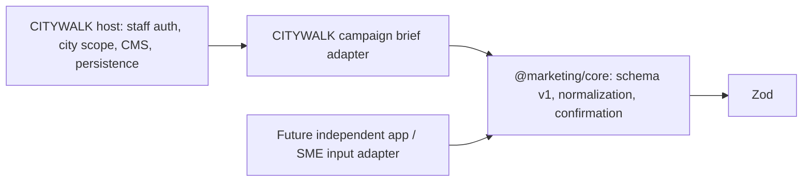

# Independent Marketing product — Sprint 01 extraction boundary

Decision: build the independent marketing domain incrementally inside this
repository, using CITYWALK as internal Customer #001. Extract the application,
repository and database **before onboarding external paying customers**. No new
repository, production resource or external customer access is created in Sprint 01.

Scope references: [#328](https://github.com/IamAssiaAjdaai/lubeck-ai-guide/issues/328)
product roadmap, [#329](https://github.com/IamAssiaAjdaai/lubeck-ai-guide/issues/329)
Project Intake, [#330](https://github.com/IamAssiaAjdaai/lubeck-ai-guide/issues/330)
later strategy, and [#319](https://github.com/IamAssiaAjdaai/lubeck-ai-guide/issues/319)
CITYWALK generation. This sprint is the raw-brief/confirmation subset of #329;
it does not complete these broader issues. The extraction-before-paying-customers
decision governs sequencing even where the earlier roadmap describes pilots first.

## Inspection and module placement

The existing `packages/i18n` and `packages/traveler-core` are localization/traveler
domains with CITYWALK contracts. Neither owns business/project context. The
repository already supports private TypeScript workspace packages and root Vitest
discovery. `packages/marketing-core` therefore follows the existing packaging
pattern with the neutral name `@marketing/core`, its own Zod dependency, versioned
JSON contract and standalone typecheck. No generic module imports these existing
packages, application aliases, database schemas, authentication or components.

Existing Marketing CMS responsibilities remain in place:

| Existing surface | Current authority | Sprint 01 treatment |
| --- | --- | --- |
| `src/db/marketingSchema.ts` | City-scoped campaigns, pages, content, ordered media links | No schema changes |
| `service.server.ts` / `workflow.server.ts` | Staff capabilities, city scope, CMS writes, human review/publishing | No runtime changes |
| `contentQa.ts`, `qaEvidence.ts`, `qaEvidence.server.ts` | Saved-copy QA and independently verified place/source evidence | Reuse later through an explicit trust adapter; no copied QA engine |
| `src/lib/contentQa` | Deterministic checks and bounded advisory AI QA | Existing behavior unchanged; not relocated in Sprint 01 |
| `automationEvents.server.ts`, `automationWorkflow.server.ts`, `automationAuth.server.ts` | Approval webhook, automation credentials, media checks, idempotent ready/published transitions | No social/automation changes |
| `automation/n8n/citywalk-approved-content-publisher.mock.json` | Explicitly inactive local mock publishing workflow | Unchanged |
| Existing Marketing unit/integration tests | QA, scope, lifecycle and automation regressions | Full existing unit suite retained |

The separate #319 Phase 1 work was opened as draft PR #359 and is not part of this
sprint's `develop` baseline. Its city-scoped source/job/output tables belong to the
CITYWALK host until deliberately adapted. This sprint does not cherry-pick that
work, create parallel generation tables or weaken its factual/media boundaries.

## Dependency direction and contracts

`RawBusinessBrief` is untrusted declared context plus narrative, source references,
fact proposals, hypotheses and gaps. `BrandContext` has generic project/context
IDs, revision/timestamps and evidence-bound human confirmations. Input shape,
counts, IDs, source references and trust semantics are validated with Zod.
`BrandBriefAdapter<TInput>` is the source normalization port; no database/auth
dependency points inward. Its output is revalidated at the core boundary.

`src/lib/admin/marketing/brandContextAdapter.ts` is the optional CITYWALK adapter.
It accepts a host-loaded campaign and generic business brief, adds campaign
objective/CTA as intent, and audience/message as explicitly unapproved hypotheses.
It returns the generic context alongside a separate `citywalkScope` binding.
City/campaign IDs never enter the generic contract; several city campaigns can
belong to the same generic project. Source identifiers may remain host-namespaced
opaque strings. There are no hardcoded brand names, cities or traveler offerings
inside the core. CITYWALK appears only in test fixtures and the host adapter/docs.

The adapter is not called by current CMS routes/actions. A future server caller
must load the campaign, authenticate staff, enforce its existing city capability,
resolve the generic project binding, and supply trusted intake/review metadata.
The core cannot prove that a caller actually performed these checks. Never pass
browser-supplied campaign records, project ownership or confirmed context directly
into privileged persistence. Human-confirmed business claims must not become
verified historical/place evidence just because the schema validates.

## Future extraction sequence

1. **Prove the contract locally.** Keep reusable schema/transitions in this package.
   Add a small opt-in CITYWALK intake/review host flow with authorized server reads,
   revision-safe persistence and an audit record before connecting generation.
   Existing human review, QA, publication and automation remain authoritative.
2. **Define application ownership.** The future independent app owns intake,
   project/brand review, later strategy and generic campaign orchestration. CITYWALK
   owns traveler/admin operations, city/place content and public marketing routes.
   Share domain contracts; do not copy the entire CMS or route/component tree.
3. **Separate identity and access.** The independent app gets its own auth/session
   boundary and project membership/capabilities. Map authorized host identity to
   generic reviewer IDs. CITYWALK staff/traveler sessions and city roles are not
   SaaS project memberships. Define connector consent, scoped service credentials
   and an audit trail; no inherited production credentials or unrestricted DB access.
4. **Separate persistence.** Before paying-customer onboarding, create a dedicated
   database for generic projects, versioned contexts/reviews and later campaign
   records. Use opaque project IDs and scoped ownership; do not carry city/place
   foreign keys into generic tables. Keep CITYWALK host bindings in adapter-owned
   mapping records. Define private-data retention and reviewer erasure behavior.
   No multi-tenant schema or store is implemented now.
5. **Migrate through an explicit export/import.** Introduce reviewed, additive
   migrations for the new database with its own Drizzle schema and migration
   journal. Do not replay CITYWALK's complete migration chain or copy traveler,
   commerce/auth tables. Export only authorized marketing records with source,
   approval/reviewer evidence, revision lineage and explicit ID mapping. Validate
   row counts, references and checksums; test in isolated non-production databases.
   Choose a deliberate cutover window, preserve the old read path for rollback,
   and reconcile any writes. No dual-write shortcut without an explicit design.
6. **Version inter-app contracts.** Carry schema version, project/context ID,
   revision, factual provenance and human-review evidence across boundaries.
   Future campaign/media/publishing contracts must define stable opaque references,
   idempotency, error codes, permissions and current media rights checks. Separate
   private domain contracts from public DTOs that omit reviewer/private-source data.
   Unsupported contract versions fail closed; compatible changes require tests.
7. **Move package and app deliberately.** Before first external paying customer,
   extract the proven core and independent app to their own repository. Add package
   build/export tooling and dedicated CI there; install/consume versioned contracts
   through CITYWALK's adapter. Verify no runtime import or deployment needs CITYWALK
   internals, then switch the adapter using the approved cutover plan.
8. **Gate external access.** Isolation, auth, audit, secret handling, retention,
   operational backup/restore and contract/migration acceptance must pass before
   paid onboarding. Subscription billing and access provisioning remain later work.

No production operation, resource creation, migration execution, new tenant,
provider call or external account action is authorized by this plan itself.

## Acceptance and limitations

Synthetic CITYWALK and German SME briefs validate identically. Tests exercise
selective confirmation, hypotheses, dangling/duplicate provenance, stale revision,
tampered evidence, redaction, missing sections and schema-version round trips.
Boundary tests inspect imports in production core modules and ensure existing CMS
runtime flows do not import the opt-in adapter. Standalone ES2022 typecheck proves
the package needs no Node/browser/application typings. Root lint, full unit tests,
TypeScript and Next.js build remain required. No database schema was changed, so
database generation/migrate/verify commands are not relevant to this sprint; do
not point them at production or create unrelated migrations to satisfy a checklist.

Mobile Core: not applicable. iOS and Android implementation/device acceptance: not
applicable. Public Web: not applicable. Admin Web: reusable domain/adapter boundary
required, live intake/review UI deferred. Existing public guest-first behavior stays
unchanged. CI/Preview evidence is separate from local tests; draft creation does not
authorize merge or production deployment.

The module validates structured human input; it does not parse facts from raw prose,
fetch source content, independently verify claims, persist review decisions or
authenticate reviewers. Obvious credential filtering is best-effort, not complete
DLP. Source-backed is not human-confirmed, human-confirmed is not independent RAG
verification, and confirmation is not permission to publish.

**Next smallest step:** add an opt-in CITYWALK raw-brief intake and factual review
flow backed by authorized server reads, a reviewed persistence contract, atomic
revision checks and audit records. Keep AI strategy/generation and external access
disabled while validating that human confirmations persist correctly.

## Sprint 02 implementation follow-up

The historical Sprint 01 baseline above remains a record of that phase. Merged
#359 now provides the separate CITYWALK Generation foundation. Sprint 02 adds an
opt-in generic revision/audit persistence layer and separate host-owned scope and
reviewer bindings; neither is wired into current CMS flows or Generation.
See [Brand Context persistence, retention and extraction](marketing-brand-context-persistence.md)
for current contracts, authorization, supported correction/purge and export plan.
The generic core and migration 0024 contracts remain unchanged.
