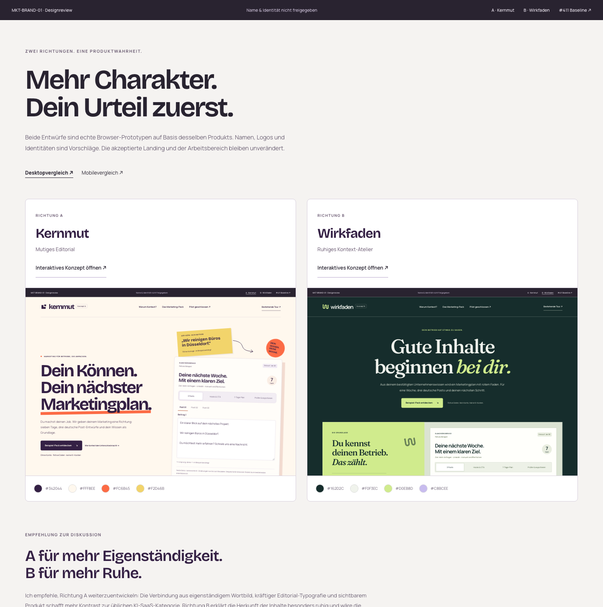

# Aktueller Stand: Richtung B gewählt, Name offen

Die Owner-Entscheidung ersetzt die frühere Empfehlung für A. Nur die isolierte B-Vorschau wird verfeinert; #411 bleibt unverändert. [Verfeinerung, Vorher/Nachher und aktuelle Prüfungen](refined-b/README.md). Die folgenden Vergleichs- und Prüfergebnisse dokumentieren die erste Zwei-Konzept-Version bei `2b0ae47`.

# MKT-BRAND-01 — zwei provisorische Markenrichtungen zur Auswahl

**Status: Owner-Review. Keine finale Marke. Keine ersetzte Landing.** Umsetzung der Forschungs-/Strategie- und Prototypenphase des beigefügten Briefings. Vollständige neue Landing und Angleichung des Arbeitsbereichs erst nach Auswahl. [Strategie und drei Namen](STRATEGY.md) · [Landing-Architektur / deutsches Messaging](LANDING_PLAN.md) · [Exakte Basistoken](../../../../apps/marketing-saas/src/brand/brand.tokens.json).

Basis ist der exakte #411-Head `f1986fdb4018966616ce8fd5fbdd9abcdff6604d`. Neuer unabhängiger Worktree und Branch `codex/mkt-brand-01-concepts`, gestapelt auf `codex/mkt-ux-01-conversion-journey`. #411 und sein Worktree bleiben unverändert. Eigenständige SaaS-Web-Oberfläche; CITYWALK Public/Admin und native iOS/Android nicht betroffen.

## Echte Browser-Vorschauen

- Vergleich: `http://127.0.0.1:3128/design/brand`
- **A · Kernmut / Mutiges Editorial:** `http://127.0.0.1:3128/design/brand/kernmut`
- **B · Wirkfaden / Kontext-Atelier:** `http://127.0.0.1:3128/design/brand/wirkfaden`
- Akzeptierte Landing weiterhin unter `/`, ohne neue Identität. Auth/Arbeitsbereich unverändert.

Die Review-Startseite zeigt beide tatsächlichen 1440px-Seiten als verkleinerte Browserframes nebeneinander; keine Bildmontage oder spekulative statische Mockups. Direkte Konzeptlinks öffnen die interaktive Ansicht. Beide Seiten markieren Namen und Identität als nicht freigegeben. Der derzeitige Produktname „Marketing Workspace“ bleibt im bestehenden Produkt erhalten.

[Mobilekonzepte nebeneinander — echte 390px-Browserframes](qa/concepts-side-by-side-mobile.png) · Live-Vergleich unter `/design/brand?viewport=mobile`.

| | A · Kernmut | B · Wirkfaden |
| --- | --- | --- |
| Charakter | Kräftig, zugänglich, ermutigend | Ruhig, zusammenhängend, beratend |
| Ausdruck | Bricolage, Papier, Aubergine, Koralle, Beleg und Richtung | Fraunces/Manrope, Waldtinte, Limette, Flieder, kontinuierlicher Faden |
| Markenprinzip | Fachlicher Kern wird nächster Schritt | Kontext verbindet Herkunft und Inhalt |
| Empfehlung | **Für mehr eigenständige Kategorie-Präsenz** | Alternative für eine ruhigere Tonalität |
| Desktop | [1440px](qa/kernmut-hero-1440.png) · [768px](qa/kernmut-hero-768.png) | [1440px](qa/wirkfaden-hero-1440.png) · [768px](qa/wirkfaden-hero-768.png) |
| Mobile | [390px](qa/kernmut-hero-390.png) · [375px](qa/kernmut-hero-375.png) | [390px](qa/wirkfaden-hero-390.png) · [375px](qa/wirkfaden-hero-375.png) |
| Kontext-Feature | [Desktop](qa/kernmut-context-1440.png) · [Mobile](qa/kernmut-context-390.png) | [Desktop](qa/wirkfaden-context-1440.png) · [Mobile](qa/wirkfaden-context-390.png) |

**Namensentscheidung und visuelle Entscheidung sind getrennt.** A ist keine automatische Freigabe des Namens Kernmut. Taktbrief ist der dritte strategische Namensvorschlag, bewusst ohne drittes Vollkonzept.

## Benchmark: aktuelle awork-Erfahrung

Gelesen und im echten Chrome auf Desktop und Mobile untersucht am 2026-10-21: [deutsche Homepage](https://www.awork.com/de) und [AI-Produktseite](https://www.awork.com/de/produkt/ai). Optionale Cookies wurden für die visuelle Recherche abgelehnt. Recherchebilder bleiben lokale Arbeitsnotizen und sind keine Produktassets.

**Homepage — Beobachtung:** große typografische Aussagen, bewusst unterschiedliches Tempo zwischen Problem, Produkt, Kontext und Nachweisen; produktbezogene visuelle Komposition statt nur gleichförmiger Karten. Mobil werden die Aussagen gestapelt und die Navigation reduziert. Die Quelle positioniert eine Agentur-Plattform mit anderen Fähigkeiten und Freigaben als unser MVP. **Ableitung:** große Aussagen mit erkennbarem Produktbeweis verbinden und Kapitel unterschiedlich komponieren. Keine Übernahme von Logo, Roboter, Stern-/3D-Assets, Screenshots, Originaltexten, Layouts oder Unternehmensnachweisen.

**AI-Seite — Beobachtung:** Kontext aus vorhandenen Arbeitsstrukturen steht vor abstrakter Modelltechnik; konkrete Anwendungsfälle und Governance erklären Nutzen und Grenzen. **Ableitung:** Unternehmenswissen, menschliche Bestätigung, Ziel und Ergebnis als zusammenhängende Geschichte darstellen. Unsere Rechte-/Qualitäts-/Funktionsbehauptungen bleiben am eigenen Code und Release-Status orientiert. Agents, Modellvergleich, Tool-Aktionen und Compliance-Botschaften des Benchmarks werden nicht auf unser Produkt übertragen.

Das sind Design-Beobachtungen und gestalterische Schlussfolgerungen, kein Conversion-Nachweis und keine Bestätigung fremder Produktbehauptungen.

## Originalität und Assets

- Eigene SVG-Markenkonzepte, Wortbilder, Editorial-Kompositionen und kontextbezogene Linien-/Belegsprache. Keine awork-Assets oder kopierten Claims.
- Grafiken sind code-/vektorbasiert, keine Stockbilder oder KI-Bitmaps. Sie zeigen Beziehungen von Quelle, menschlicher Prüfung und Pack, keine Fake-Metriken.
- Bricolage Grotesque, Fraunces (normal und echte Kursive) und Manrope werden als lokale Latin-WOFF2-Variablenfonts geladen. Keine Browseranfragen an Google Fonts. Vollständige OFL-Lizenztexte (nur Endleerzeichen normalisiert) liegen neben den Dateien in `public/brand/fonts/`.
- Primärquellen: [Bricolage](https://github.com/google/fonts/tree/main/ofl/bricolagegrotesque), [Fraunces](https://github.com/google/fonts/tree/main/ofl/fraunces), [Manrope](https://github.com/google/fonts/tree/main/ofl/manrope). Fontdateien kamen aus dem offiziellen Google-Fonts-CSS/CDN, Lizenzdateien aus dem offiziellen Repository. Keine Schrift des Benchmarks übernommen.
- Das echte Produktbild bleibt der vorhandene synthetische #411-Editor. Es ist ausdrücklich als bestehende Identität beschriftet.

## Implementierung / Grenzen

Nur neue Designrouten plus Lazy-Import in `main.tsx`; Konzept-CSS und Fonts werden außerhalb dieser Routen nicht benötigt. Bestehende Landing, Auth, Workspace, APIs, DB-Schemas, Tenant-Isolation, Quoten, Herkunfts-/Bestätigungslogik und Exportverträge unverändert. Keine neue Laufzeitdependency/Lockfile-Änderung.

Jedes Konzept enthält Hero, eigenes Markensystem, kontextbezogenes interaktives Feature, vierstufigen Ablauf, ein editierbares synthetisches Pack, echten Produktbeweis und ein ehrliches Review-Footer. Das Pack verwendet den bestehenden Assembler/Markdown-Renderer: drei Posts, drei Hooks, CTA, sieben Tage. Der Export ist erst nach menschlicher Prüfung aktiv. Änderungen leben nur bis Neuladen; gespeicherte Versionen werden nicht vorgetäuscht, sondern mit Verweis auf den bestehenden Arbeitsbereich erklärt. Es gibt keine Modell-/Crawl-/API-Anfrage aus dem Konzept.

Die vollständige neue 13-Kapitel-Landing und das Rebranding des Arbeitsbereichs sind **absichtlich noch nicht umgesetzt**, entsprechend dem expliziten Owner-Gate im Briefing. Das ist keine technische Blockade.

## Prüfung und Evidenz

- Zwei Konzepte jeweils **1440 / 768 / 390 / 375px**: tatsächliche Hero-, Kontext- und Pack-Screenshots `qa/{name}-{hero|context|pack}-{width}.png`; kein Dokument-Overflow und keine Seitenfehler.
- `MARKETING_BRAND_CONCEPTS_PASS`: Kontextzustände, Auswahl der drei Posts, Hook-/Textänderung über Tabs erhalten, sieben Tage, explizite Prüfung vor echtem Markdown-Download, Keyboard-Pfeile/Home, Skip-Link, Mobile-Menü und reduzierte Bewegung. Konzept- und Reviewrouten: **keine API-/externen Requests**.
- **0 automatisierte axe WCAG-2.x-Tag-Verstöße** für beide Seiten, Exportzustände und Vergleich. Unvollständige/manuell zu prüfende Kategorien in `qa/axe-*.json` erhalten; keine Accessibility-Zertifizierung oder Screenreader-Abnahme behauptet.
- Bestehender echter Chrome-Kundenweg und anonyme Tour auf diesem Branch bestanden: `MARKETING_SAAS_COMPLETE_DEMO_JOURNEY_PASS`, `MARKETING_SAAS_LANDING_TOUR_PASS`. Separate Loopback-Ports **3128 / 3129**, neue isolierte lokale DB **marketing_brand_qa**, echte KI ausgeschaltet, nur lokaler Mail-Sink. Die akzeptierten 3108/3109-Server bleiben unberührt. Evidenz unter `qa/core/`.
- Vollständige Unit-Suite: **1.516 bestanden / 142 übersprungen**, 237 Dateien bestanden / 21 übersprungen. Keine übersprungenen Integrationen als bestanden gezählt.
- Reale isolierte PostgreSQL-Integration: **9 bestanden**, Auth/Tenant/Pack. Vier unveränderte SaaS-Migrationen angewendet; Integritätsverifier bestanden.
- UI-Typecheck und Vite-Build bestanden; Lint **0 Fehler / 8 vorhandene Warnungen**. Root-TypeScript bestanden; Root-Next-Build mit `--webpack` und synthetischer Build-Konfiguration bestanden. Der Standard-Turbopack-Build wurde ausgeführt, scheiterte jedoch an der nach außen gerichteten Dependency-Symlink-Grenze dieses neuen Worktrees; kein Quellcode-/Konfigurationsfix wurde dafür eingeführt. `db:generate` ohne Drift; `git diff --check` bestanden. CITYWALK-DB-Migrate/Verify nicht ausgeführt, da deren Datenbank außerhalb dieses Frontend-Prototyps liegt.

## Reproduzieren

Normale Variante auf freiem Standardport: vorhandenen isolierten Marketing-Demo-Stack mit `npm run marketing:demo` starten; dann `MARKETING_BRAND_ORIGIN=http://127.0.0.1:3108 node scripts/marketing-saas-brand-smoke.mjs`. Auf diesem Review-Host läuft die neue Vorschau separat auf 3128/3129. Dafür wurde temporär die Vite-Proxy-Konfiguration auf den zweiten QA-Server gelegt; die committed Vite-/API-Konfiguration blieb unverändert. Erwartete Origins stimmen überein, keine Sicherheitsprüfung wurde umgangen.

Die vorhandenen Browser-Skripte unterstützen jetzt optionale `MARKETING_BROWSER_ORIGIN`, `MARKETING_EVIDENCE_ROOT` und (authenticated script) `MARKETING_PRODUCT_EVIDENCE_ROOT`. Ohne Optionen unveränderte Standardziele; bei Brand-QA bleiben Baselineassets unverändert. Die dedizierte SaaS-CI führt zusätzlich den neuen Konzept-Test aus und lädt die QA-Evidenz hoch.

## Freigabe

Zur Entscheidung stehen **visuelle Richtung A oder B**, separat der weiter zu prüfende Name. Kein Name ist rechtlich freigegeben; Domainprüfung siehe Strategie. Keine Markeneinführung, öffentliche Registrierung, Kontakt-/Wartelistenerfassung, E-Mail-Zustellung, Billing, Live-KI, Deployment oder CITYWALK-Produktion. Pilot und externe kommerzielle Nutzung bleiben **NO-GO**. Alle bestehenden Release-Gates gelten fort; kein Merge oder Release ohne spätere ausdrückliche Freigabe.
