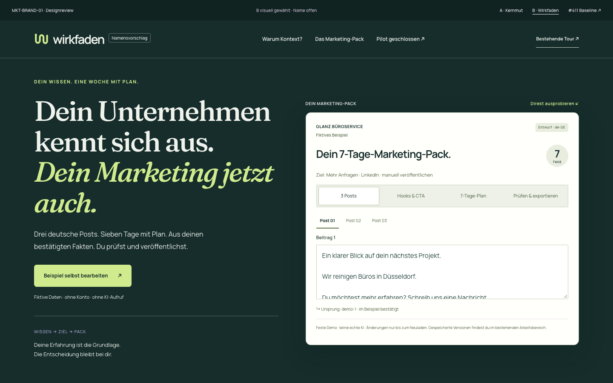
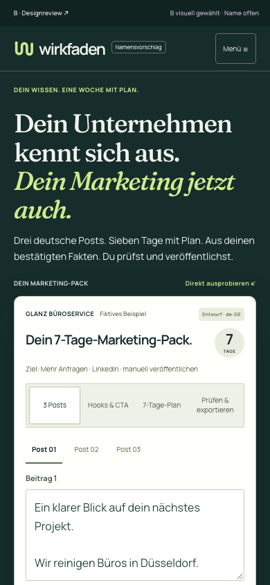

# MKT-BRAND-01 — verfeinerte Richtung B

**Owner wählt die grüne Identität. „Wirkfaden“ bleibt ein ungeprüfter Namensvorschlag.** Nur die isolierte Prototypenroute wurde verfeinert; die akzeptierte #411-Landing und der echte Arbeitsbereich bleiben unverändert. Kein Merge, Deployment oder öffentlicher Pilotstart.

Lokale interaktive Vorschau: `http://127.0.0.1:3128/design/brand/wirkfaden` · Produktstudien: gleicher Pfad mit `#produktstil`.

## Was sich verändert

- Hero: **„Dein Unternehmen kennt sich aus. Dein Marketing jetzt auch.“** Konkreter Nutzen: drei deutsche Post-Entwürfe und ein Sieben-Tage-Plan aus menschlich bestätigten Angaben.
- Das interaktive Pack steht auf Desktop direkt neben der Aussage, auf Mobile unmittelbar darunter. Der große Grundlagenblock vor dem Produkt entfällt. Vier direkte Inhaltstabs, drei auswählbare Posts, editierbare Hooks/CTA und geprüfter Markdown-Export bleiben funktionsfähig. Auf Mobile ersetzt das sichtbare Pack den redundanten Sprung-CTA.
- Forest Ink `#162D2C`, Soft Sage `#F0F3EC`, Lime `#D0EB8D`, Lilac `#C8BCEE`; Fraunces mit echter Kursive für Editorial, Manrope für UI und Lesetext. Kein Aubergine/Koralle in der B-Identität. Mobile-Posttext jetzt 16px, eigenständiger 14px-Herotext, reduzierte Reviewleiste und klare Abstände.
- Unterschiedlich komponierte Kapitel: fokussierter Hero mit Produkt, Ergebniskapitel, interaktive Herkunfts-/Bestätigungsstory, ruhige Produktstudie mit dunkler Seitenleiste, nachvollziehbarer Ablauf und vollständiges Beispiel-Pack. Der vorhandene Produktbeleg bleibt ehrlich als bestehende Identität beschriftet.
- Neue **isolierte Gestaltungsstudien** zeigen die Kontinuität zu Anmeldung, Unternehmensprofil und Pack-Workspace. Umschalter und „Nächste Designansicht“ funktionieren; dargestellte Zugangsdaten sind synthetischer Lesetext, keine Formulare und keine Kontoerstellung. Der Pack in dieser Studie ist tatsächlich editierbar. Das ist noch keine Übernahme der Identität in die echte Auth-/Onboarding-Oberfläche.
- Vergleichsseite, Strategie und Tokens dokumentieren die Auswahl von B. A bleibt archivierter Vergleich; Namensprüfung und spätere Freigabe bleiben separat.

## Vorher / nachher — echte Chrome-Aufnahmen

Die vergleichbaren Hero-Aufnahmen haben dieselbe Breite und jeweils 1000px Höhe. „Vorher“ sind unveränderte Dateien des vorherigen Heads `2b0ae47`; „Nachher“ sind aktuelle Browser-Renderings. Keine Montagen.

| Breite | Vorher | Nachher | Zusätzlicher erster Bildschirm |
| --- | --- | --- | --- |
| 1440px | [Vorher](before/hero-1440.png) | [Nachher](qa/wirkfaden-hero-1440.png) | [1440 × 900](qa/wirkfaden-first-screen-1440.png) |
| 768px | [Vorher](before/hero-768.png) | [Nachher](qa/wirkfaden-hero-768.png) | [768 × 1024](qa/wirkfaden-first-screen-768.png) |
| 390px | [Vorher](before/hero-390.png) | [Nachher](qa/wirkfaden-hero-390.png) | [390 × 844](qa/wirkfaden-first-screen-390.png) |
| 375px | [Vorher](before/hero-375.png) | [Nachher](qa/wirkfaden-hero-375.png) | [375 × 812](qa/wirkfaden-first-screen-375.png) |





| Produktstudie | Desktop | Mobile |
| --- | --- | --- |
| Zugang, geschlossen | [1440px](qa/wirkfaden-product-1-1440.png) | [390px](qa/wirkfaden-product-1-390.png) |
| Unternehmenswissen | [1440px](qa/wirkfaden-product-2-1440.png) | [390px](qa/wirkfaden-product-2-390.png) |
| Pack-Workspace | [1440px](qa/wirkfaden-product-3-1440.png) | [390px](qa/wirkfaden-product-3-390.png) |

Alle drei Produktstudien wurden zusätzlich bei 768 und 375px aufgenommen. Kontext und vollständiges Pack ebenfalls bei allen vier Breiten in `qa/`.

## Tatsächlich ausgeführte Prüfungen

- Vollständige Unit-Suite: **1.516 bestanden, 142 übersprungen**; 237 Testdateien bestanden, 21 übersprungen.
- **9 reale PostgreSQL-Integrationstests bestanden**, isolierte lokale DB `marketing_brand_qa`; vier unveränderte SaaS-Migrationen, Migration- und Integritätsprüfung bestanden. Keine CITYWALK-Datenbank verwendet.
- `MARKETING_BRAND_CONCEPTS_PASS`: beide Richtungen × vier Breiten; Kontextzustände, Texte/Hooks bearbeiten und über Tabs erhalten, sieben Tage, tatsächlich heruntergeladener Markdown-Export nach Prüfung, Keyboard/Home/Skip-Link, Mobile-Menü, reduzierte Bewegung. Zusätzlich B-Hero bearbeiten/exportieren und Navigation durch die Produktstudien geprüft. **Keine API- oder externen Requests aus den Designrouten.**
- Messbare erste Bildschirmansicht: **alle vier Inhaltstabs vollständig sichtbar und mindestens 80px des editierbaren Posts** bei 1440×900, 768×1024, 390×844 und 375×812. Tatsächliche Browserkoordinaten in [first-screen-measurements.json](qa/first-screen-measurements.json). Keine Dokumentüberbreite oder Seitenfehler.
- **0 automatisierte axe-WCAG-2.x-Verstöße** in den geprüften Konzept-/Export-/Vergleichsansichten und allen drei Produktstudien bei vier Breiten. Unvollständige manuelle Prüfkategorien in den JSON-Dateien erhalten. Keine Screenreader- oder Geräteabnahme behauptet.
- Bestehende Kundenwege auf dem unveränderten Produkt bestanden: `MARKETING_SAAS_COMPLETE_DEMO_JOURNEY_PASS` und `MARKETING_SAAS_LANDING_TOUR_PASS`. Echte lokale Auth-/Bestätigungs-/Demo-Pack-/Versions-/Export-Prüfung; synthetischer lokaler Mail-Sink, keine E-Mails versandt und keine Modellaufrufe. Evidenz in `qa/core/`.
- UI-Typecheck und Vite-Produktionsbuild bestanden; Root-TypeScript bestanden. Lint: **0 Fehler, 8 vorhandene Warnungen**. Root-Produktionsbuild mit **`npm run build -- --webpack` bestanden**, synthetische Build-Einstellungen. Standard-Turbopack wurde bei dieser Verfeinerung nicht erneut ausgeführt; zuvor dokumentierte externe Dependency-Symlink-Grenze des Worktrees bleibt bestehen.
- `db:generate`: keine Schemaänderung. `git diff --check` sauber. CITYWALK-Migration/Verify nicht ausgeführt, da außerhalb dieser isolierten Frontend-Arbeit. Keine Schema-/API-/Auth-/Quotenänderung.

Reproduzieren auf dem bestehenden isolierten Stack:

```sh
MARKETING_BRAND_EVIDENCE_ROOT=docs/design/marketing-saas/brand-01/refined-b/qa node scripts/marketing-saas-brand-smoke.mjs
```

Standard-Origin des Skripts ist Loopback-Port 3128; in CI weiter explizit 3108. Vorherige Evidenz wird bei Nutzung des optionalen Evidenzpfads erhalten. Browserprüfungen blockieren externe Netzwerkanfragen.

## Grenzen und Freigabe

Die neue B-Komposition ist zur visuellen Owner-Abnahme vorbereitet. Name, vollständige Landing-Übernahme und Rebranding des echten Produkts bleiben offen. Prototypeingaben bestehen nur bis zum Neuladen; bestehende gespeicherte Versionen werden nicht in den Designstudien vorgetäuscht. Keine Conversion- oder Leistungsmessung wird behauptet.

Geschlossener Pilot: keine Lead-Erfassung, öffentliche Registrierung, Billing, automatische Veröffentlichung, echte E-Mail oder Live-KI. Keine Änderungen an #411, CITYWALK-Produktion oder anderen Worktrees. Eigenständige Marketing-SaaS-Web-Studie; CITYWALK Mobile Core/iOS/Android, Public Web und Admin Web nicht betroffen. Draft PR #414 bleibt auf #411 gestapelt; kein Merge oder Release ohne spätere Owner-Freigabe.
