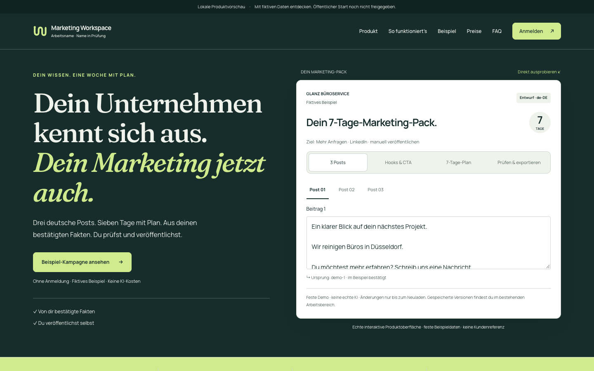
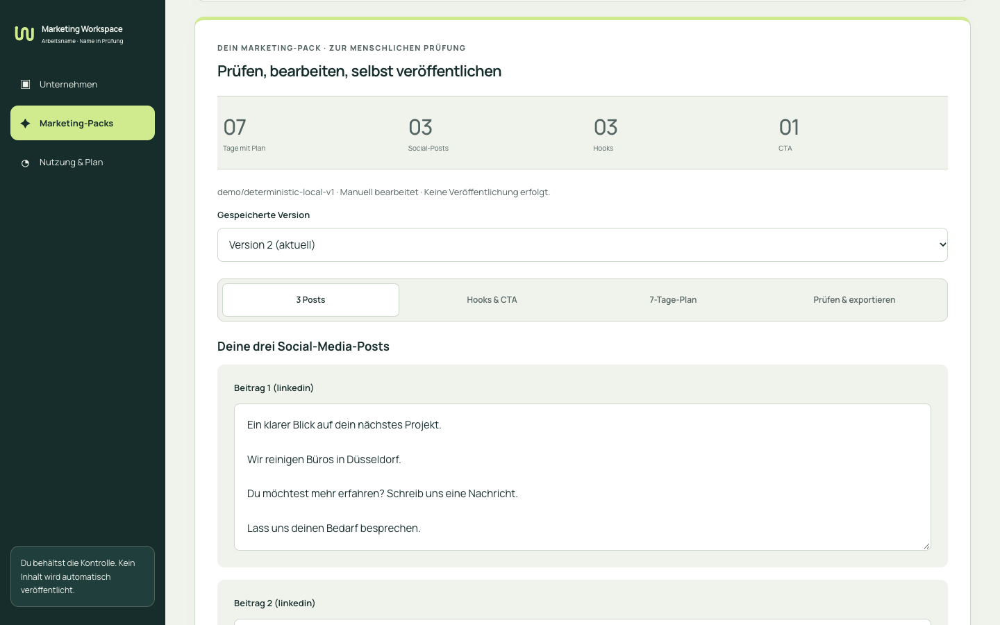

# MKT-BRAND-02 — grünes Markensystem im echten Produkt

**Implementiert auf dem exakten freigegebenen #414-Head `3289e31dfafb44be8d1c76d694d723fa075d4ccd`.** Neuer Branch `codex/mkt-brand-02-green-system`, gestapelt auf `codex/mkt-brand-01-concepts`. Die visuelle Freigabe betrifft Richtung B. Name, kommerzieller Start, öffentliche Zugänge und Deployment sind nicht freigegeben.

Lokale Vorschau: `http://127.0.0.1:3148/` · echter authentifizierter Arbeitsbereich: `/auth`. Separater QA-Stack auf 3148/3149 und neue isolierte lokale DB `marketing_brand02_qa`; ältere Worktrees und Server bleiben erhalten.

## Ergebnis

Die **tatsächliche** Landing und die vorhandenen, API-verbundenen Produktkomponenten verwenden jetzt Forest Ink `#162D2C`, Soft Sage `#F0F3EC`, Lime `#D0EB8D` und Lilac `#C8BCEE`. Lokale Fraunces für Editorial und lokale Manrope für UI/Lesetext. Keine A-Palette, keine fremden Markenassets, keine kopierten awork-Kompositionen.

Der zentrale Token-Layer `src/brand/system.css` enthält Farben, Typografie, Radien, Inhaltsbreite, Zustände und responsives Verhalten. `brand/identity.ts` konfiguriert den **Arbeitsnamen Marketing Workspace** und dessen Prüfstatus; `BrandIdentity`/`BrandMark` werden für Navigation, Auth und Arbeitsbereich wiederverwendet. „Wirkfaden“ erscheint ausschließlich in den erhaltenen historischen Konzept-Routen und deren Belegen, nicht als neue Produkt-/Rechtsidentität.

### Vollständige Landing

Alle **13 Hauptsektionen** sind implementiert und im Browser geprüft; Header und Footer kommen hinzu:

| Abschnitt | Implementierung |
| --- | --- |
| 1 Hero + Produkt | Freigegebene Headline; echtes editierbares, synthetisches Pack direkt sichtbar, Tabs für Posts/Hooks/Plan/Export |
| 2 Ergebnisrahmen | 7 Tage, 3 Posts, 3 Hooks, 1 CTA ohne Erfolgsversprechen |
| 3 Probleme/Nutzen | Konkrete Aufgaben kleiner Dienstleistungsbetriebe |
| 4 Brand Context | Interaktive Geschichte: Website-Vorschlag → menschliche Bestätigung → zielbezogenes Pack; fiktive Quelle klar gekennzeichnet |
| 5 Vier Schritte | Vorhandener per Tastatur bedienbarer Ablauf mit korrekten Vertrauensgrenzen |
| 6 Interaktive Demo | Bestehende vollständige Tour einschließlich Faktenfreigabe, Ziel, Versionen und Export |
| 7 Fakten/Quellen | Echte neue grüne Screenshots aus dem authentifizierten lokalen MVP |
| 8 Pack/Editor | Echter neuer Produktbeleg, speicherbare Versionen und manueller Export |
| 9 Einsatzideen | Handwerk, lokale Services, B2B; keine erfundenen Kundenberichte |
| 10 Preise | 79/149 € zzgl. USt. als Hypothesen, keine Buchung oder Trial |
| 11 Vertrauen | Menschliche Prüfung vor Erstellung/Export, Grenzen der Bestätigung |
| 12 FAQ | Vollständige bestehende sachliche Antworten erhalten |
| 13 Pilotstatus | Funktionierende Beispieltour; Kontaktanfrage deaktiviert, keine Eingabefelder |

Navigation, Legal-Statusseiten, Footer und noindex bleiben funktionsfähig. Der öffentliche Hero verwendet den aus #414 übernommenen und nun gemeinsam genutzten `InteractivePack`; die historischen Designrouten re-exportieren denselben Editor mit ihrem bisherigen Designbeispiel-Label. Produkt- und Designexporte bleiben ausdrücklich fiktiv. Kein Modell-/API-Aufruf aus der offenen Landing oder Demo.

### Echtes SaaS

Die bestehenden Komponenten `AuthForm`, `PilotApp` und `PackWorkspace` bleiben mit ihren API-Aufrufen und Zustandsübergängen verbunden. Aktualisiert sind Anmeldung/Passwortfluss, Unternehmensanlage, Website/Kurzbrief, Quellen/Faktenprüfung, Kampagnenparameter, Pack-Editor, Hooks, Versionswahl, manueller Export, Verlauf und Nutzung. Keine Formulare durch Illustrationen ersetzt. Fraunces bleibt auf Editorial und Seitenüberschriften beschränkt; Formulare und Editor verwenden Manrope mit 15–16px Feldern, mobil 16px.

Unverändert: Authentifizierung, Mandantenrechte, sichere Website-Imports, Herkunft, menschliche Bestätigung, Generierungsverträge, Quoten, gespeicherte Versionen, Export-/Autorisierungsregeln. **Keine Backend-, Schema-, Migrations-, Dependency- oder Lockfile-Änderungen.** Das neue Brand-Context-Element erklärt den vorhandenen Vertrag, statt einen neuen einzuführen.

## Echte Screenshots / Vergleich mit der Freigabe

Referenzen in `approved-b/` sind unveränderte Bilddateien des freigegebenen `3289e31`. Alle neuen Bilder zeigen tatsächlich gerenderte lokale Chrome-Ansichten. Der abweichende Arbeitsname ist beabsichtigt, da die Namensfreigabe offen bleibt.

| Viewport | Freigegebene B-Vorschau | Echte Landing | Vollständige Landing |
| --- | --- | --- | --- |
| 1440 × 900 | [Referenz](approved-b/hero-1440.png) | [Hero](qa/green/landing-hero-1440.png) | [Gesamtseite](qa/green/landing-full-1440.webp) |
| 768 × 1024 | [Referenz](approved-b/hero-768.png) | [Hero](qa/green/landing-hero-768.png) | [Gesamtseite](qa/green/landing-full-768.webp) |
| 390 × 844 | [Referenz](approved-b/hero-390.png) | [Hero](qa/green/landing-hero-390.png) | [Gesamtseite](qa/green/landing-full-390.webp) |
| 375 × 812 | [Referenz](approved-b/hero-375.png) | [Hero](qa/green/landing-hero-375.png) | [Gesamtseite](qa/green/landing-full-375.webp) |

Alle vier Pack-Tabs und mindestens 80px des tatsächlich editierbaren Posts sind im ersten Bildschirm sichtbar. [Gemessene Browserkoordinaten](qa/green/first-screen-measurements.json).

| Echter Produktzustand | Desktop | Mobile |
| --- | --- | --- |
| Anmeldung | [1440px](qa/green/auth-1440.png) | [390px](qa/green/auth-390.png) |
| Unternehmensanlage | [1440px](qa/green/onboarding-1440.png) | [390px](qa/green/onboarding-390.png) |
| Website/Kurzbrief | [1440px](qa/green/intake-1440.png) | [390px](qa/green/intake-390.png) |
| Bestätigte Fakten/Quellen | [1440px](qa/green/facts-1440.png) | [390px](qa/green/facts-390.png) |
| Kampagnenerstellung | [1440px](qa/green/campaign-1440.png) | [390px](qa/green/campaign-390.png) |
| Persistiertes Pack, Version 2 | [1440px](qa/green/workspace-1440.png) | [390px](qa/green/workspace-390.png) |
| Alte Version, schreibgeschützt | [1440px](qa/green/version-history-1440.png) | [390px](qa/green/version-history-390.png) |
| Hooks/CTA | [1440px](qa/green/hooks-1440.png) | [390px](qa/green/hooks-390.png) |
| Export | [1440px](qa/green/export-1440.png) | [390px](qa/green/export-390.png) |
| Nutzung/Plan | [1440px](qa/green/usage-1440.png) | [390px](qa/green/usage-390.png) |

Dieselben tatsächlichen Produktzustände sind bei **768 und 375px** in `qa/green/` gespeichert. Keine Bildmontagen. Die ursprünglichen Designstudien zum Vergleich liegen in `approved-b/product-{1|2|3}-{1440|390}.png`.





## Ausgeführte Prüfungen

- **Vollständige Unit-Suite:** 1.516 bestanden / 142 übersprungen; 237 Testdateien bestanden / 21 übersprungen. Übersprungene Integrationen nicht als bestanden gezählt.
- **PostgreSQL:** 9 echte Auth-/Tenant-/Pack-Integrationstests bestanden auf `marketing_brand02_qa`. Vier unveränderte SaaS-Migrationen angewendet; `MARKETING_SAAS_DB_VERIFY_OK`. `db:generate` ohne Drift. Keine CITYWALK-DB-Migration oder -Verifikation, da nicht betroffen.
- **`MARKETING_SAAS_COMPLETE_DEMO_JOURNEY_PASS`:** echtes Konto über lokalen geschützten Mail-Sink, verifizierte Anmeldung, deterministischer Website-Import, menschliche Bestätigung, Pack-Generierung, Hook-/Textbearbeitung, Dirty-Guard, neue gespeicherte Version, alte unveränderte Version, geprüfter Markdown-/Clipboard-Export, Nutzung und Screenshots. Ein zwischenzeitlicher Import-Timeout während der lokalen Iteration bestand im sauberen Wiederholungslauf; keine Sicherheitsprüfung oder Backendlogik wurde dafür geändert.
- **`MARKETING_SAAS_LANDING_TOUR_PASS`:** gesamte vorhandene offene Tour, Versionen, Faktenfreigabe, Tastatur-Tabs, geprüfter Export/Clipboard, FAQ, geschlossener Pilot und Legal-Status. Keine API-Aufrufe aus Landing/Tour.
- **`MARKETING_GREEN_SYSTEM_PASS`:** 13 Landing-Sektionen, freigegebene Typografie/Farbe, Messung im ersten Bildschirm, Hero-Editor/Hook/echter Markdown-Download, Brand-Context-Interaktion, kein Kontaktformular, reduzierte Bewegung, Skip-Link, Anmeldung/Passwortansicht sowie alle echten Produktzustände bei vier Breiten. Nach Seitenneuladen gespeicherte Version 1 schreibgeschützt und bearbeitete Version 2 aus dem Backend nachgewiesen. Keine Dokumentüberbreite, keine Seitenfehler, keine externen Browserrequests.
- **`MARKETING_BRAND_CONCEPTS_PASS`:** ursprüngliche Konzept-Journeys samt Vergleich, Export, Accessibility und vier Breiten erneut bestanden; eigene neue Evidenz unter `qa/concept-regression/`. Die gespeicherten #414-Reviewdateien bleiben bytegleich.
- **Accessibility:** 0 automatisierte axe-WCAG-2.x-Tag-Verstöße in den geprüften Landing-/Auth-/Demo-/Workspace-Zuständen. Vier Breiten für alle zentralen echten Produktseiten; manuelle/unvollständige Kategorien als JSON erhalten. Bei der Iteration gefundene Wordmark- und Trust-Kontrastfehler korrigiert. Keine Screenreader- oder echte iOS-/Android-Geräteabnahme behauptet.
- **Typechecks:** Frontend, eigenständige SaaS-API und Repository bestanden. Der erste Root-Typecheck vor Next-Typgenerierung meldete fehlende `PageProps`/`LayoutProps`; nach dem regulären Build erneut bestanden, ohne CITYWALK-Codeänderung.
- **Lint:** 0 Fehler / 8 bereits bestehende Warnungen.
- **Builds:** Vite-Produktionsbuild bestanden. Root-Next-Produktionsbuild mit `npm run build -- --webpack` und ausschließlich synthetischen Build-Einstellungen bestanden. Standard-Turbopack nicht erneut ausgeführt: bekannte externe node_modules-Symlink-Grenze der managed Worktrees, unverändert aus #414 dokumentiert.
- **Diff-/Sicherheitsprüfung:** `git diff --check` sauber. Keine Secrets, QA-Sitzungen oder Mail-Sink-Dateien im Diff. Synthetische Browser-Sitzung nur in geschützter temporärer Datei mit Modus 0600, außerhalb der Evidenz/Artefakte. Keine Laufzeit-/Deploymentkonfiguration geändert.

Die dedizierte SaaS-CI führt zusätzlich den neuen Green-System-Browsercheck aus. Der Commit-/CI-Status des neuen Draft PR ist separat am exakten Head zu prüfen; lokale Ergebnisse sind keine Remote-CI- oder Preview-Freigabe.

## Reproduzieren / Grenzen

Der bestehende lokale Demo-Stack kann unverändert auf 3108/3109 verwendet werden. Für diesen getrennten QA-Lauf wurde nur eine temporäre, nicht versionierte Vite-Proxykonfiguration mit passendem Origin 3148 und API-Port 3149 verwendet. Keine Origin-Prüfung umgangen. Beispiel:

```sh
MARKETING_BROWSER_ORIGIN=http://127.0.0.1:3148 \
MARKETING_EVIDENCE_ROOT=docs/design/marketing-saas/brand-02/qa \
MARKETING_PRODUCT_EVIDENCE_ROOT=apps/marketing-saas/public/product \
MARKETING_AUTH_STATE_PATH=/private/tmp/mkt-brand02-auth-state.json \
MARKETING_FULL_JOURNEY=true node scripts/marketing-saas-pilot-smoke.mjs

MARKETING_BROWSER_ORIGIN=http://127.0.0.1:3148 \
MARKETING_AUTH_STATE_PATH=/private/tmp/mkt-brand02-auth-state.json \
node scripts/marketing-saas-green-smoke.mjs
```

Der Hero ist ein festes synthetisches Beispiel ohne Speicherung. Die vollständige öffentliche Tour hält Beispielversionen im Arbeitsspeicher des Browsers; echte angemeldete Packs und Versionen bleiben wie bisher in PostgreSQL. Live-KI-Qualität/Kosten, rechtliche Freigabe, Name/Domain/Marke, kommerzieller Betrieb und externe E-Mail sind weiterhin ungeprüft bzw. nicht freigegeben.

Mobile Core: nicht betroffen; iOS/Android keine Implementierung oder Geräteabnahme. Public Web: eigenständige Marketing-SaaS-Landing erforderlich und lokal geprüft. CITYWALK Admin Web: nicht betroffen. Keine CITYWALK-Produktionsänderung.

**Kein Merge, Deployment, öffentliches Signup-Enablement, Pilot-/Lead-Erfassung, Billing, echter E-Mail-Versand oder Live-KI.** #411 und #414 bleiben unverändert und Draft. Die neue Umsetzung wird als eigener gestapelter Draft PR zur Owner-Abnahme vorgelegt.
