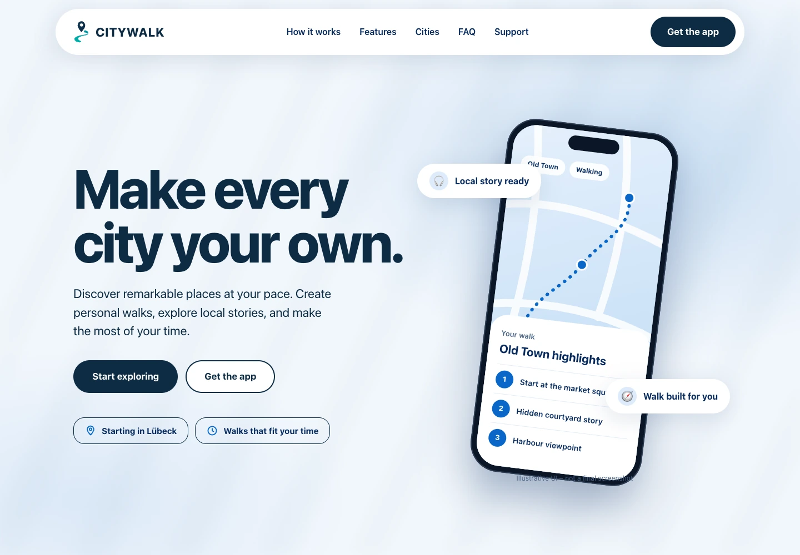

# #402 — Approved LANDING-NEXT handoff

Founder visually approved the final landing on 2026-10-21 and authorized saving it to the existing feature branch and Draft PR #402. The two final requested CSS corrections are included: the hero CTA/trust containers have transparent backgrounds, and the hero paragraph has navy text with no dark rectangle. The feature-card backgrounds and readable dark mode remain intact.

Scope: Public Web preview at `/landing-next-preview`. Mobile Core and Admin Web: no functional changes. Production `/`, the original LandingPreview/#395, APIs, authentication, database/schema, Cloudflare, payments and existing unrelated local work remain unchanged. **Production #395 remains NO-GO.** No merge or deployment is authorized or performed.

## Included implementation

- Nine named React sections from the founder's complete HTML, Navbar through Footer; CSS Modules, authentic CitywalkLogo and shared brand tokens.
- Real Next.js internal links, accessible mobile menu, keyboard focus/Escape behavior, native exclusive FAQ and noindex metadata. No raw HTML injection or standalone-preview link interception.
- City names/statuses remain derived from the source-controlled availability data. Store links remain disabled prelaunch labels; existing fail-closed URL-validation helpers/tests are preserved.
- First-party 900×822 WebP illustration with visible illustrative caption and alternative text. It was extracted from the supplied embedded JPEG and reduced from 108,328 to 79,614 bytes without upscaling.
- The six-file Next build repair moves `GenericCityContent` and `GenericPlaceContent` plus their private loaders/props into sibling modules, leaves each default page/Suspense wrapper intact, and redirects the two test imports. Function/helper bodies and all test assertions are unchanged.

Reference HTML SHA-256: `aafef293fee8e81e530970cb0385f37897787edf00502233fd9becefc53d20ce`. The HTML itself is not committed.

## Fresh final-source checks

These checks were rerun after both final CSS corrections. Earlier reports/captures remain preserved locally as historical evidence; they are not used to claim validation of the newer CSS.

| Check | Result |
| --- | --- |
| Full Next.js 16.3.8 Webpack build | PASS — compilation, generated route types, 785/785 pages, optimization and build traces; no route filtering or error suppression |
| Full project TypeScript | PASS — `tsc --noEmit --incremental false` with fresh full route types |
| Focused ESLint | PASS — complete landing preview and all six route-fix files, zero warnings |
| Affected city/place route tests | PASS — 25/25 (12 city, 13 place) |
| Existing store-link security tests | PASS — 8/8 |
| Responsive/text reflow | PASS — 12/12: 320, 390, 768, 1024, 1440, 1920px at both 100% and 200% root text size |
| Content/interaction checks | PASS — 40/40, including all nine sections' copy, both final background corrections, decoded image, skip link, menu/Escape/focus, section links, back-to-top and zoomed-menu reachability |
| All FAQ answers by keyboard | PASS — 9/9 open/close checks with exclusive disclosure |
| Internal Next navigation and HTTP | PASS — six unique routes: `/explore`, `/support`, `/account-deletion`, `/privacy`, `/terms`, `/imprint` |
| axe-core 4.11.0 | PASS — zero violations over 14 runs, including dark mode; incomplete gradient/illustration contrast checks still require human judgment |
| Browser console/external requests | PASS — zero errors, zero external requests |
| Whitespace | PASS — `git diff --check` |

Browser: Chromium 153.0.8010.12 / Playwright 1.62.1, device scale 1, reduced motion. Screenshots use a 1000px viewport height; zoomed mobile menu tests also use 640px height. Text zoom is simulated by setting the document root text size to 200%; decorative phone-image typography retains image-like scaling. This is not a Safari/Firefox, screen-reader or physical-device verification claim.

## Safe test environment and provenance

The full build and tests ran in a fresh ignored snapshot, excluding `.env*`, existing generated types and nested review checkouts. It used curated code content, fresh synthetic process-local auth configuration, an unreachable loopback database placeholder, disabled telemetry and bundled local Geist font fixtures through the installed Next font-test interface. The landing retains the reference system-font stack. Node guards rejected database/provider/external connections, and browser requests were restricted to the isolated loopback server plus reference file/data resources. No database was provisioned, queried or mutated. No real secrets were read or changed. This is a complete local Webpack build, not a production-configured deployment artifact or a claim about default Turbopack/remote CI.

`approved-results.json` contains sanitized actual results. `approved-manifest.json` hashes the exact tested source, protected production landing source, generated landing artifacts and curated review evidence. The source is based on `383aa82d565cd281ffffb9ea8c4ce9db24acdcf7`; file hashes establish equality with the saved source after committing. Detailed local logs, raw PNGs, snapshots, credentials-free helper scripts and older audit artifacts are excluded from Git.

Commands used in the isolated snapshot:

```sh
next build --webpack
tsc --noEmit --incremental false
vitest run 'src/app/[locale]/[citySlug]/page.test.tsx' 'src/app/[locale]/[citySlug]/[placeSlug]/page.test.tsx' src/app/landing-next-preview/storeLinks.test.ts
eslint 'src/app/[locale]/[citySlug]/page.tsx' 'src/app/[locale]/[citySlug]/CityPageContent.tsx' 'src/app/[locale]/[citySlug]/page.test.tsx' 'src/app/[locale]/[citySlug]/[placeSlug]/page.tsx' 'src/app/[locale]/[citySlug]/[placeSlug]/PlacePageContent.tsx' 'src/app/[locale]/[citySlug]/[placeSlug]/page.test.tsx' src/app/landing-next-preview --max-warnings=0
```

## Final screenshots

Full-resolution WebP review copies retain capture dimensions (quality 92). Raw PNGs remain local. The 200% images below are explicitly labeled viewport crops.

[320px](approved-screenshots/landing-320.webp) · [390px](approved-screenshots/landing-390.webp) · [768px](approved-screenshots/landing-768.webp) · [1024px](approved-screenshots/landing-1024.webp) · [1440px](approved-screenshots/landing-1440.webp) · [1920px](approved-screenshots/landing-1920.webp)

[320px / 200% text viewport](approved-screenshots/landing-320-text-200-viewport.webp) · [390px / 200% text viewport](approved-screenshots/landing-390-text-200-viewport.webp)



## Remaining gates

- Keep PR #402 in DRAFT; required remote CI/review remains separate from these passing local checks. No merge/deploy.
- Before public launch, complete private legal/operator/support configuration and release review. HTTP 200 does not establish legal approval.
- Verify genuine iOS/Android listings before separately enabling store links; native store/device acceptance remains a separate track.
- Production #395 stays NO-GO pending its independent backend/schema/rollback and explicit final owner release gates. This preview does not replace the production Worker or API/auth origin.
