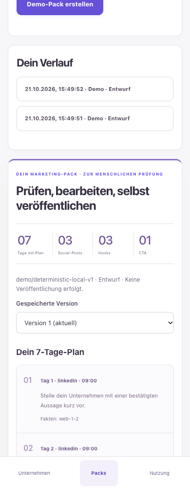
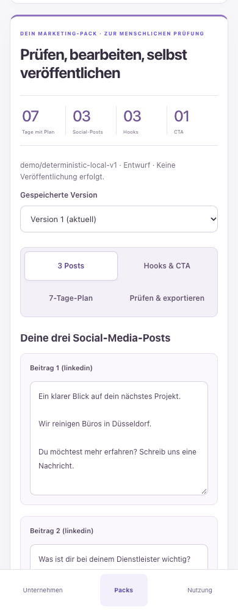
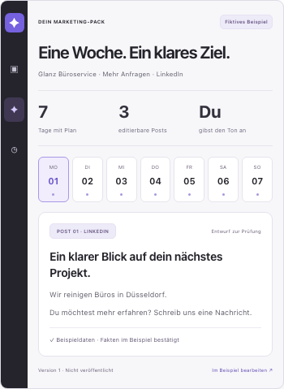
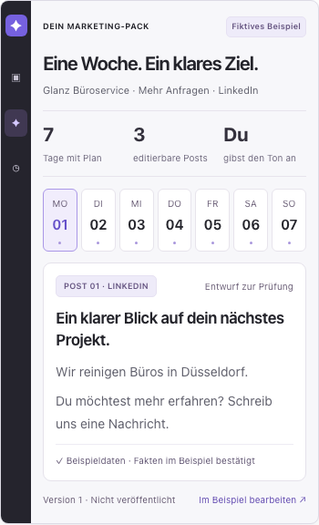

# PR #411 — focused UX refinement for owner approval

[Draft PR #411](https://github.com/IamAssiaAjdaai/lubeck-ai-guide/pull/411) · [Issue #410](https://github.com/IamAssiaAjdaai/lubeck-ai-guide/issues/410) · [Original implementation/research report](../ux-410/README.md).

Baseline: accepted visual direction at `e658ac0af381d33e5b0a826534bd856fcbfacb58`. Same feature branch `codex/mkt-ux-01-conversion-journey`, same base `codex/mkt-mvp-03-marketing-packs` from #409. This refinement addresses only Pack discoverability, product-preview readability and the closed-pilot conversion state. Palette, hero headline/composition, sidebar, pricing and existing customer journey are preserved. Independent SaaS Web only; CITYWALK Web/Admin and native iOS/Android are not affected.

## What changed

1. **Pack content is directly accessible.** Both the authenticated workspace and anonymous tour open results on **3 Posts**, with adjacent **Hooks & CTA**, **7-Tage-Plan** and **Prüfen & exportieren** tabs. The plan no longer pushes the editor and export controls down the page. New real Pack results scroll into view. Tabs support arrow keys, Home/End, correct tab/panel names and keyboard focus. All editors remain mounted, preserving unsaved values across content tabs. Existing safeguards still block leaving the workspace with unsaved edits. Save/discard controls appear when there are actual changes; the export view makes the existing saved-version review checkbox and manual download/copy actions immediately accessible.
2. **Product preview text is legible.** The hero still uses the same headline, columns, restrained violet and product frame. Preview post body copy increases from 10px desktop / 9px mobile to **14px at every tested width**; the post heading is 19px desktop / 17px mobile. Supporting labels are enlarged and retain the contrast fixes. No screenshot is upscaled to simulate a new capability.
3. **Pilot conversion explains its state.** The same final CTA still opens the working fictional example. The status now separates “Jetzt entdecken” from “Erst nach Freigabe”, states that no launch date is set, and links to the existing legal release-status page. The pilot request action is **disabled**, with an explanation: no contacts, registration, booking or waiting-list collection. No form, endpoint, consent workflow or billing was added. Existing local test-account access is unchanged.

## Before / after evidence

Every row has screenshots at **1440, 768, 390 and 375px**. Data is synthetic throughout.

| View | Before at 390px | After at 390px | Desktop after |
| --- | --- | --- | --- |
| Workspace / immediate content | [Before](before/complete-journey-390.png) | [Posts first](workspace-390.png) | [1440px](workspace-1440.png) |
| Product-preview text | [Before](before/preview-390.png) | [Readable preview](preview-390.png) | [1440px](preview-1440.png) |
| Closed pilot conversion | [Before](before/pilot-390.png) | [Clear gated state](pilot-390.png) | [1440px](pilot-1440.png) |

Mobile Pack before and after:

| Before | After |
| --- | --- |
|  |  |

Preview typography before and after:

| Before | After |
| --- | --- |
|  |  |

All widths: use `landing-{width}.png`, `preview-{width}.png`, `workspace-{width}.png`, `workspace-hooks-{width}.png`, `workspace-export-{width}.png`, `sample-{width}.png`, `hooks-{width}.png`, `export-{width}.png`, and `pilot-{width}.png` in this directory. Matching prior landing/sample/workspace evidence is in `before/`. The original `e658ac0` workspace captures are preserved byte-for-byte. Prior preview/pilot captures were taken from a temporary loopback-only Vite copy of the **actual archived e658ac0 source**, with API/external requests blocked; no other checkout or branch was changed. Temporary baseline server was stopped after capture.

The disabled export buttons in fresh-result screenshots are intentional: the version has not yet received human review. Actual browser download/copy, after review, still passes. `sample-export.md` is the actual version-two edited export, including an edited hook. Accessibility JSON records zero automated violations plus incomplete/manual-review categories.

## Executed checks

| Check | Actual result |
| --- | --- |
| Full unit regression | **1,516 passed / 142 skipped**; 237 files passed / 21 skipped. Skipped integration cases are not counted as passes. |
| PostgreSQL safety integration | **9 passed** across auth/tenant and Pack suites, against the isolated local Marketing QA DB. |
| Authenticated Chrome journey | `MARKETING_SAAS_COMPLETE_DEMO_JOURNEY_PASS`. Website fixture → fact confirmation → Pack → direct tabs → edited hook/post retained → unsaved navigation guard → version history → reviewed download/clipboard → second attempt/usage. |
| Anonymous Chrome journey | `MARKETING_SAAS_LANDING_TOUR_PASS`. Confirmed-fact selection, goal, 7-day plan / three posts, default Posts view, editable hook retained across tabs, keyboard navigation, original/new versions, reviewed download/copy, closed-pilot action disabled and no form/inputs. **Zero API calls** on landing/tour. |
| Responsive acceptance | Both journeys/screenshots at **1440 / 768 / 390 / 375px**; no document overflow or page errors. Preview copy asserted at least 14px at every width. Posts, hooks and export views captured separately. |
| Accessibility | Zero automated axe WCAG-tagged violations for landing, sample, legal, login and authenticated Pack. This is not screen-reader certification; incomplete/manual categories retained. |
| TypeScript / builds | Root `tsc --noEmit`, independent UI typecheck and Vite production build passed. Root Next production build passed with synthetic build-only auth/database settings. |
| Lint | **0 errors / 8 existing warnings**, no new warnings. |
| Database | `db:generate`: no schema changes. Independent SaaS migrations replayed and integrity verifier passed (four unchanged migrations). CITYWALK DB migrate/verify not run; its DB is outside this UI-only refinement. |
| Diff review | `git diff --check` passed. Backend, API contracts, schemas, tenant isolation, quotas, provenance, intake/SSRF and dependency files unchanged. No secret/env/mail-sink files included. |

Reproduce with the existing isolated local DB and `npm run marketing:demo` (real AI forced off), then:

```sh
MARKETING_FULL_JOURNEY=true node scripts/marketing-saas-pilot-smoke.mjs
node scripts/marketing-saas-landing-smoke.mjs
npm --prefix apps/marketing-saas run typecheck
npm --prefix apps/marketing-saas run build
npm run test:run
npm run lint
```

The existing dedicated SaaS CI workflow runs both journeys and uploads this evidence folder. No new dependencies.

## Safety and approval

No API, authorization, model/provider, quota, source-trust or database behavior changed. No live AI, real emails, public signup/pilot access, contact collection or billing was enabled. No deployment or CITYWALK production change. Existing legal, security, live-AI quality/cost, email, deployment, retention/erasure and backup/restore release gates remain **NO-GO**. Keep #411 **Draft** and wait for owner approval of these focused changes; no merge or release is authorized.
