# CITYWALK screen and flow audit

Completed **28 October 2026, Europe/Berlin**; discovery began 27 October (directory name retained). Read-only product audit. Only this dedicated report directory is generated. No source edits, checkout switching, consolidation, commit, push, merge or deployment.

Current redesign: `codex/onboarding-global-welcome`, worktree `/Users/assia/Documents/GitHub/citywalk-onboarding-global-welcome`, base `98a1dbbda17f945a0d982eb6dbc36713bad61617` plus existing uncommitted/untracked implementation. Base SHA alone does **not** identify the approved designs; current source hashes and snapshots are preserved here. Screens **01–13 are visually approved by the owner**, with functional verification pending where documented. Candidate Active Walk (14) exists from preceding work and remains **unapproved**; this audit does not extend it.

Native is Mobile Core; Public Web is acquisition/SEO/sharing/legal/intentional existing preview, not an automatic native mirror; Admin Web is staff operations. Independent Marketing SaaS branches are excluded from CITYWALK route counts, while CITYWALK internal Admin marketing is included.

Live remote refs read: develop `9f8470077dfa8eb7663246905bffd3cf8a0c6591`; main `88191e77e55a489804c49bccccf6307b5876b41d`. No fetch/merge was performed. Locally available refs/history may not equal every remote branch ever created. See `github-evidence.json`, `refs.json`, `worktrees.json`, branch-route indexes and source snapshots. Exact-head CI/device/deployment status is not inferred from source presence.

## Counts and definitions

- **68 current route-file entries**: 19 native, 21 Public Web, 28 Admin Web. Dynamic parameters and query/state variants are not multiplied into imaginary routes.
- **15 additional historical/other-branch route paths**; **83 distinct discovered CITYWALK route-file paths** in the audited local history/ref scope. Not all are active simultaneously; static/dynamic route overlaps need precedence analysis.
- **41 embedded state/capability groups** separately inventoried, not added to route totals; in addition to the official 05–08 states mapped in the registry; these groups include auth forms, preview/active/finish and settings-related modes.
- **14 duplicate/overlap candidate groups**; these are advisory comparisons, including legitimate reuse—not 14 deletions.
- **0 confirmed completely unreachable current file routes**. This is not a claim of complete reachability. 01 and 02 are confirmed bypassed by normal launch; 12 has reverse collection discovery. Deep links, feature/permission/auth gates and Admin acceptance remain conditional/unverified.
- **15 findings** (flow inconsistencies and functional/evidence gaps), individually identified F01–F15.
- **13 screen choices + 14 flow choices = 27 review decisions**, all PENDING. The 13 design IDs remain unchanged.

## Evidence limits

13 fresh current native captures at 402×874 points; language/scale and original pixel dimensions recorded in `screenshot-provenance.json`. Four OLD native comparisons are available: two retained current legacy variants (03/04), two archived before captures (11/13). Other native OLD captures are unavailable or no original equivalent exists. Supplemental Web screenshots are explicitly marked Web and never substituted as native. Earlier report links to absent screenshots are not evidence of a present image. No fabricated legacy renders or screenshot-based performance claims. Archived capture provenance does not establish an exact binary hash. Current source snapshots are hash-identified; visual approval remains the owner's historical decision.

Audit-only verification: file/source/hash/link/gallery checks and observational simulator navigation. Historical tests in prior reports are retained evidence, not rerun or new end-to-end acceptance. No DB, provider, payment, server-write or full product test gate was run for this documentation-only task.

## Screen 01–13 — OLD vs NEW

### Screen 01 — Global Welcome — OLD vs NEW

**Visually Approved / Functional Verification Pending** · **USER DECISION: PENDING**

NEW: [mobile/src/app/welcome.tsx](/Users/assia/Documents/GitHub/citywalk-onboarding-global-welcome/mobile/src/app/welcome.tsx); `WelcomeScreen`; `/welcome`. `codex/onboarding-global-welcome` / `/Users/assia/Documents/GitHub/citywalk-onboarding-global-welcome` / base `98a1dbbda17f945a0d982eb6dbc36713bad61617` + hashed dirty source.

OLD: **No legacy equivalent identified**. Exact old source/route/branch: not applicable. Earlier redesign iterations are not treated as original legacy.

OLD native: unavailable.

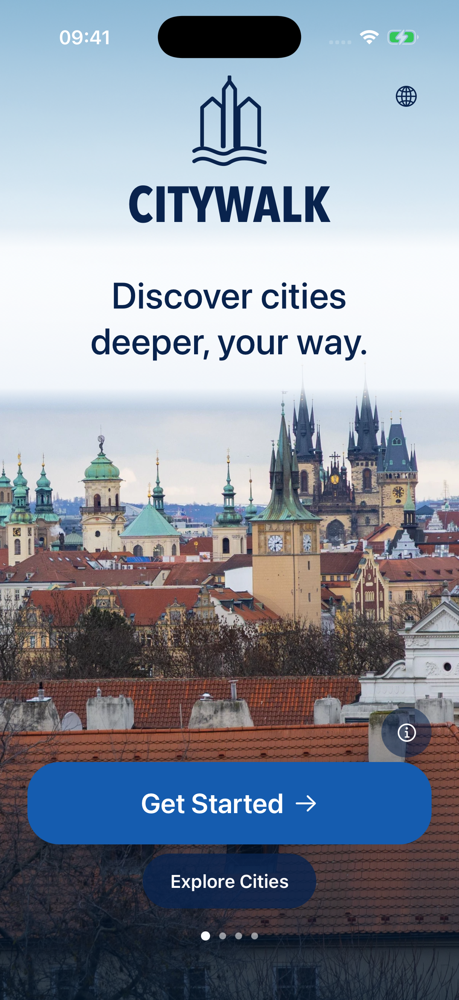

NEW native: 1206×2622 pixels. Fresh 28 October 2026 local native capture; 402×874 point standard iPhone. Language: English. Source hashes in registry.

Viewport comparison: Native legacy screenshot unavailable; no fabricated OLD capture. Supplementary Web evidence, where shown, is not a matched native comparison.

- **Old functionality:** No legacy equivalent identified. The pre-redesign launch was the existing Home/city discovery, not a photographic welcome.
- **New functionality:** Four-photo global carousel; attribution modal; Get Started → introduction; Explore Cities → existing city discovery; localization.
- **Functional gaps:** Review/deep-link entry only. Normal launch still resolves Home; no first-run completion or returning-traveler policy is wired.
- **UX differences:** New immersive global entry; discovery remains optional. The earlier first-draft welcome is a redesign iteration, not an original legacy screen.
- **Recommendation:** KEEP NEW (advisory; preserve approved visuals and necessary old capabilities).
- **Accessibility/performance:** native labels/selected states and historical layout tests exist; full physical assistive-technology acceptance and performance measurements are unverified. Screenshots cannot prove these.
- **USER DECISION: PENDING**

### Screen 02 — Product Value Story — OLD vs NEW

**Visually Approved / Functional Verification Pending** · **USER DECISION: PENDING**

NEW: [mobile/src/app/introduction.tsx](/Users/assia/Documents/GitHub/citywalk-onboarding-global-welcome/mobile/src/app/introduction.tsx); `IntroductionScreen`; `/introduction`. `codex/onboarding-global-welcome` / `/Users/assia/Documents/GitHub/citywalk-onboarding-global-welcome` / base `98a1dbbda17f945a0d982eb6dbc36713bad61617` + hashed dirty source.

OLD: **No legacy equivalent identified**. Exact old source/route/branch: not applicable. Earlier redesign iterations are not treated as original legacy.

OLD native: unavailable.

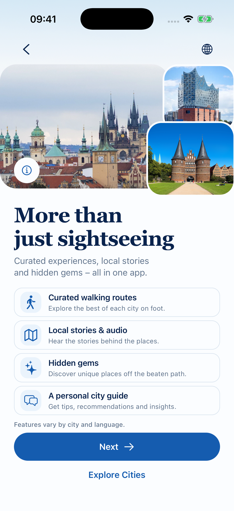

NEW native: 1206×2622 pixels. Fresh 28 October 2026 local native capture; 402×874 point standard iPhone. Language: English. Source hashes in registry.

Viewport comparison: Native legacy screenshot unavailable; no fabricated OLD capture. Supplementary Web evidence, where shown, is not a matched native comparison.

- **Old functionality:** No legacy equivalent identified. Product capabilities previously appeared within Home/planner/city content.
- **New functionality:** Wide licensed-photo composition, four descriptive noninteractive value rows, availability disclaimer, Next → optional account, Explore Cities guest exit.
- **Functional gaps:** Only entered through Screen 01 or explicit deep link. City-wide Guide remains unavailable; audio is exact-locale and content dependent. Disclaimer is material.
- **UX differences:** Editorial introduction instead of adding planner steps; no false chevrons. Compact earlier collage is an iteration, not legacy.
- **Recommendation:** KEEP NEW (advisory; preserve approved visuals and necessary old capabilities).
- **Accessibility/performance:** native labels/selected states and historical layout tests exist; full physical assistive-technology acceptance and performance measurements are unverified. Screenshots cannot prove these.
- **USER DECISION: PENDING**

### Screen 03 — Account / Sign-in — OLD vs NEW

**Visually Approved / Functional Verification Pending** · **USER DECISION: PENDING**

NEW: [mobile/src/app/account/index.tsx](/Users/assia/Documents/GitHub/citywalk-onboarding-global-welcome/mobile/src/app/account/index.tsx); `AccountScreen + AccountOnboardingFrame`; `/account?onboarding=1`. `codex/onboarding-global-welcome` / `/Users/assia/Documents/GitHub/citywalk-onboarding-global-welcome` / base `98a1dbbda17f945a0d982eb6dbc36713bad61617` + hashed dirty source.

OLD: [mobile/src/app/account/index.tsx](/Users/assia/Documents/GitHub/citywalk-onboarding-global-welcome/mobile/src/app/account/index.tsx); `AccountScreen`; `/account; ?entry=sign-in|sign-up`. Baseline source `98a1dbbda17f945a0d982eb6dbc36713bad61617` in the same branch history; retained variant where stated.

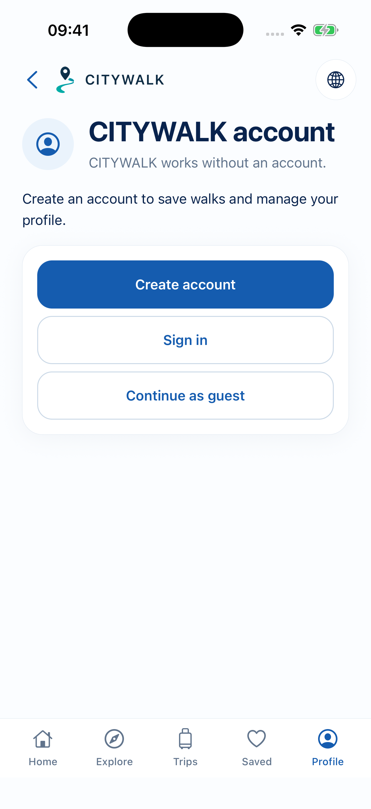

OLD native: 1206×2622 pixels. Fresh retained legacy presentation on current source, not an exact checkout of baseline.

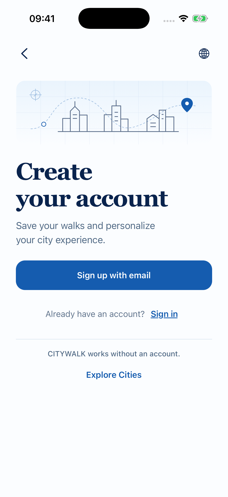

NEW native: 1206×2622 pixels. Fresh 28 October 2026 local native capture; 402×874 point standard iPhone. Language: English. Source hashes in registry.

Viewport comparison: Matched pixel dimensions.

- **Old functionality:** Guest account chooser, email sign-in/sign-up, recovery, configured OAuth, authenticated account management, preferences/password/deletion and entitlement status.
- **New functionality:** Same Better Auth and forms inside a premium onboarding frame; email action; sign-in; reassuring guest exit. General account variant remains available.
- **Functional gaps:** Visual approval is not live OAuth/email/provider acceptance. General guest exit returns Home/back, onboarding guest exit replaces with city discovery. Authenticated account still contains a Lübeck-specific pass link; not a dynamic selected-city profile.
- **UX differences:** Two intentional entry presentations currently coexist; management actions must not be removed with the old chooser.
- **Recommendation:** MERGE BEST OF BOTH (advisory; preserve approved visuals and necessary old capabilities).
- **Accessibility/performance:** native labels/selected states and historical layout tests exist; full physical assistive-technology acceptance and performance measurements are unverified. Screenshots cannot prove these.
- **USER DECISION: PENDING**

### Screen 04 — Choose a City — OLD vs NEW

**Visually Approved / Functional Verification Pending** · **USER DECISION: PENDING**

NEW: [mobile/src/app/index.tsx](/Users/assia/Documents/GitHub/citywalk-onboarding-global-welcome/mobile/src/app/index.tsx); `HomeScreen + HomeCityCard(size=selection)`; `/?section=cities`. `codex/onboarding-global-welcome` / `/Users/assia/Documents/GitHub/citywalk-onboarding-global-welcome` / base `98a1dbbda17f945a0d982eb6dbc36713bad61617` + hashed dirty source.

OLD: [mobile/src/app/index.tsx](/Users/assia/Documents/GitHub/citywalk-onboarding-global-welcome/mobile/src/app/index.tsx); `HomeScreen + HomeCityCard`; `/`. Baseline source `98a1dbbda17f945a0d982eb6dbc36713bad61617` in the same branch history; retained variant where stated.

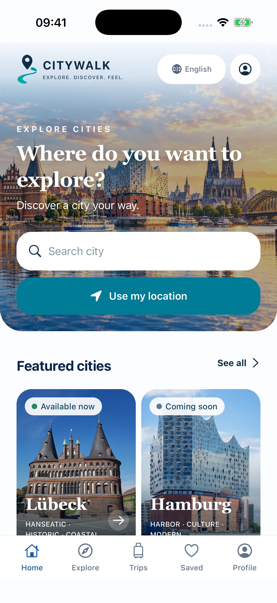

OLD native: 1206×2622 pixels. Fresh retained legacy presentation on current source, not an exact checkout of baseline.

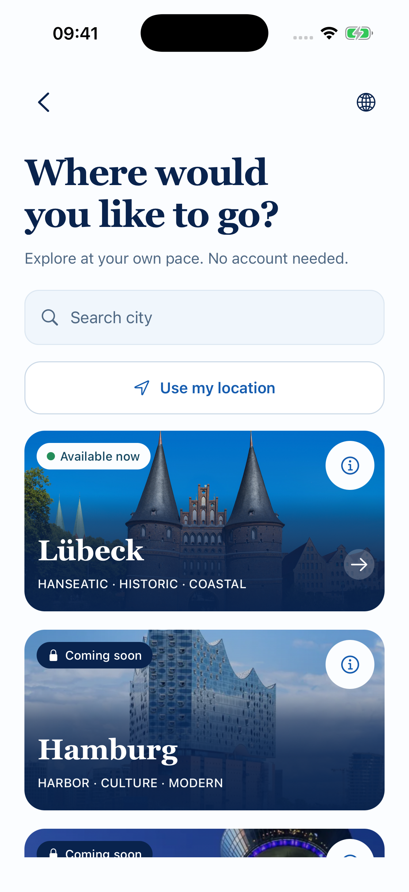

NEW native: 1206×2622 pixels. Fresh 28 October 2026 local native capture; 402×874 point standard iPhone. Language: English. Source hashes in registry.

Viewport comparison: Matched pixel dimensions.

- **Old functionality:** Original Home editorial city discovery, featured cities, search, optional location, availability, language and bottom navigation.
- **New functionality:** Premium full selection variant on the same source/route, city search/location, disabled Coming Soon and licensed city photos; selection → Hub.
- **Functional gaps:** No direct continuation to Screen 05; this is intentional guest discovery but differs from storyboard numbering. Back without stack falls to Welcome; normal Home and selection mode remain separate variants.
- **UX differences:** Focused selection versus original Home discovery. Same city registry/data, not two city systems.
- **Recommendation:** MERGE BEST OF BOTH (advisory; preserve approved visuals and necessary old capabilities).
- **Accessibility/performance:** native labels/selected states and historical layout tests exist; full physical assistive-technology acceptance and performance measurements are unverified. Screenshots cannot prove these.
- **USER DECISION: PENDING**

### Screen 05 — Select Interests — OLD vs NEW

**Visually Approved / Functional Verification Pending** · **USER DECISION: PENDING**

NEW: [mobile/src/components/SelectInterests.tsx](/Users/assia/Documents/GitHub/citywalk-onboarding-global-welcome/mobile/src/components/SelectInterests.tsx); `SelectInterests; NativeWalkFlow internal state`; `/city/:citySlug/walk [plan, step=1, !interestEntryComplete]`. `codex/onboarding-global-welcome` / `/Users/assia/Documents/GitHub/citywalk-onboarding-global-welcome` / base `98a1dbbda17f945a0d982eb6dbc36713bad61617` + hashed dirty source.

OLD: [mobile/src/components/NativeWalkFlow.tsx](/Users/assia/Documents/GitHub/citywalk-onboarding-global-welcome/mobile/src/components/NativeWalkFlow.tsx); `NativeWalkFlow planning fields`; `/city/:citySlug/walk [legacy plan step 2]`. Baseline source `98a1dbbda17f945a0d982eb6dbc36713bad61617` in the same branch history; retained variant where stated.

OLD native: unavailable.

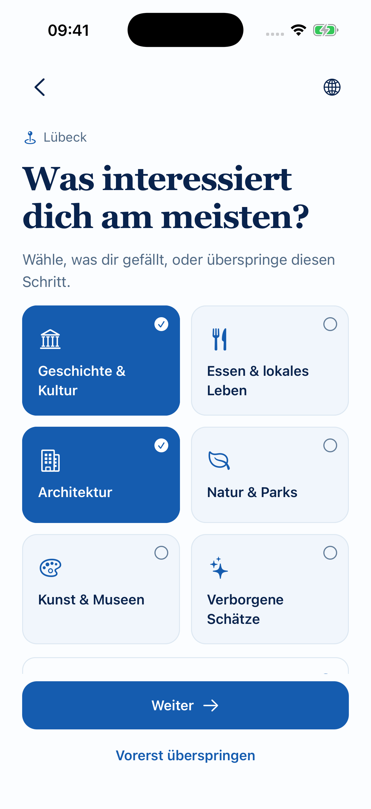

NEW native: 1206×2622 pixels. Fresh 28 October 2026 local native capture; 402×874 point standard iPhone. Language: German. Source hashes in registry.

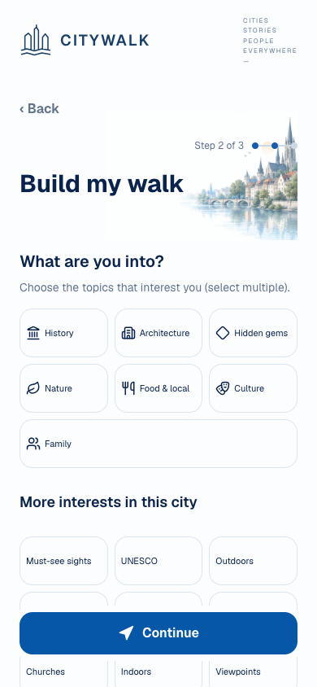

Supplementary legacy WEB—not native OLD: 390×844 pixels. Archived web screenshot, not a native OLD screenshot; no native parity or exact revision claim.

Viewport comparison: Native legacy screenshot unavailable; no fabricated OLD capture. Supplementary Web evidence, where shown, is not a matched native comparison.

- **Old functionality:** Existing city-scoped planner interests, duration and walking preferences used shared builder settings; retained later planner controls remain.
- **New functionality:** Optional multiple-select supported taxonomy including expandable family; Continue requires selection; Skip clears interest selection; city retained.
- **Functional gaps:** Per-mounted-flow completion flag, not global onboarding completion. Rebuild resets defaults; process termination does not preserve unbuilt draft selections. Guest selections do not feed Hub recommendations (account interests only).
- **UX differences:** Dedicated premium cards replace the interest entry presentation; not a standalone navigation route.
- **Recommendation:** MERGE BEST OF BOTH (advisory; preserve approved visuals and necessary old capabilities).
- **Accessibility/performance:** native labels/selected states and historical layout tests exist; full physical assistive-technology acceptance and performance measurements are unverified. Screenshots cannot prove these.
- **USER DECISION: PENDING**

### Screen 06 — Available Time / Return-by — OLD vs NEW

**Visually Approved / Functional Verification Pending** · **USER DECISION: PENDING**

NEW: [mobile/src/components/AvailableTime.tsx](/Users/assia/Documents/GitHub/citywalk-onboarding-global-welcome/mobile/src/components/AvailableTime.tsx); `AvailableTime + ReturnByTimePicker; NativeWalkFlow`; `/city/:citySlug/walk [plan, step=1, interestEntryComplete]`. `codex/onboarding-global-welcome` / `/Users/assia/Documents/GitHub/citywalk-onboarding-global-welcome` / base `98a1dbbda17f945a0d982eb6dbc36713bad61617` + hashed dirty source.

OLD: [mobile/src/components/NativeWalkFlow.tsx](/Users/assia/Documents/GitHub/citywalk-onboarding-global-welcome/mobile/src/components/NativeWalkFlow.tsx); `NativeWalkFlow + ReturnByTimePicker`; `/city/:citySlug/walk [legacy plan step 1]`. Baseline source `98a1dbbda17f945a0d982eb6dbc36713bad61617` in the same branch history; retained variant where stated.

OLD native: unavailable.

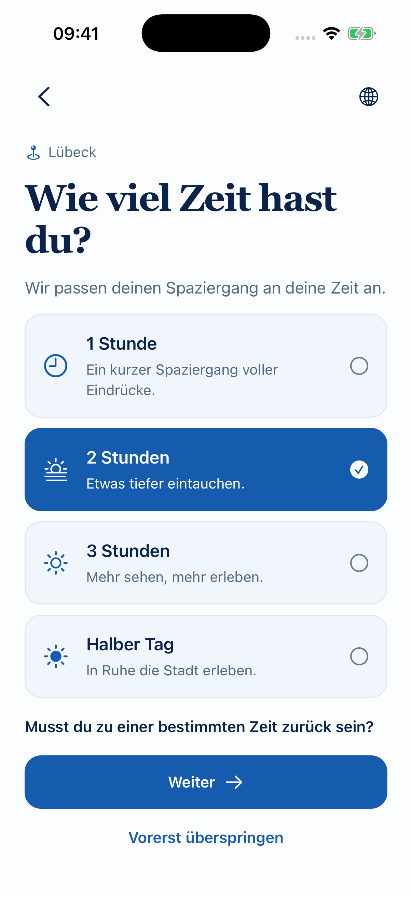

NEW native: 1206×2622 pixels. Fresh 28 October 2026 local native capture; 402×874 point standard iPhone. Language: German. Source hashes in registry.

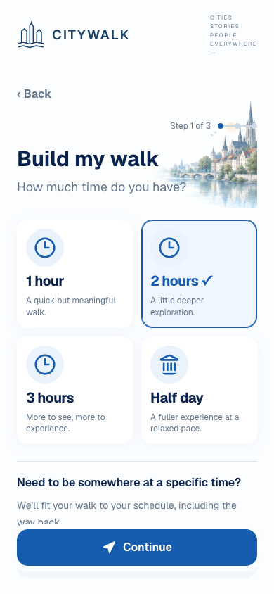

Supplementary legacy WEB—not native OLD: 390×844 pixels. Archived web screenshot, not a native OLD screenshot; no native parity or exact revision claim.

Viewport comparison: Native legacy screenshot unavailable; no fabricated OLD capture. Supplementary Web evidence, where shown, is not a matched native comparison.

- **Old functionality:** Planner time budget/deadline, walking pace, start/end/return constraints; saved/current journey restoration.
- **New functionality:** 60/120/180/240-minute cards; hydrated values such as 90 preserved; optional return-by; existing shared planner deadline/return-leg estimates. Saved picker HH:MM restoration fix.
- **Functional gaps:** Skip advances with the current/default duration; it does not remove the budget. Return-by is walking-based estimated planning, no car/transit or verified street-routing ETA. Unbuilt draft deadline remains in mounted state only.
- **UX differences:** Large accessible duration cards and inline optional return-by replace combined form presentation.
- **Recommendation:** MERGE BEST OF BOTH (advisory; preserve approved visuals and necessary old capabilities).
- **Accessibility/performance:** native labels/selected states and historical layout tests exist; full physical assistive-technology acceptance and performance measurements are unverified. Screenshots cannot prove these.
- **USER DECISION: PENDING**

### Screen 07 — Location Permission — OLD vs NEW

**Visually Approved / Functional Verification Pending** · **USER DECISION: PENDING**

NEW: [mobile/src/components/LocationPermission.tsx](/Users/assia/Documents/GitHub/citywalk-onboarding-global-welcome/mobile/src/components/LocationPermission.tsx); `LocationPermission; NativeWalkFlow`; `/city/:citySlug/walk [plan, step=2, !locationEntryComplete]`. `codex/onboarding-global-welcome` / `/Users/assia/Documents/GitHub/citywalk-onboarding-global-welcome` / base `98a1dbbda17f945a0d982eb6dbc36713bad61617` + hashed dirty source.

OLD: [mobile/src/components/NativeWalkFlow.tsx](/Users/assia/Documents/GitHub/citywalk-onboarding-global-welcome/mobile/src/components/NativeWalkFlow.tsx); `NativeWalkFlow locate/manual start controls`; `/city/:citySlug/walk [legacy start/end step 3]`. Baseline source `98a1dbbda17f945a0d982eb6dbc36713bad61617` in the same branch history; retained variant where stated.

OLD native: unavailable.

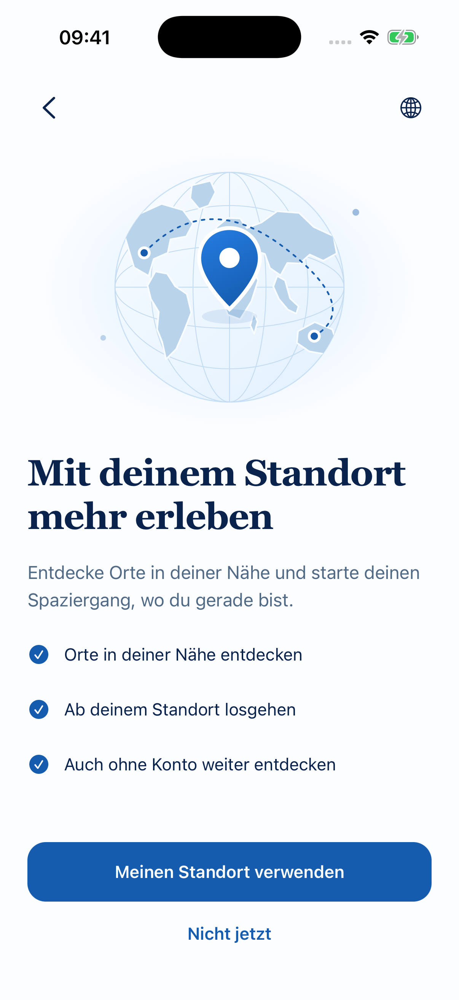

NEW native: 1206×2622 pixels. Fresh 28 October 2026 local native capture; 402×874 point standard iPhone. Language: German. Source hashes in registry.

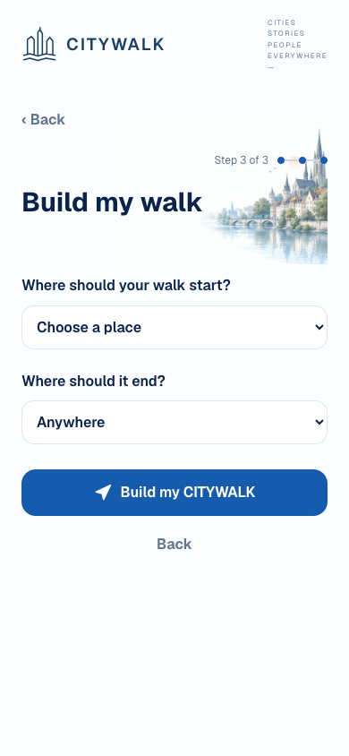

Supplementary legacy WEB—not native OLD: 390×844 pixels. Archived web screenshot, not a native OLD screenshot; no native parity or exact revision claim.

Viewport comparison: Native legacy screenshot unavailable; no fabricated OLD capture. Supplementary Web evidence, where shown, is not a matched native comparison.

- **Old functionality:** Optional explicit locate action and manual place start/end in the existing builder; no separate explanation screen.
- **New functionality:** Global map illustration; explicit permission request; Not now; errors; existing location handler; manual controls continue below the introductory states.
- **Functional gaps:** This is a planner-context explanation, not an OS permission screen or global first-launch gate. Later planner/map locate controls can repeat the location request affordance.
- **UX differences:** New standalone-looking state, backed by the old permission system and retained manual controls.
- **Recommendation:** MERGE BEST OF BOTH (advisory; preserve approved visuals and necessary old capabilities).
- **Accessibility/performance:** native labels/selected states and historical layout tests exist; full physical assistive-technology acceptance and performance measurements are unverified. Screenshots cannot prove these.
- **USER DECISION: PENDING**

### Screen 08 — First Experience — OLD vs NEW

**Visually Approved / Functional Verification Pending** · **USER DECISION: PENDING**

NEW: [mobile/src/components/FirstExperience.tsx](/Users/assia/Documents/GitHub/citywalk-onboarding-global-welcome/mobile/src/components/FirstExperience.tsx); `FirstExperience; NativeWalkFlow`; `/city/:citySlug/walk [plan, step=2, location complete, firstExperience incomplete]`. `codex/onboarding-global-welcome` / `/Users/assia/Documents/GitHub/citywalk-onboarding-global-welcome` / base `98a1dbbda17f945a0d982eb6dbc36713bad61617` + hashed dirty source.

OLD: **No legacy equivalent identified**. Exact old source/route/branch: not applicable. Earlier redesign iterations are not treated as original legacy.

OLD native: unavailable.

NEW native: 1206×2622 pixels. Fresh 28 October 2026 local native capture; 402×874 point standard iPhone. Language: German. Source hashes in registry.

Viewport comparison: Native legacy screenshot unavailable; no fabricated OLD capture. Supplementary Web evidence, where shown, is not a matched native comparison.

- **Old functionality:** No legacy equivalent identified. The planner previously advanced directly into start/end planning.
- **New functionality:** Selected available city photo and confirmation; honest no-generated-route text; Explore city → Hub(returnToPlanner=1); retained mounted planner resumes from Hub.
- **Functional gaps:** Detour to a second Hub instance can feel circular. A cold launch/direct Hub link cannot recover an unbuilt draft; stack intent is not durable persistence.
- **UX differences:** New confirmation state; does not build or start a route. Number 08 is design review identity, not launch step eight.
- **Recommendation:** REBUILD FLOW (advisory; preserve approved visuals and necessary old capabilities).
- **Accessibility/performance:** native labels/selected states and historical layout tests exist; full physical assistive-technology acceptance and performance measurements are unverified. Screenshots cannot prove these.
- **USER DECISION: PENDING**

### Screen 09 — City Hub — OLD vs NEW

**Visually Approved / Functional Verification Pending** · **USER DECISION: PENDING**

NEW: [mobile/src/app/city/[citySlug]/index.tsx](/Users/assia/Documents/GitHub/citywalk-onboarding-global-welcome/mobile/src/app/city/[citySlug]/index.tsx); `CityScreen + CityHubHero`; `/city/:citySlug`. `codex/onboarding-global-welcome` / `/Users/assia/Documents/GitHub/citywalk-onboarding-global-welcome` / base `98a1dbbda17f945a0d982eb6dbc36713bad61617` + hashed dirty source.

OLD: [mobile/src/app/city/[citySlug]/index.tsx](/Users/assia/Documents/GitHub/citywalk-onboarding-global-welcome/mobile/src/app/city/[citySlug]/index.tsx); `CityScreen / existing hub content`; `/city/:citySlug`. Baseline source `98a1dbbda17f945a0d982eb6dbc36713bad61617` in the same branch history; retained variant where stated.

OLD native: unavailable.

NEW native: 1206×2622 pixels. Fresh 28 October 2026 local native capture; 402×874 point standard iPhone. Language: English. Source hashes in registry.

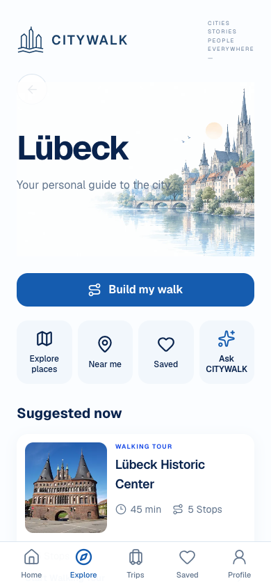

Supplementary legacy WEB—not native OLD: 390×844 pixels. Archived web screenshot, not a native OLD screenshot; no native parity or exact revision claim.

Viewport comparison: Native legacy screenshot unavailable; no fabricated OLD capture. Supplementary Web evidence, where shown, is not a matched native comparison.

- **Old functionality:** City-scoped published tours, places, search/category/map discovery, trip builder and honest Guide fallback.
- **New functionality:** Premium hero, retained builder action, Explore/Near me/Ask actions, real tour recommendation and places list/map, city switcher and attribution.
- **Functional gaps:** Hub route card still advertises 45 min while Screen 13 shows 120 min at stops. Guest onboarding interests are not consumed by cityHubRecommendations. Walking Routes 12 has no direct Hub entry; Ask opens supported unavailable fallback rather than a city-wide answer.
- **UX differences:** Compact editorial route card and photography improve hierarchy. City Hub and Places are both in Explore tab; Home remains global discovery.
- **Recommendation:** MERGE BEST OF BOTH (advisory; preserve approved visuals and necessary old capabilities).
- **Accessibility/performance:** native labels/selected states and historical layout tests exist; full physical assistive-technology acceptance and performance measurements are unverified. Screenshots cannot prove these.
- **USER DECISION: PENDING**

### Screen 10 — Explore Places — OLD vs NEW

**Visually Approved / Functional Verification Pending** · **USER DECISION: PENDING**

NEW: [mobile/src/app/city/[citySlug]/explore.tsx](/Users/assia/Documents/GitHub/citywalk-onboarding-global-welcome/mobile/src/app/city/[citySlug]/explore.tsx); `ExploreScreen / ExploreContent`; `/city/:citySlug/explore`. `codex/onboarding-global-welcome` / `/Users/assia/Documents/GitHub/citywalk-onboarding-global-welcome` / base `98a1dbbda17f945a0d982eb6dbc36713bad61617` + hashed dirty source.

OLD: [mobile/src/app/city/[citySlug]/explore.tsx](/Users/assia/Documents/GitHub/citywalk-onboarding-global-welcome/mobile/src/app/city/[citySlug]/explore.tsx); `ExploreScreen`; `/city/:citySlug/explore`. Baseline source `98a1dbbda17f945a0d982eb6dbc36713bad61617` in the same branch history; retained variant where stated.

OLD native: unavailable.

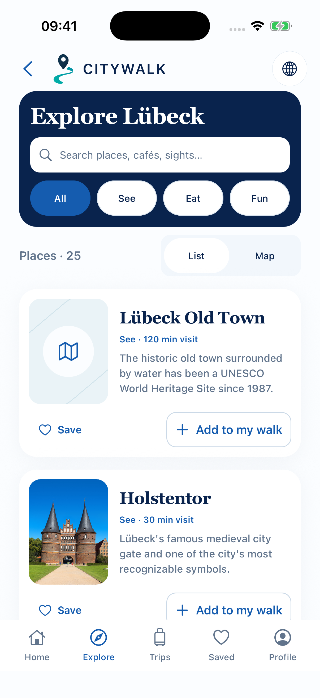

NEW native: 1206×2622 pixels. Fresh 28 October 2026 local native capture; 402×874 point standard iPhone. Language: English. Source hashes in registry.

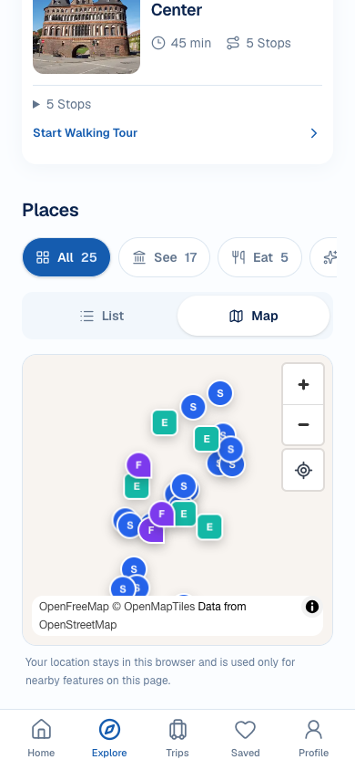

Supplementary legacy WEB—not native OLD: 390×844 pixels. Archived web screenshot, not a native OLD screenshot; no native parity or exact revision claim.

Viewport comparison: Native legacy screenshot unavailable; no fabricated OLD capture. Supplementary Web evidence, where shown, is not a matched native comparison.

- **Old functionality:** Existing city POI list/map, category browsing, save and walk integration; legacy header/search entry.
- **New functionality:** Compact navy header, richer POI cards, distinct Save/Add, genuine photo where verified, polished placeholders; search opens separate SearchScreen.
- **Functional gaps:** 20 missing photos and four unverified legacy assets remain excluded, not solved by placeholders. Separate Search route has recent history/result caps, so merging inline search blindly would lose functionality. Current runtime still exposes adjacent Holstentor attribution text in Explore; centralized Place Detail credits do not imply every credit UI was removed.
- **UX differences:** Premium discovery layout replaces generic rows; crash fix and existing five tabs retained.
- **Recommendation:** MERGE BEST OF BOTH (advisory; preserve approved visuals and necessary old capabilities).
- **Accessibility/performance:** native labels/selected states and historical layout tests exist; full physical assistive-technology acceptance and performance measurements are unverified. Screenshots cannot prove these.
- **USER DECISION: PENDING**

### Screen 11 — Place Detail — OLD vs NEW

**Visually Approved / Functional Verification Pending** · **USER DECISION: PENDING**

NEW: [mobile/src/app/city/[citySlug]/place/[placeSlug].tsx](/Users/assia/Documents/GitHub/citywalk-onboarding-global-welcome/mobile/src/app/city/[citySlug]/place/[placeSlug].tsx); `PlaceScreen → PlaceContent (ordinary place context)`; `/city/:citySlug/place/:placeSlug [without published-trip context]`. `codex/onboarding-global-welcome` / `/Users/assia/Documents/GitHub/citywalk-onboarding-global-welcome` / base `98a1dbbda17f945a0d982eb6dbc36713bad61617` + hashed dirty source.

OLD: [mobile/src/app/city/[citySlug]/place/[placeSlug].tsx](/Users/assia/Documents/GitHub/citywalk-onboarding-global-welcome/mobile/src/app/city/[citySlug]/place/[placeSlug].tsx); `PlaceScreen / PlaceContent`; `/city/:citySlug/place/:placeSlug`. Baseline source `98a1dbbda17f945a0d982eb6dbc36713bad61617` in the same branch history; retained variant where stated.

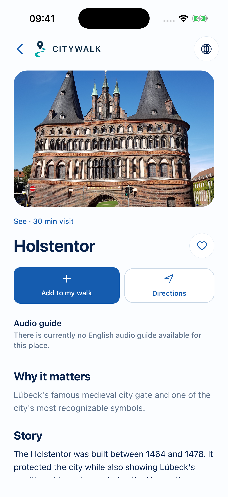

OLD native: 1206×2622 pixels. Archived pre-redesign simulator capture. Language: English. Retained report identifies context; source-to-binary exact match not independently established.

NEW native: 1206×2622 pixels. Fresh 28 October 2026 local native capture; 402×874 point standard iPhone. Language: English. Source hashes in registry.

Viewport comparison: Matched pixel dimensions.

- **Old functionality:** Verified content, exact-locale audio, sources, guide eligibility, directions, saved place and walk actions; trip-context next/previous.
- **New functionality:** Large place-specific hero/fallback, title/category/visit time, Save/Add/Directions, real Overview/Story/Audio, accessible central Photo Credits link.
- **Functional gaps:** Published-trip URL now dispatches to unapproved PublishedActiveWalk rather than PlaceContent; this is a distinct mode sharing one route. Missing photos and exact-locale unavailable audio remain real limits. Live external directions and provider-gated Guide not accepted by a screenshot.
- **UX differences:** Large inline Holstentor credit removed in ordinary detail in favor of centralized credits; required licensing metadata preserved.
- **Recommendation:** KEEP NEW (advisory; preserve approved visuals and necessary old capabilities).
- **Accessibility/performance:** native labels/selected states and historical layout tests exist; full physical assistive-technology acceptance and performance measurements are unverified. Screenshots cannot prove these.
- **USER DECISION: PENDING**

### Screen 12 — Walking Routes — OLD vs NEW

**Visually Approved / Functional Verification Pending** · **USER DECISION: PENDING**

NEW: [mobile/src/app/city/[citySlug]/routes.tsx](/Users/assia/Documents/GitHub/citywalk-onboarding-global-welcome/mobile/src/app/city/[citySlug]/routes.tsx); `WalkingRoutesScreen / RoutesContent / PublishedRouteCard`; `/city/:citySlug/routes`. `codex/onboarding-global-welcome` / `/Users/assia/Documents/GitHub/citywalk-onboarding-global-welcome` / base `98a1dbbda17f945a0d982eb6dbc36713bad61617` + hashed dirty source.

OLD: [mobile/src/app/city/[citySlug]/index.tsx](/Users/assia/Documents/GitHub/citywalk-onboarding-global-welcome/mobile/src/app/city/[citySlug]/index.tsx); `existing TourCard in City Hub`; `/city/:citySlug [tour collection section]`. Baseline source `98a1dbbda17f945a0d982eb6dbc36713bad61617` in the same branch history; retained variant where stated.

OLD native: unavailable.

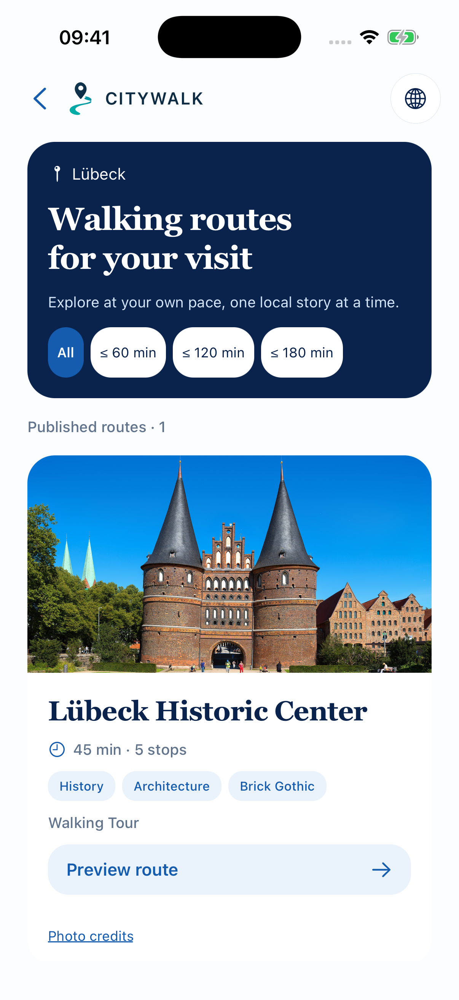

NEW native: 1206×2622 pixels. Fresh 28 October 2026 local native capture; 402×874 point standard iPhone. Language: English. Source hashes in registry.

Supplementary legacy WEB—not native OLD: 390×844 pixels. Archived web screenshot, not a native OLD screenshot; no native parity or exact revision claim.

Viewport comparison: Native legacy screenshot unavailable; no fabricated OLD capture. Supplementary Web evidence, where shown, is not a matched native comparison.

- **Old functionality:** No legacy equivalent identified for a standalone route-list page. Equivalent published-tour collection was embedded in City Hub.
- **New functionality:** Dedicated real published route collection; supported duration filters; real metadata/themes; preview; build/saved/hub exits; legal credits.
- **Functional gaps:** Duration filters use ambiguous estimatedDurationMinutes=45 despite 120 min summed visits shown in preview. Single real route matches all current budget filters. No curated-route favorite contract. Discoverability is reverse: preview links to list, not Hub → list.
- **UX differences:** New dedicated list; no fictional storyboard routes or ratings. Host collection overlap is legitimate reuse, but entry needs a decision.
- **Recommendation:** MERGE BEST OF BOTH (advisory; preserve approved visuals and necessary old capabilities).
- **Accessibility/performance:** native labels/selected states and historical layout tests exist; full physical assistive-technology acceptance and performance measurements are unverified. Screenshots cannot prove these.
- **USER DECISION: PENDING**

### Screen 13 — Route Preview — OLD vs NEW

**Visually Approved / Functional Verification Pending** · **USER DECISION: PENDING**

NEW: [mobile/src/app/city/[citySlug]/tour/[tourSlug].tsx](/Users/assia/Documents/GitHub/citywalk-onboarding-global-welcome/mobile/src/app/city/[citySlug]/tour/[tourSlug].tsx); `TourScreen → RoutePreview`; `/city/:citySlug/tour/:tourSlug`. `codex/onboarding-global-welcome` / `/Users/assia/Documents/GitHub/citywalk-onboarding-global-welcome` / base `98a1dbbda17f945a0d982eb6dbc36713bad61617` + hashed dirty source.

OLD: [mobile/src/app/city/[citySlug]/tour/[tourSlug].tsx](/Users/assia/Documents/GitHub/citywalk-onboarding-global-welcome/mobile/src/app/city/[citySlug]/tour/[tourSlug].tsx); `TourScreen (original published-tour preview)`; `/city/:citySlug/tour/:tourSlug`. Baseline source `98a1dbbda17f945a0d982eb6dbc36713bad61617` in the same branch history; retained variant where stated.

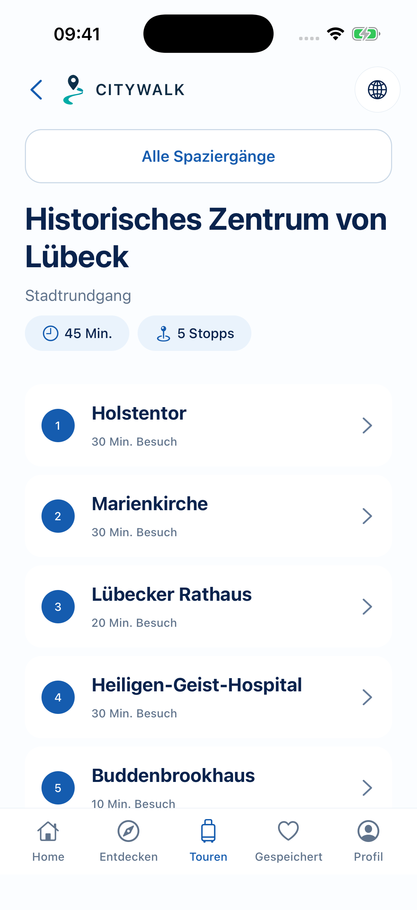

OLD native: 1206×2622 pixels. Archived pre-redesign simulator capture. Language: German. Retained report identifies context; source-to-binary exact match not independently established.

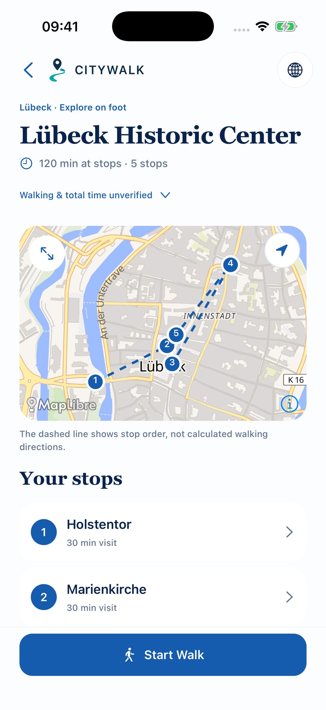

NEW native: 1206×2622 pixels. Fresh 28 October 2026 local native capture; 402×874 point standard iPhone. Language: English. Source hashes in registry.

Viewport comparison: Matched pixel dimensions.

- **Old functionality:** Published title/description/duration/stops; place links and explicit first-stop start, without separate verified pedestrian routing.
- **New functionality:** Real coordinate map with numbered stop sequence, ordered places, truthful visit-only total, original-duration disclosure; explicit Start Walk; builder return-by link.
- **Functional gaps:** 45 min has no verified walking/full-experience semantics. Real pedestrian geometry unavailable; dashed sequence explicitly not directions. Curated favorite unavailable. Start goes to new unapproved Active Walk mode; current preview contains no direct durable-progress resume decision itself.
- **UX differences:** Map/list and duration integrity replace simple metadata list; explicit action is still required before active context.
- **Recommendation:** KEEP NEW (advisory; preserve approved visuals and necessary old capabilities).
- **Accessibility/performance:** native labels/selected states and historical layout tests exist; full physical assistive-technology acceptance and performance measurements are unverified. Screenshots cannot prove these.
- **USER DECISION: PENDING**

