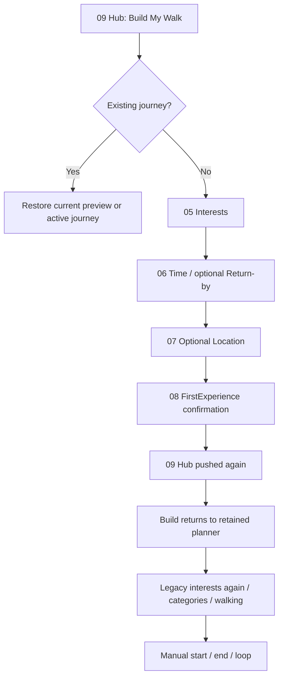
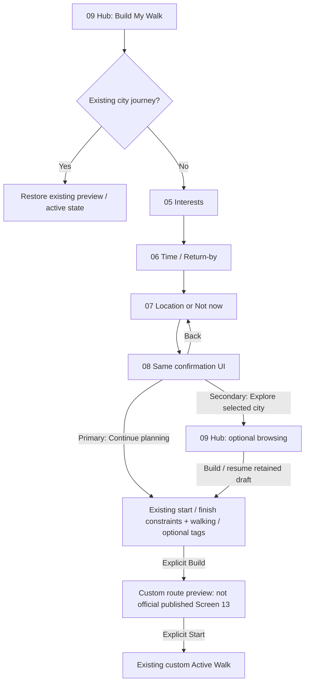
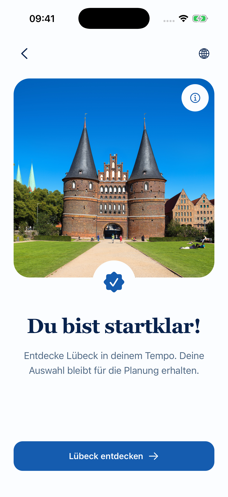
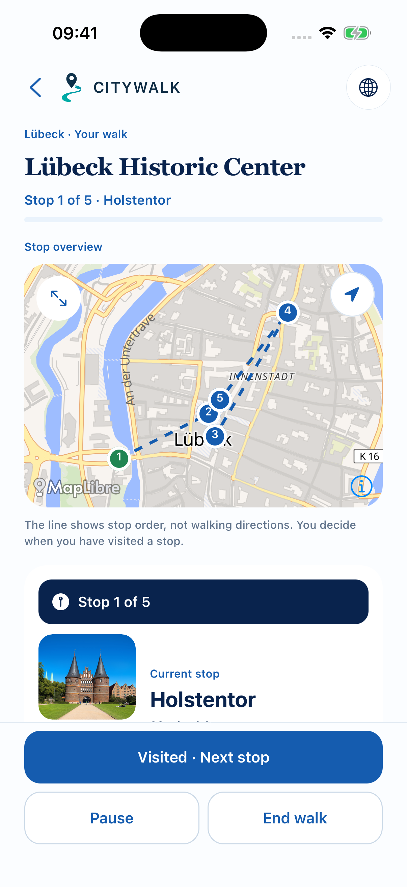

# SCREEN 08 — proposed navigation redesign

> **Owner update — 28 October 2026:** S08 UX/FLOW is **APPROVED**. Implementation remains **NOT AUTHORIZED / NOT IMPLEMENTED**. The original worksheet remains REBUILD FLOW; this approval is an additional event, not a replacement selection. Technical/test and new-footer visual acceptance remain pending. D01–D14 and Screen 14 remain PENDING. See [approval record](../screen-08-flow-approval-2026-10-28/SCREEN-08-APPROVAL-RECORD.md) and [next proposal](../screen-08-flow-approval-2026-10-28/NEXT-IMPLEMENTATION-PROPOSAL.md).

Date: **28 October 2026**. Scope: owner decision import and proposed implementation specifications only. **No implementation is authorized or performed.** Screens 01–13 retain their exact design-review IDs and approved visuals except any explicitly proposed follow-up changes still awaiting review. Screen 14 remains unapproved. D01–D14 remain PENDING.

Source worksheet: `/Users/assia/Downloads/CITYWALK-review-decisions.json`; export timestamp `2026-10-28T04:20:45.479Z`; SHA-256 `c9c7ce183342f482fbb2d8a0bea98a35fa0520253fc3f6d63142351c142ece30`. The exact bytes and empty notes are preserved in [CITYWALK-review-decisions.original.json](CITYWALK-review-decisions.original.json). Current source: `codex/onboarding-global-welcome` in `/Users/assia/Documents/GitHub/citywalk-onboarding-global-welcome`, base `98a1dbbda17f945a0d982eb6dbc36713bad61617` plus existing uncommitted work. Base SHA alone does not identify the approved redesign; audit source snapshots/hashes remain authoritative.

Original audit files, advisory recommendations, screenshots, branches and worktrees remain untouched. This plan's imported owner-selection column supersedes the historical audit's PENDING screen selections; it does not overwrite or reinterpret the original worksheet. KEEP NEW means preferred presentation; MERGE BEST OF BOTH means a proposed feature specification; REBUILD FLOW means a proposed journey change, not UI deletion. Historical visual approval is distinct from approval of these new specifications and from functional/device acceptance.

## Problem and recommendation

Current code in NativeWalkFlow renders FirstExperience after optional location and then `onExplore` pushes a second City Hub with `returnToPlanner=1`. Hub Build returns to the retained planner. That planner's step 2 renders the legacy interests grid again, after S05 has already collected the same selection; step 3 contains manual/GPS start/end/loop controls.

**Owner-approved UX/flow (not implemented):** keep the approved FirstExperience imagery, selected-city context, headline and reassurance. Make its primary action an honest **planning handoff**, not a mandatory exit to Hub. Keep city browsing as an explicit secondary exit. Do not delete S08, generate a route there or imply that one exists.

## Current versus proposed flow

This proposed graph is a specification, not a coded prototype. The combined constraints view must retain all meaningful old step-2 categories/walking preferences and step-3 start/end options; it may move the interests grid behind an explicit Edit Interests action instead of asking it again. It must not silently discard the legacy configuration capabilities. Placement and text reflow require native review after implementation authorization.

## Entry rules

| Entry / state | Required proposed behavior |
|---|---|
| New city custom walk; no current journey | Enter 05 → 06 → 07 → 08 through existing city-scoped controller; same settings object throughout. |
| Location succeeds | Advance to 08 using existing permission result; no second request. |
| Not now / denial | Manual city selection/planning stays available. Denial shows existing recovery; explicit Not now can proceed without coordinates. No auto prompt on 08. |
| Saved/current preview or active journey | Restore it; do not replay 05–08, reset its settings or create a new journey. |
| Published route preview / Start | Outside S08; remain curated path. S13 and unapproved S14 are not redirected into custom onboarding. |
| Invalid/unavailable city | Existing recovery/availability gate, no enabled explore/build action or default Lübeck substitution. |
| Direct /walk launch | Hydrate/validate existing journey first; new walk enters settings. Do not expose a separate forgeable /first-experience route. |

## Exit and Back contract

1. **Primary proposed copy:** EN “Continue planning”; DE “Planung fortsetzen”. Advance the same mounted controller to existing constraints, preserve interests/minutes/returnBy/GPS/manual city and walking/category settings. No router.push to a second Hub, API generation, persistence of an invented route or active-walk start.
2. **Secondary proposed copy:** EN “Explore {city}”; DE “{city} entdecken”. Browse the selected city Hub as a deliberate exit, retaining the current mounted draft underneath with a validated return-to-planner intent. Hub Build returns to the next constraints step; it does not replay S05 or S08. A failed/missing stack must fall back honestly to new/restored planner state, never claim recovered unpersisted data.
3. **Back from 08:** return to 07 with existing values. Do not revoke OS permission or erase a granted location. Back from 07 → 06; from 06 → 05; from 05 → originating city Hub. Native iOS Back and Android hardware Back must match.
4. **Back from constraints:** return to 08 without resetting selections. An explicit Edit Interests affordance may return to 05 and then advance through retained settings, not duplicate stores or stack entries.
5. **Optional browse/leave:** no hidden route generation or current-walk deletion. City switching must not apply one city's coordinates/places to another. Recommend preserving the original draft while that mounted stack exists; a broader cross-city durable draft policy is D01/D03 work, still pending.
6. **App termination:** smallest proposed slice stays session-only for unbuilt drafts, matching current storage boundaries. On restart restore a real built CurrentWalk if present; otherwise begin a new draft and do not promise old choices. Durable unbuilt-draft persistence is a separate owner decision with privacy/lifetime/versioning requirements; do not misuse account TravelerStyle or existing curated-progress storage.

## State contract and implementation boundary (prospective)

- Reuse `NativeWalkFlow` as the only owner; `FirstExperience` remains presentation receiving callbacks and selected available-city media.
- Prefer explicit named transition helpers in the existing controller for confirmation → constraints, Back, edit and browse-return. Numeric `step` guards currently also gate restored/add/saved paths; changing only one number would risk replaying onboarding or losing controls.
- Potential files: `mobile/src/components/NativeWalkFlow.tsx`, `FirstExperience.tsx`, `mobile/src/lib/firstExperienceCopy.ts`, scoped Hub return-intent handler in `mobile/src/app/city/[citySlug]/index.tsx`. Shared chrome/tab architecture is out of scope unless separately approved.
- No new auth/location/route builder, state store, API, schema, payment or pedestrian-routing provider. No navigation/session flags treated as entitlements or persisted completion proof.
- Existing published route S13 remains independent. This proposal does not approve or redesign Screen 14.

## Acceptance specification

- New guest flow reaches constraints after S08 without a mandatory second Hub visit or repeated interests prompt.
- Categories/walking pace/manual/GPS start/end/loop and walking-based deadline behavior remain available; selected settings actually reach the existing builder.
- S08 primary creates no route; only explicit Build creates preview; only explicit Start begins execution.
- Secondary browse and resume retain the exact session draft; no-stack fallback, repeated taps, city switch, locale refresh, permission denial/late completion and process restart behave as above.
- Back from every step retains data and never starts navigation. No automatic location request or account gate.
- Verify EN/DE on standard/small iOS, large Dynamic Type and Android layout/hardware Back; keyboard and deadline picker remain usable. Physical VoiceOver/TalkBack acceptance remains separate.
- Extend `first-experience.test.tsx`, `walk-flow.behavior.tsx`, `city-hub-actions.test.tsx`, `return-by-picker.test.tsx` and location tests with rendered transition/negative cases. Repeated taps must not create duplicate Hub/draft stack entries.

## UX/flow approved — technical and actual new-layout acceptance pending

The owner approved the referenced flow, primary/secondary semantics, interests-once behavior and Back journey. The exact technical/test dependencies are specified in the new approval package; implementation is not authorized. Related D03/D04/D05/D09 decisions remain PENDING; no broad consolidation permission is inferred.

Current approved S08 below is retained. The approved action semantics are **not rendered** in this screenshot; actual new-footer layout/accessibility/device acceptance remains pending. No new mock screenshot is being presented as an implementation.

Existing Hub involved in the optional browse/resume path:

Screen 14 remains unapproved and outside this proposal:

