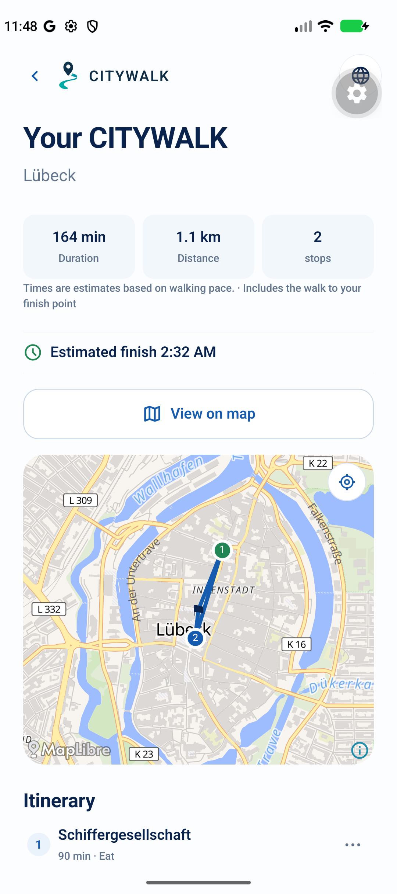

# D08 — Custom preview vs published Route Preview

**OWNER DECISION: PENDING.** Recommendation below is advisory. OLD/NEW label contracts, not always chronological replacements.

Classification: **Distinct domain contracts; not replacement versions**.

## OLD — existing/alternate evidence

`/city/:citySlug/walk — NativeWalkFlow stage=preview`

- [mobile/src/components/NativeWalkFlow.tsx](</Users/assia/Documents/GitHub/citywalk-onboarding-global-welcome/mobile/src/components/NativeWalkFlow.tsx>) · [current snapshot](sources/current/mobile/src/components/NativeWalkFlow.tsx.txt) · [baseline 98a1dbbd](sources/base/mobile/src/components/NativeWalkFlow.tsx.txt)
- [mobile/src/lib/walkStorage.ts](</Users/assia/Documents/GitHub/citywalk-onboarding-global-welcome/mobile/src/lib/walkStorage.ts>) · [current snapshot](sources/current/mobile/src/lib/walkStorage.ts.txt) · [baseline 98a1dbbd](sources/base/mobile/src/lib/walkStorage.ts.txt)

Current custom preview from29 Oct Android QA; not a historical OLD render and not matched to the iPhone viewport.

- Personalized WalkSettings, walking return-by, start/finish/loop/categories and adaptation.
- Guarded current-preview writes, saved-route replay lineage and explicit Start.

## NEW — existing/alternate evidence

`/city/:citySlug/tour/:tourSlug — TourScreen / RoutePreview`

- [mobile/src/app/city/[citySlug]/tour/[tourSlug].tsx](</Users/assia/Documents/GitHub/citywalk-onboarding-global-welcome/mobile/src/app/city/[citySlug]/tour/[tourSlug].tsx>) · [current snapshot](sources/current/mobile/src/app/city/[citySlug]/tour/[tourSlug].tsx.txt) · [baseline 98a1dbbd](sources/base/mobile/src/app/city/[citySlug]/tour/[tourSlug].tsx.txt)
- [mobile/src/lib/publishedRouteTiming.ts](</Users/assia/Documents/GitHub/citywalk-onboarding-global-welcome/mobile/src/lib/publishedRouteTiming.ts>) · [current snapshot](sources/current/mobile/src/lib/publishedRouteTiming.ts.txt) · No file at baseline commit; current candidate/addition preserved.

Archived approved native Screen 13; audit capture 28 Oct 2026, 402×874pt. Not a new device acceptance run.

- Approved S13 published stop order, interactive stop overview and ordered stop details.
- Visit estimates separated from unverified walking/total; explicit Start enters published execution.

## Overlap and recommendation

Both display a preview/map, but one is a generated editable journey and the other a published editorial itinerary. Straight-line stop sequence is not pedestrian directions.

**Recommended decision:** KEEP BOTH DOMAIN FLOWS; share only compatible display primitives without changing approved S13.

Historical audit advice: MERGE BEST OF BOTH (never an owner selection).

**Owner decision needed:** Confirm published editorial order and personalized adaptation remain separate. Any unified preview shell needs an explicit adapter specification and later visual review, not a shared storage-schema shortcut.

- Do not overwrite CurrentWalk when browsing a published tour.
- No route geometry or total-time invention; Build and Start boundaries stay intact.

No application/test edits, consolidation, legacy removal or release authorization. Screen 14 and all D choices remain pending.
