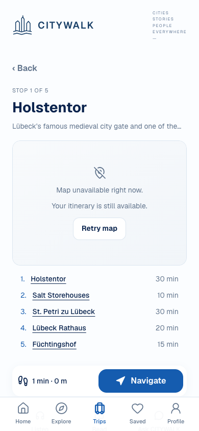

# D09 — Custom Active Walk vs published Active Walk

**OWNER DECISION: PENDING.** Recommendation below is advisory. OLD/NEW label contracts, not always chronological replacements.

Classification: **Distinct execution models; Screen 14 pending**.

## OLD — existing/alternate evidence

`/city/:citySlug/walk — NativeWalkFlow stage=active`

- [mobile/src/components/NativeWalkFlow.tsx](</Users/assia/Documents/GitHub/citywalk-onboarding-global-welcome/mobile/src/components/NativeWalkFlow.tsx>) · [current snapshot](sources/current/mobile/src/components/NativeWalkFlow.tsx.txt) · [baseline 98a1dbbd](sources/base/mobile/src/components/NativeWalkFlow.tsx.txt)
- [mobile/src/lib/walkStorage.ts](</Users/assia/Documents/GitHub/citywalk-onboarding-global-welcome/mobile/src/lib/walkStorage.ts>) · [current snapshot](sources/current/mobile/src/lib/walkStorage.ts.txt) · [baseline 98a1dbbd](sources/base/mobile/src/lib/walkStorage.ts.txt)

Supplementary archived Web Active Walk only. Native OLD custom-active screenshot unavailable; not native parity proof.

- Custom CurrentWalk/adaptation/finish and saved lineage.
- Current phase is preview|active; do not claim an equivalent durable paused phase.

## NEW — existing/alternate evidence

`/city/:citySlug/place/:placeSlug + published trip context — PublishedActiveWalk`

- [mobile/src/components/PublishedActiveWalk.tsx](</Users/assia/Documents/GitHub/citywalk-onboarding-global-welcome/mobile/src/components/PublishedActiveWalk.tsx>) · [current snapshot](sources/current/mobile/src/components/PublishedActiveWalk.tsx.txt) · No file at baseline commit; current candidate/addition preserved.
- [mobile/src/lib/activePublishedTrip.ts](</Users/assia/Documents/GitHub/citywalk-onboarding-global-welcome/mobile/src/lib/activePublishedTrip.ts>) · [current snapshot](sources/current/mobile/src/lib/activePublishedTrip.ts.txt) · No file at baseline commit; current candidate/addition preserved.
- [mobile/src/lib/curatedProgressStorage.ts](</Users/assia/Documents/GitHub/citywalk-onboarding-global-welcome/mobile/src/lib/curatedProgressStorage.ts>) · [current snapshot](sources/current/mobile/src/lib/curatedProgressStorage.ts.txt) · No file at baseline commit; current candidate/addition preserved.

Archived native candidate Screen 14, source report awaiting approval. This is explicitly UNAPPROVED.

- Unapproved candidate14: editorial manual visited/skipped order, pause/resume/end and device-local progress.
- Different curated model/namespace; no verified street navigation or GPS completion.

## Overlap and recommendation

Shared map/progress vocabulary does not make execution semantics interchangeable. Consolidation would risk mixing stores and progress identities.

**Recommended decision:** DEFER EXECUTION CONSOLIDATION; preserve both implementations and Screen 14 approval gate.

Historical audit advice: MERGE BEST OF BOTH (never an owner selection).

**Owner decision needed:** Keep this decision deferred until Screen 14 review? Before any convergence, choose Trips discovery/resume ownership and define equivalent pause/end/adaptation behavior explicitly.

- No Screen 14 implementation or inferred visual approval.
- Native Active Walk/field/navigation acceptance is not established by source inventory.

No application/test edits, consolidation, legacy removal or release authorization. Screen 14 and all D choices remain pending.
