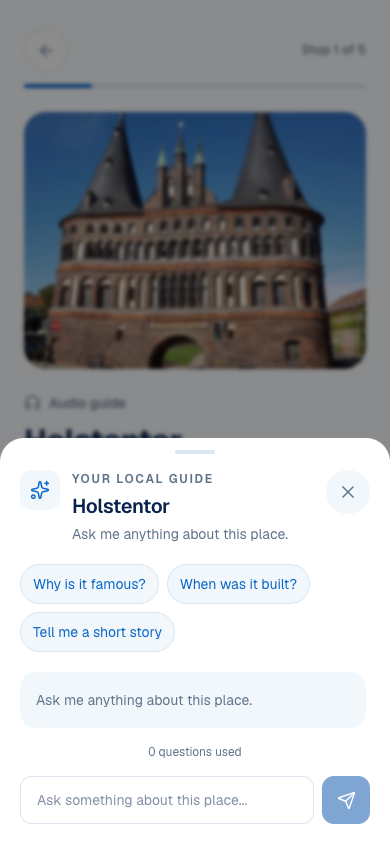
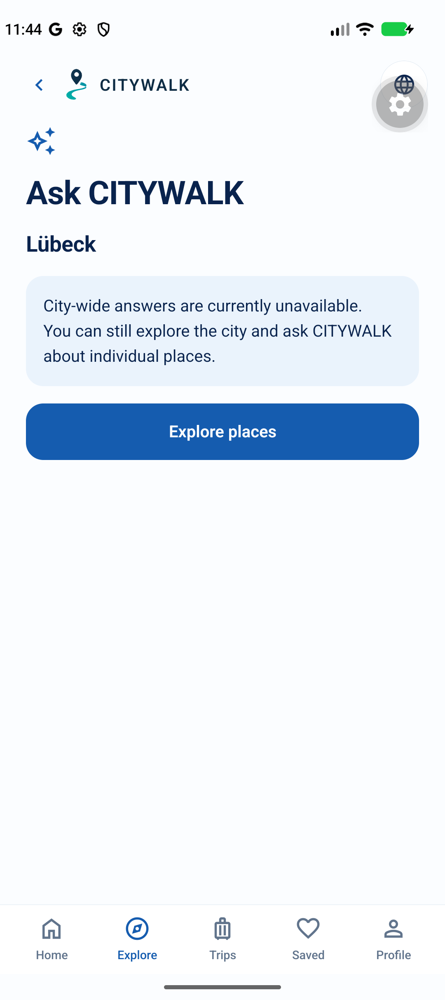

# D10 — Place Guide vs city assistant fallback

**OWNER DECISION: PENDING.** Recommendation below is advisory. OLD/NEW label contracts, not always chronological replacements.

Classification: **Different scope and availability; not duplicate answers**.

## OLD — existing/alternate evidence

`/city/:citySlug/guide/:placeSlug — GuideScreen`

- [mobile/src/app/city/[citySlug]/guide/[placeSlug].tsx](</Users/assia/Documents/GitHub/citywalk-onboarding-global-welcome/mobile/src/app/city/[citySlug]/guide/[placeSlug].tsx>) · [current snapshot](sources/current/mobile/src/app/city/[citySlug]/guide/[placeSlug].tsx.txt) · [baseline 98a1dbbd](sources/base/mobile/src/app/city/[citySlug]/guide/[placeSlug].tsx.txt)

Supplementary archived Web Guide UI; native OLD place-Guide screenshot unavailable. Not proof of live provider responses.

- Verified place eligibility, grounded context, source links, conversation/error/allowance controls.
- Live model/eligibility/device acceptance is conditional; no unconditional city-wide capability.

## NEW — existing/alternate evidence

`/city/:citySlug/assistant — CityAssistantScreen / CityAssistant`

- [mobile/src/app/city/[citySlug]/assistant.tsx](</Users/assia/Documents/GitHub/citywalk-onboarding-global-welcome/mobile/src/app/city/[citySlug]/assistant.tsx>) · [current snapshot](sources/current/mobile/src/app/city/[citySlug]/assistant.tsx.txt) · [baseline 98a1dbbd](sources/base/mobile/src/app/city/[citySlug]/assistant.tsx.txt)
- [mobile/src/lib/cityAssistant.ts](</Users/assia/Documents/GitHub/citywalk-onboarding-global-welcome/mobile/src/lib/cityAssistant.ts>) · [current snapshot](sources/current/mobile/src/lib/cityAssistant.ts.txt) · [baseline 98a1dbbd](sources/base/mobile/src/lib/cityAssistant.ts.txt)

Actual Android city assistant fallback from fixed-Back QA; no working city-wide chat is implied.

- Honest city-wide-unavailable message and Explore places fallback.
- Validated planner-return envelope preserves supported browse return behavior.

## Overlap and recommendation

A fallback is not a second working Guide system. Removing it or supplying a fake place to a city-wide question would violate the current API/trust contract.

**Recommended decision:** KEEP PLACE GUIDE AND HONEST CITY FALLBACK; no new AI capability.

Historical audit advice: KEEP OLD (never an owner selection).

**Owner decision needed:** Confirm the city-wide fallback remains until a separately verified city-scoped backend exists. Should Ask retain its current truthful fallback label/behavior? No provider activation is authorized.

- Guide feature availability/source trust remains conditional.
- Preserve leases and normal Back through Hub; no repeated onboarding.

No application/test edits, consolidation, legacy removal or release authorization. Screen 14 and all D choices remain pending.
