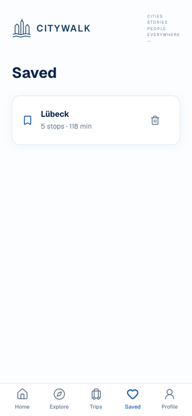

# D11 — Trips vs Saved

**OWNER DECISION: PENDING.** Recommendation below is advisory. OLD/NEW label contracts, not always chronological replacements.

Classification: **Legitimate filtered modes of one controller**.

## OLD — existing/alternate evidence

`/saved — SavedScreen`

- [mobile/src/app/saved.tsx](</Users/assia/Documents/GitHub/citywalk-onboarding-global-welcome/mobile/src/app/saved.tsx>) · [current snapshot](sources/current/mobile/src/app/saved.tsx.txt) · [baseline 98a1dbbd](sources/base/mobile/src/app/saved.tsx.txt)
- [mobile/src/lib/walkStorage.ts](</Users/assia/Documents/GitHub/citywalk-onboarding-global-welcome/mobile/src/lib/walkStorage.ts>) · [current snapshot](sources/current/mobile/src/lib/walkStorage.ts.txt) · [baseline 98a1dbbd](sources/base/mobile/src/lib/walkStorage.ts.txt)

Supplementary archived Web Saved only; native OLD capture unavailable.

- Saved POIs/routes, account/local selection and legacy local trips.
- Saved replay remains separate from resuming current progress.

## NEW — existing/alternate evidence

`/saved?view=trips — same SavedScreen`

- [mobile/src/app/saved.tsx](</Users/assia/Documents/GitHub/citywalk-onboarding-global-welcome/mobile/src/app/saved.tsx>) · [current snapshot](sources/current/mobile/src/app/saved.tsx.txt) · [baseline 98a1dbbd](sources/base/mobile/src/app/saved.tsx.txt)
- [mobile/src/lib/tabNavigation.tsx](</Users/assia/Documents/GitHub/citywalk-onboarding-global-welcome/mobile/src/lib/tabNavigation.tsx>) · [current snapshot](sources/current/mobile/src/lib/tabNavigation.tsx.txt) · [baseline 98a1dbbd](sources/base/mobile/src/lib/tabNavigation.tsx.txt)

**NEW matching screenshot unavailable.** Source/contract evidence is provided; no replacement render is invented.

- Active/completed custom journey history, city filtering and resume/open controls.
- Five-tab labels map to distinct task views; no second SavedScreen implementation.

## Overlap and recommendation

Same source is reused deliberately. Local/account/legacy saved data are distinct scopes, not duplicated stores to erase. Published curated progress is not automatically included.

**Recommended decision:** KEEP BOTH TABS/MODES AND EXISTING STORES; defer migrations and curated Trips inclusion.

Historical audit advice: KEEP OLD (never an owner selection).

**Owner decision needed:** Confirm Trips means execution/history and Saved means bookmarks/replay. Any inclusion of published progress depends on D09/Screen 14; no tab merge now.

- No new approved NEW redesign exists for either mode.
- Native side-by-side Trips/Saved captures still needed before a future visual/navigation change.

No application/test edits, consolidation, legacy removal or release authorization. Screen 14 and all D choices remain pending.
