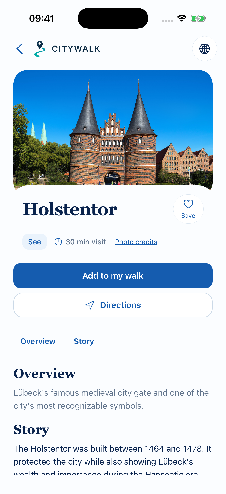

# D14 — Ordinary Place Detail vs published execution mode

**OWNER DECISION: PENDING.** Recommendation below is advisory. OLD/NEW label contracts, not always chronological replacements.

Classification: **Same URL with different intent; candidate mode not approved**.

## OLD — existing/alternate evidence

`/city/:citySlug/place/:placeSlug — PlaceContent`

- [mobile/src/app/city/[citySlug]/place/[placeSlug].tsx](</Users/assia/Documents/GitHub/citywalk-onboarding-global-welcome/mobile/src/app/city/[citySlug]/place/[placeSlug].tsx>) · [current snapshot](sources/current/mobile/src/app/city/[citySlug]/place/[placeSlug].tsx.txt) · [baseline 98a1dbbd](sources/base/mobile/src/app/city/[citySlug]/place/[placeSlug].tsx.txt)

Archived approved native Screen 11; audit capture 28 Oct 2026, 402×874pt. Not a new device acceptance run.

- Approved S11 overview/story, practical information, legal credits, save/add/directions and content-gated audio/nearby.
- Ordinary POI navigation and back to discovery remain intact.

## NEW — existing/alternate evidence

`Same place route + parsed source=published trip context`

- [mobile/src/app/city/[citySlug]/place/[placeSlug].tsx](</Users/assia/Documents/GitHub/citywalk-onboarding-global-welcome/mobile/src/app/city/[citySlug]/place/[placeSlug].tsx>) · [current snapshot](sources/current/mobile/src/app/city/[citySlug]/place/[placeSlug].tsx.txt) · [baseline 98a1dbbd](sources/base/mobile/src/app/city/[citySlug]/place/[placeSlug].tsx.txt)
- [mobile/src/components/PublishedActiveWalk.tsx](</Users/assia/Documents/GitHub/citywalk-onboarding-global-welcome/mobile/src/components/PublishedActiveWalk.tsx>) · [current snapshot](sources/current/mobile/src/components/PublishedActiveWalk.tsx.txt) · No file at baseline commit; current candidate/addition preserved.
- [mobile/src/lib/tripNavigation.ts](</Users/assia/Documents/GitHub/citywalk-onboarding-global-welcome/mobile/src/lib/tripNavigation.ts>) · [current snapshot](sources/current/mobile/src/lib/tripNavigation.ts.txt) · [baseline 98a1dbbd](sources/base/mobile/src/lib/tripNavigation.ts.txt)

Archived published execution candidate14 on the place route; UNAPPROVED.

- PlaceScreen early-returns PublishedActiveWalk for published context.
- Candidate progress-first entry takes precedence; verified tour/stop identities required. Current/selected/ordered-stop Details links already open ordinary S11 without published params.

## Overlap and recommendation

Not a second file route. The published intent initially replaces PlaceContent. Existing Details and stop links already open ordinary Place Detail without published params; Back/return-to-execution remains the review question, not complete loss of all content.

**Recommended decision:** KEEP ORDINARY S11 DEFAULT; DEFER PUBLISHED-MODE FLOW DECISION WITH SCREEN14.

Historical audit advice: REBUILD FLOW (never an owner selection).

**Owner decision needed:** Confirm the existing two-view pattern (progress first, Details opens ordinary S11), or request a separate specification for integrating content. Define Back/return-to-execution and invalid/cold context before any change; the existing Details links must remain.

- Do not infer Screen 14 approval or erase its UI.
- Preserve ordinary S11 content, source/license links and explicit Start boundary.

No application/test edits, consolidation, legacy removal or release authorization. Screen 14 and all D choices remain pending.
