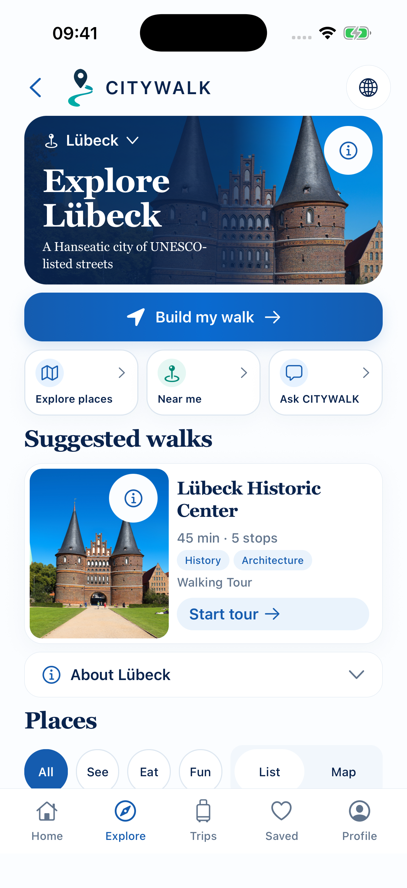

# Review of approved MERGE BEST OF BOTH selections

The owner selections S03/S04/S09/S10/S12 remain MERGE BEST OF BOTH. This is a request to retain exact capabilities, not blanket implementation permission. Approved visuals are frozen. OLD-capability/NEW-presentation composition is already partly or fully present; current status below does not claim a newly completed code merge.

## S03 — Account / Sign-in

Route: `/account?onboarding=1; ordinary /account retained`.

- [mobile/src/app/account/index.tsx](</Users/assia/Documents/GitHub/citywalk-onboarding-global-welcome/mobile/src/app/account/index.tsx>) · [current snapshot](sources/current/mobile/src/app/account/index.tsx.txt) · [baseline 98a1dbbd](sources/base/mobile/src/app/account/index.tsx.txt)
- [mobile/src/components/AccountOnboardingFrame.tsx](</Users/assia/Documents/GitHub/citywalk-onboarding-global-welcome/mobile/src/components/AccountOnboardingFrame.tsx>) · [current snapshot](sources/current/mobile/src/components/AccountOnboardingFrame.tsx.txt) · No file at baseline commit; current candidate/addition preserved.
- [mobile/src/lib/auth/client.ts](</Users/assia/Documents/GitHub/citywalk-onboarding-global-welcome/mobile/src/lib/auth/client.ts>) · [current snapshot](sources/current/mobile/src/lib/auth/client.ts.txt) · [baseline 98a1dbbd](sources/base/mobile/src/lib/auth/client.ts.txt)

### Retain from OLD

- Keep Better Auth, validation/locks, configured OAuth gates, callback/error handling, verification/recovery, deletion/export and account-scoped cleanup.
- Keep signed-in account management, explicit TravelerStyle defaults, entitlements and valid returnToWalk/non-onboarding back semantics.

### Retain from NEW

- Freeze approved AccountOnboardingFrame, editorial Create your account, prominent email, Sign in and reassuring guest Explore Cities.
- Keep localized keyboard/large-text/safe-area behavior.

**Actual current status:** Already composed around one AccountScreen and provider. Retaining these features does not require a second auth screen or a new merge implementation.

### Missing decisions / acceptance

- D02: ordinary guest account entry should use which presentation?
- Live signed-in/provider acceptance remains unverified; no auth feature changes in this review.

Fresh retained legacy presentation on current source, not an exact checkout of baseline.

Fresh 28 October 2026 local native capture; 402×874 point standard iPhone. Language: English. Source hashes in registry.

**Exact specification acceptance: PENDING. No implementation authorized.**

## S04 — Choose a City

Route: `/?section=cities; Home / retained`.

- [mobile/src/app/index.tsx](</Users/assia/Documents/GitHub/citywalk-onboarding-global-welcome/mobile/src/app/index.tsx>) · [current snapshot](sources/current/mobile/src/app/index.tsx.txt) · [baseline 98a1dbbd](sources/base/mobile/src/app/index.tsx.txt)
- [mobile/src/lib/citySelectionCopy.ts](</Users/assia/Documents/GitHub/citywalk-onboarding-global-welcome/mobile/src/lib/citySelectionCopy.ts>) · [current snapshot](sources/current/mobile/src/lib/citySelectionCopy.ts.txt) · No file at baseline commit; current candidate/addition preserved.
- [mobile/src/lib/routing.ts](</Users/assia/Documents/GitHub/citywalk-onboarding-global-welcome/mobile/src/lib/routing.ts>) · [current snapshot](sources/current/mobile/src/lib/routing.ts.txt) · [baseline 98a1dbbd](sources/base/mobile/src/lib/routing.ts.txt)

### Retain from OLD

- Retain Home/catalog loading/retry/search, optional location, available-city gating and original Home/featured entry.
- Preserve existing city/deep-link identity and valid origin/back behavior.

### Retain from NEW

- Freeze approved focused selection layout, city photographs/gradient, availability treatment and accessible credits.
- Keep guest choice and disabled Coming Soon entries.

**Actual current status:** Both entry variants already share HomeScreen/HomeCityCard and city availability. No catalog unification or city activation is needed.

### Missing decisions / acceptance

- D01: launch/returning-user/fallback policy.
- D05: city switch with a mounted draft/current journey; do not discard selections or create a duplicate draft.

Fresh retained legacy presentation on current source, not an exact checkout of baseline.

Fresh 28 October 2026 local native capture; 402×874 point standard iPhone. Language: English. Source hashes in registry.

**Exact specification acceptance: PENDING. No implementation authorized.**

## S09 — City Hub

Route: `/city/:citySlug`.

- [mobile/src/app/city/[citySlug]/index.tsx](</Users/assia/Documents/GitHub/citywalk-onboarding-global-welcome/mobile/src/app/city/[citySlug]/index.tsx>) · [current snapshot](sources/current/mobile/src/app/city/[citySlug]/index.tsx.txt) · [baseline 98a1dbbd](sources/base/mobile/src/app/city/[citySlug]/index.tsx.txt)
- [mobile/src/components/CityHubHero.tsx](</Users/assia/Documents/GitHub/citywalk-onboarding-global-welcome/mobile/src/components/CityHubHero.tsx>) · [current snapshot](sources/current/mobile/src/components/CityHubHero.tsx.txt) · No file at baseline commit; current candidate/addition preserved.
- [mobile/src/lib/cityHubRecommendations.ts](</Users/assia/Documents/GitHub/citywalk-onboarding-global-welcome/mobile/src/lib/cityHubRecommendations.ts>) · [current snapshot](sources/current/mobile/src/lib/cityHubRecommendations.ts.txt) · No file at baseline commit; current candidate/addition preserved.
- [mobile/src/lib/publishedRouteTiming.ts](</Users/assia/Documents/GitHub/citywalk-onboarding-global-welcome/mobile/src/lib/publishedRouteTiming.ts>) · [current snapshot](sources/current/mobile/src/lib/publishedRouteTiming.ts.txt) · No file at baseline commit; current candidate/addition preserved.

### Retain from OLD

- Retain published routes/POIs, city availability/recovery, optional Near me, filters/List-Map and supported Add actions.
- Retain current/saved-walk distinction and now-implemented validated Slice02 planner-return lease, guarded storage revalidation and fixed Android Back.
- Keep honest city assistant fallback and account-scoped recommendation ranking.

### Retain from NEW

- Freeze approved header/logo, cinematic dynamic-city hero, Build my walk, three Quick Actions and compact Suggested Walks.
- Retain About/Places, authentic photos/credits, real metadata/themes and five-tab architecture.

**Actual current status:** Approved premium UI already wraps existing city data/actions. The old plan’s S08 handoff wording is superseded by implemented Slice02/focus guard, which must stay frozen.

### Missing decisions / acceptance

- D07: collection entry placement, no automatic visual change.
- D03: guest draft interests are not current Hub recommendation input.
- Timing: Hub raw45-minute publisher estimate conflicts with S13 visit-only120/unknown walking-total semantics. Approve a consistent copy/filter policy before changes.

**OLD matching screenshot unavailable.** Source/contract evidence is provided; no replacement render is invented.

Fresh 28 October 2026 local native capture; 402×874 point standard iPhone. Language: English. Source hashes in registry.

**Exact specification acceptance: PENDING. No implementation authorized.**

## S10 — Explore Places

Route: `/city/:citySlug/explore → /city/:citySlug/search`.

- [mobile/src/app/city/[citySlug]/explore.tsx](</Users/assia/Documents/GitHub/citywalk-onboarding-global-welcome/mobile/src/app/city/[citySlug]/explore.tsx>) · [current snapshot](sources/current/mobile/src/app/city/[citySlug]/explore.tsx.txt) · [baseline 98a1dbbd](sources/base/mobile/src/app/city/[citySlug]/explore.tsx.txt)
- [mobile/src/app/city/[citySlug]/search.tsx](</Users/assia/Documents/GitHub/citywalk-onboarding-global-welcome/mobile/src/app/city/[citySlug]/search.tsx>) · [current snapshot](sources/current/mobile/src/app/city/[citySlug]/search.tsx.txt) · [baseline 98a1dbbd](sources/base/mobile/src/app/city/[citySlug]/search.tsx.txt)
- [mobile/src/lib/searchHistory.ts](</Users/assia/Documents/GitHub/citywalk-onboarding-global-welcome/mobile/src/lib/searchHistory.ts>) · [current snapshot](sources/current/mobile/src/lib/searchHistory.ts.txt) · [baseline 98a1dbbd](sources/base/mobile/src/lib/searchHistory.ts.txt)
- [mobile/src/lib/explorePhotography.ts](</Users/assia/Documents/GitHub/citywalk-onboarding-global-welcome/mobile/src/lib/explorePhotography.ts>) · [current snapshot](sources/current/mobile/src/lib/explorePhotography.ts.txt) · No file at baseline commit; current candidate/addition preserved.

### Retain from OLD

- Retain real city POIs, categories, List/Map and place identity/navigation crash regression.
- Preserve dedicated Search: city-scoped recently opened POIs, clear history,12 query results/6 suggestions; preserve current result rules unless explicitly changed.
- Preserve guest favorite storage/recovery/locking and distinct Add/Remove-to-Walk contracts.

### Retain from NEW

- Freeze approved compact navy header/logo, premium POI hierarchy and distinct accessible Favorite/Add controls.
- Retain verified place photos, honest placeholders, central legal credits plus license-specific adjacent exceptions.

**Actual current status:** Premium Explore remains on the existing city/POI/search/save architecture. No Search rewrite or storage migration is implied.

### Missing decisions / acceptance

- D06: retain dedicated Search initially? Should filter/map/query state cross Hub and Explore or reset intentionally?
- Photo audit backlog:20 missing and4 unverified legacy images from existing evidence; no new photo audit/provider work or unrelated replacements performed.

**OLD matching screenshot unavailable.** Source/contract evidence is provided; no replacement render is invented.

Fresh 28 October 2026 local native capture; 402×874 point standard iPhone. Language: English. Source hashes in registry.

**Exact specification acceptance: PENDING. No implementation authorized.**

## S12 — Walking Routes

Route: `/city/:citySlug/routes → /city/:citySlug/tour/:tourSlug`.

- [mobile/src/app/city/[citySlug]/routes.tsx](</Users/assia/Documents/GitHub/citywalk-onboarding-global-welcome/mobile/src/app/city/[citySlug]/routes.tsx>) · [current snapshot](sources/current/mobile/src/app/city/[citySlug]/routes.tsx.txt) · [baseline 98a1dbbd](sources/base/mobile/src/app/city/[citySlug]/routes.tsx.txt)
- [mobile/src/lib/publishedRoutes.ts](</Users/assia/Documents/GitHub/citywalk-onboarding-global-welcome/mobile/src/lib/publishedRoutes.ts>) · [current snapshot](sources/current/mobile/src/lib/publishedRoutes.ts.txt) · No file at baseline commit; current candidate/addition preserved.
- [mobile/src/lib/publishedRouteTiming.ts](</Users/assia/Documents/GitHub/citywalk-onboarding-global-welcome/mobile/src/lib/publishedRouteTiming.ts>) · [current snapshot](sources/current/mobile/src/lib/publishedRouteTiming.ts.txt) · No file at baseline commit; current candidate/addition preserved.
- [mobile/src/app/city/[citySlug]/tour/[tourSlug].tsx](</Users/assia/Documents/GitHub/citywalk-onboarding-global-welcome/mobile/src/app/city/[citySlug]/tour/[tourSlug].tsx>) · [current snapshot](sources/current/mobile/src/app/city/[citySlug]/tour/[tourSlug].tsx.txt) · [baseline 98a1dbbd](sources/base/mobile/src/app/city/[citySlug]/tour/[tourSlug].tsx.txt)

### Retain from OLD

- Retain published-tour source, identities, full ordered stop graph, availability/guest gates and preview navigation.
- Retain embedded Hub entry and builder/Saved/Hub exits; do not create another route catalog or unsupported curated Save action.

### Retain from NEW

- Freeze approved editorial collection/cards, real photos/themes/stop counts, accessibility and empty/loading/error states.
- Keep approved duration-control layout; semantics require an explicit owner decision before changing copy/filter behavior.

**Actual current status:** Dedicated collection already exists. filterPublishedRoutes still compares raw estimatedDurationMinutes to budgets; publishedRouteTiming only distinguishes visits/unknown scope in S13. No corrected time is verified.

### Missing decisions / acceptance

- D07: decide collection entry without changing tabs or approved S09 by implication.
- Approve preferred interim semantics: consistent visit-only time + unknown walking/total, with unscoped totals excluded from timed full-experience matching (disable/explain controls if none qualify). Alternative requires verified publisher scope first.
- D08/D09: keep editorial execution and custom adaptation distinct; Screen 14 pending.

**OLD matching screenshot unavailable.** Source/contract evidence is provided; no replacement render is invented.

Fresh 28 October 2026 local native capture; 402×874 point standard iPhone. Language: English. Source hashes in registry.

**Exact specification acceptance: PENDING. No implementation authorized.**

