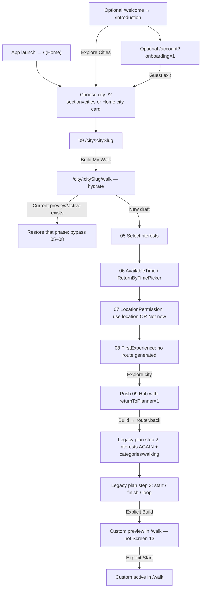
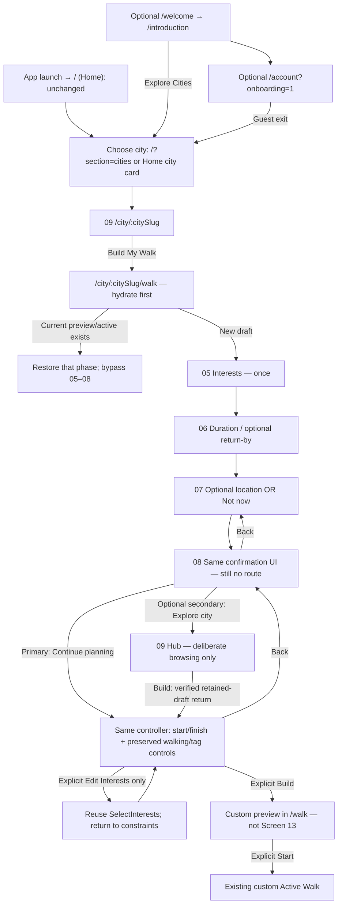

# Screen 08 — OLD vs PROPOSED flow review gate

**28 October 2026 · OWNER FLOW APPROVAL: PENDING · IMPLEMENTATION: NOT AUTHORIZED**

Scope: only the Screen 08 journey and its necessary entry/exit/state dependencies. “OLD” below means the **currently implemented approved-design flow**, not an invented pre-redesign screen. “PROPOSED” is a specification, not working code or a new simulator build. Original screens, worksheet, audit, previous plans, branches and worktrees are preserved. S01–S13 keep their official IDs. All D01–D14 and Screen 14 remain pending.

Source: `/Users/assia/Documents/GitHub/citywalk-onboarding-global-welcome`; branch `codex/onboarding-global-welcome`; base `98a1dbbda17f945a0d982eb6dbc36713bad61617` plus preexisting uncommitted work. Fresh read-only source checks are identified in `source-evidence.json`. No new remote CI, runtime, deployment or device acceptance is claimed.

## Decision in one sentence

**Keep Screen 08, make its primary action “Continue planning,” and continue in the existing city-scoped builder without a mandatory second Hub visit or another interests question. Keep “Explore {city}” as an optional browsing exit.** This requires explicit owner flow/copy approval; it is not implemented.

## Side-by-side behavior

| Journey point | OLD — current implementation | PROPOSED — pending owner approval |
|---|---|---|
| App launch / guest entry | Normal launch is / (Home). /welcome is an explicit review/deep-link/fallback entry; /introduction Next opens optional /account?onboarding=1. Explore Cities exits to /?section=cities. | Unchanged. No forced authentication, new launch gate or automatic eight-screen wizard. D01 launch policy stays pending. |
| City selection | HomeScreen / HomeCityCard opens /city/[citySlug] for an available city; unavailable cities are disabled. | Unchanged. Selected city is route context, never a global Lübeck default. |
| Build My Walk | CityScreen links /city/[citySlug]/walk; WalkScreen loads real city data and NativeWalkFlow hydrates current/saved state first. | Same route/data/controller. Existing journey restoration has priority over new-draft introductory states. |
| Interests / time | 05 uses controller interests; Continue or Skip → 06. AvailableTime sets minutes; ReturnByTimePicker sets returnBy. Time Skip keeps current/default minutes. | Same existing S05/S06 UI and Skip semantics. No second mandatory interests grid later. Do not auto-save per-walk minutes as account defaults. |
| Optional location | 07 requests only on explicit Use my location. Success → 08; Not now → 08; denied/error remains recoverable and can use Not now. | Same permission handler and manual fallback. No automatic request on 08, no GPS requirement. |
| 08 completion | FirstExperience onExplore sets firstExperienceComplete and pushes /city/[citySlug]?returnToPlanner=1. No route has been generated. | Retain confirmation UI. Proposed primary Continue planning advances same mounted controller directly to remaining constraints. Completion means settings-entry handoff only, not route creation or walk completion. |
| Continue planning | Second Hub Build goes router.back when a back stack exists; legacy step 2 repeats interests, then step 3 asks start/finish. | No mandatory Hub push on primary, and no unconditional legacy interests step. Preserve walking pace/category tags alongside existing start/end/loop controls. Owner must approve their placement. |
| Optional browsing | Only primary 08 action sends user out to Hub. | Explicit secondary Explore {city} keeps city browsing available. Only this voluntary branch visits Hub; Build resumes a verified retained draft if one exists. |
| Build / Start | Remaining constraints → explicit Build → custom /walk preview; explicit Start begins custom execution. | Unchanged separation. S08 never calls generation/persistCurrentWalk/start. Published Screen 13 is a different route/domain and is not this custom preview. |
| Back / drafts | 08 Back clears location-entry completion; step-based Back from legacy step 3 returns to repeated interests. Mounted state can survive the Hub detour; no unbuilt draft storage. | Explicit Back transitions: constraints → 08 → 07 → 06 → 05 → valid origin/selected-city Hub. Retain values while mounted. Process-death restoration of unbuilt drafts is NOT promised. |
| Existing walk | CurrentWalk restores preview/active phase. Explicit saved route opens via saved/source params and reopenSavedWalk to a new preview session. | Preserve both behaviors and bypass 05–08. No current walk is cleared/rebuilt merely to display 08. New-walk/rebuild remains explicit and separately confirmed. |

## OLD navigation

## PROPOSED navigation

The story/value screens also have direct guest-discovery exits; they are optional entry routes, not a prerequisite for the normal Home path. Their launch behavior is deliberately unchanged here.

## Exact route and component registry for this review

| Design / responsibility | Existing route | Existing component / exact source |
|---|---|---|
| Launch / Home / 04 selection | `/`; `/?section=cities` | `HomeScreen`, `HomeCityCard(size="selection")` — `mobile/src/app/index.tsx`; Stack in `mobile/src/app/_layout.tsx` |
| 01 / 02 | `/welcome`; `/introduction` | `WelcomeScreen` / `IntroductionScreen` — `mobile/src/app/welcome.tsx`, `introduction.tsx` |
| Optional 03 | `/account?onboarding=1` | `AccountScreen` + `AccountOnboardingFrame` — `mobile/src/app/account/index.tsx`; existing Better Auth |
| 09 / Build | `/city/[citySlug]` → `/city/[citySlug]/walk` | `CityScreen` — `mobile/src/app/city/[citySlug]/index.tsx`; `WalkScreen` — `.../walk.tsx` |
| 05 | Internal `/walk`, `stage=plan`, `step=1`, interests entry incomplete | `SelectInterests` — `mobile/src/components/SelectInterests.tsx`, owned by `NativeWalkFlow.tsx` |
| 06 | Same route/stage/step, interests entry complete | `AvailableTime`, `ReturnByTimePicker` — `mobile/src/components/AvailableTime.tsx`, `ReturnByTimePicker.tsx` |
| 07 | Same route, `stage=plan`, `step=2`, location entry incomplete | `LocationPermission` — `mobile/src/components/LocationPermission.tsx`; existing controller `locate` handler |
| 08 | Same route/stage/step, location entry complete, first experience incomplete | `FirstExperience` — `mobile/src/components/FirstExperience.tsx` |
| Legacy interests / walking / tags | Same route, current legacy planning `step=2` | `NativeWalkFlow.tsx` generic body; `WalkChoices`; no new route |
| Existing start / end / loop | Same route, current legacy planning `step=3` | `NativeWalkFlow.tsx` generic body; no new route |
| Custom preview / execution | Same `/city/[citySlug]/walk`, `stage=preview` / `active` | `NativeWalkFlow`, `CurrentWalk`, `WalkJourney`; not numbered published Screen 13 |
| Published preview — excluded | `/city/[citySlug]/tour/[tourSlug]` | `TourScreen` / `RoutePreview`; published-trip place context / unapproved Screen 14 stays separate |

05–08 are **controller states within one route**. No `/screen08`, `/first-experience` or second planner is proposed. Dynamic city path templates above are actual Expo Router templates; screenshots use available Lübeck only as a concrete instance.

## Proposed entry, completion, exit and Back rules

### Normal new draft

1. Hub Build opens the existing `/walk` route; hydration resolves before showing settings.
2. If no current/saved journey is being opened, 05 → 06 → 07 → 08 uses the existing `interests`, `minutes`, `returnBy`, `walking`, `categories`, start/end and optional GPS state.
3. At 08, the primary EN **Continue planning** / DE **Planung fortsetzen** advances to the remaining constraints in that same controller. Preserve the approved imagery, title, city context and honest no-route-created meaning.
4. Retain old category/walking choices and manual/GPS start, anywhere/loop/destination finish controls. Move these meaningful controls into the remaining configuration composition; their exact layout is a technical/design dependency, not permission to drop them or visually change approved S05–S07.
5. Show interests already chosen as a summary with an **explicit Edit Interests** action if needed. Do not render the old interests grid automatically. Edit reuses SelectInterests; Continue/Skip returns to configuration through a transient return target in the same controller. No new settings store. An edit's Back returns to configuration retaining current values; no unimplemented “Cancel restores previous values” promise.
6. Only the existing explicit Build invokes shared planning and persists preview. Only existing explicit Start transitions to execution.

### Optional city browsing

Secondary EN **Explore {city}** / DE **{city} entdecken** opens the selected-city Hub with the current supported `returnToPlanner=1` intent while the draft remains mounted. On this deliberate branch, Hub Build may return to **that exact city draft's constraints**; it must not restart 05 or push another draft. An unrelated back destination is not proof of a retained planner: `router.canGoBack()` alone is insufficient. Validate actual origin/route identity, otherwise use ordinary `/walk` hydration and tell no restoration story beyond what exists.

The optional branch can still visit Hub. The proposal removes **mandatory** detours; it does not remove city discovery or pretend there will never be a Hub revisit.

### Proposed Back targets

| From | Proposed destination | Retained state / guard |
|---|---|---|
| Remaining constraints | 08 in same mounted flow | Keep all settings; no Build or reset |
| 08 | 07 | Keep selections and current location result; no permission revoke/request |
| 07 | 06 | Keep deadline/time/interests; invalidate late in-flight location result |
| 06 | 05 | Keep selections; preserve restored time/picker value |
| 05, normal draft | Valid originating discovery/Hub, else selected-city Hub | Never assume `/welcome` or globally hardcode city |
| 05, explicit edit from constraints | Constraints | Explicit edit return target; do not replay time/location/confirmation |
| Optional browse Hub | Native Back to retained draft when valid | Same city/controller; no fabricated restore if unmounted |
| Direct `/walk` with no native Back destination | Existing selected-city Hub fallback | Deterministic manual discovery; no account gate |

Android hardware Back, on-screen Back and any enabled native iOS gesture must agree. Current numeric-step handlers do **not** implement all these targets; they must be deliberately revised only after approval. In-flight location attempts already have an attempt token; keep that cancellation/late-result protection.

## Existing walk and restoration decision table

| Situation | Current contract / fact | Proposed treatment |
|---|---|---|
| Valid current preview in selected city | `loadCurrentWalk(citySlug)` returns `{journey, phase:"preview"}` | Resume preview, skip 05–08; never auto-start |
| Valid current active in selected city | Same function returns active phase; legacy missing phase falls back to active | Resume existing execution using current acceptance rules, skip 05–08; do not route through confirmation |
| Saved local/account route explicitly opened | `/walk?saved=<id>`; optional `source=account`; `reopenSavedWalk` creates a fresh session ID, resets visited/progress, clears `finishedAt` and prior deadline; persists a **preview** | Preserve saved-route replay semantics and original saved record. This is NOT continuation of its old active execution. No new 05–08; no claim the old return-by survives |
| Add-place route intent | `/walk?add=<placeSlug>`; existing hydration/proposal logic | Preserve existing add-to-walk behavior and eligibility checks; no unrelated first-experience gate |
| Current walk belongs to another city | Storage is city-scoped: `citywalk:native:v2:active:${city}` | Do not load or mutate that other-city journey; keep city switching explicit |
| Completed current record | `loadCurrentWalk` rejects records with `finishedAt` | Do not resurrect completion as active. A completed saved route can only reopen via its existing explicit saved action |
| Explicit new walk/rebuild while one exists | Existing `requestRebuild` / confirmation / `rebuild` protects the current journey | Preserve explicit confirmation and compare-and-clear behavior. Never clear current walk merely to display 05–08 |
| App process dies before Build | No durable unbuilt-draft contract exists | Session-only limitation stays honest: restore built CurrentWalk if present, otherwise start a new draft; do not claim restored unsaved settings |
| Optional browse stack is gone / cold Hub link | `returnToPlanner=1` is an intent, not storage | Fall back to ordinary city-scoped hydration; do not call Back to an arbitrary origin |
| Invalid data / missing stops / storage failure | Current reads may return no record for invalid JSON/schema, or throw; current hydration can fall back to plan with feedback. Preview and active eligibility guards are not identical | **Missing-state dependency:** define distinguishable recoverable failure versus genuinely no journey before promising safe no-overwrite restoration. Proposed Retry / Explore recovery and explicit restart need acceptance; no new storage format or fix is implemented here |

## How the two problems are prevented

- **Repeated interests:** the primary path has exactly one mandatory interests entry, S05. The old generic step-2 grid is no longer the automatic destination after 08. Walking pace/custom tags survive as separate meaningful configuration; deliberate Edit Interests is the only return to the same grid. Skipping 05 still means an empty canonical selection, not silently restoring default interests later.
- **Hub detour:** primary 08 transitions in the controller, without `router.push` to Hub. The user does not have to press Build My Walk twice. Only an intentional secondary browse action uses Hub and the existing return intent.
- **No premature route:** S08 completion sets only view/transition state. It does not create a `WalkJourney`, call `persistCurrentWalk`, generate a route or start navigation.

## Existing contracts and exact technical dependencies

| Existing boundary | Exact source / contract | Dependency or missing state to resolve |
|---|---|---|
| Presentation/controller | `FirstExperience({citySlug,cityName,cityMedia,onBack,onExplore})`; `NativeWalkFlow` | Current component has no primary planning callback or secondary action. A proposed `onContinue` callback/copy and footer layout are **new interface work**, not an existing capability. Native visual review is required after any future authorization. |
| Internal phases | NativeWalkFlow `stage`, `step`, `interestEntryComplete`, `locationEntryComplete`, `firstExperienceComplete`; `savedId`, `addSlug`, `journey`, `buildError` guards | Numeric `setStep(3)` alone would bypass retained walking/tags and give wrong Back behavior. Need an explicit continuation/edit return target within the existing controller, not a second state-management system. |
| Planner inputs | `packages/traveler-core/src/walkPlanner.ts`: `Interest`, `WalkSettings`, `Point`; actual existing build functions | Preserve interests/minutes/walking/start/deadline/finish/category effects and real eligibility. No new interest taxonomy, transport return model or API. Return-by remains walking-estimate based, not verified street ETA. |
| Account defaults | `mobile/src/lib/travelerStyle.ts`: account-scoped `TravelerStyle` | Account duration values 60/90/120/180 differ from 60/120/180/240 planner cards; hydrated 90 must remain. Do not write a 240 draft into that account contract or use defaults as durable guest draft storage. |
| Current/saved state | `mobile/src/lib/walkStorage.ts`: `CurrentWalk`, `loadCurrentWalk`, `persistCurrentWalk`, `subscribeCurrentWalk`, `reopenSavedWalk` | Keep current resume versus saved replay semantics, failures, concurrency and publication/eligibility recovery distinct. No automatic migration or namespace reuse for draft persistence. |
| Permission | Existing `NativeWalkFlow.locate`, `requestForegroundLocation`, `locationEntryAttempt`, `LocationPermission` | Busy/error/denied/no fix, Not now, Back during request and late fix after skip need deterministic tests. No background permission added. |
| Hub return | `CityScreen` handler for `returnToPlanner=1`; `/walk` route identity | Existing check is only intent + `canGoBack`; matching retained planner identity/city needs stronger proof. Tab changes and multiple Hub instances are missing cases, not implicitly solved. |
| Content / lifecycle | `WalkScreen` public city loading/error/previous-locale data behavior; `FirstExperience` availability gate | Loading/offline/empty eligible catalog, city becoming unavailable, removed stops, locale change and unmount must preserve honest states. No route generation from stale/ineligible input. |
| Back / a11y / gestures | Existing Screen back callback, Android BackHandler; EN/DE copy; safe-area footer | All Back entry modes and large-text second action must fit/scroll. No evidence yet for the proposed layout, physical VoiceOver/TalkBack or Android device acceptance. |

## Proposed acceptance scenarios — none executed for a new implementation

1. Guest from `/` or optional Welcome/account exit selects an available city and completes 05 → 06 → 07 Not now → 08 → primary → constraints, without a second Hub visit or repeated interests.
2. Permission grant, denial, no fix, skip-while-locating and Back-while-locating retain correct state; no automatic prompt at 08.
3. All explicit Back targets above preserve selection/time/deadline/location; Edit Interests returns to constraints once rather than looping through 06–08.
4. Secondary browse → Hub Build resumes the matching session draft; invalid/missing stack falls back honestly. Repeated taps do not create duplicate draft/Hub entries.
5. Current preview/active, saved local/account replay, add-place, completed record and city switch behave according to the restoration table. No current/saved record is silently overwritten.
6. App restart never claims unbuilt-draft recovery. Deadline expiry while browsing and crossing midnight must use existing future-today validation; do not silently reinterpret an old HH:MM as tomorrow.
7. No eligible places or content/storage failure presents recoverable feedback; no false route success. Only explicit Build then explicit Start can reach custom execution.
8. EN/DE standard/small iPhone, Android Back/layout, large text, safe areas and keyboard/time-picker controls require actual future evidence. Preserve approved screenshots of other screens.

Existing tests to extend after authorization: `mobile/tests/first-experience.test.tsx`, `walk-flow.behavior.tsx`, `city-hub-actions.test.tsx`, `location-permission.test.tsx`, `select-interests.test.tsx`, `available-time.test.tsx`, `return-by-picker.test.tsx` and saved/current storage regressions. Tests/builds are not run for a nonexistent proposed implementation.

## Current UI reference — not a proposed implementation screenshot

The approved S08 composition stays. This archived audit capture shows the **current Explore city primary only**; it does not depict the proposed Continue planning or secondary footer. No new UI mock is being passed off as implemented.

## Explicit owner approval gate

**PENDING. Please approve or revise the Screen 08 flow specification on these four points:**

1. Primary “Continue planning / Planung fortsetzen” → existing remaining builder constraints, preserving the approved confirmation UI.
2. Secondary “Explore {city} / {city} entdecken” as an optional Hub exit with validated session-draft resume.
3. One automatic interests entry only; preserve walking/tags/start/end and use explicit Edit Interests with the Back targets above.
4. Preserve session-only unbuilt drafts and existing current/saved semantics; durable drafts, recovery-contract changes and broader D-group consolidation require separately scoped decisions.

Approval of this flow document alone must not be interpreted as implementation authorization unless the owner explicitly says so. D01–D14 and Screen 14 remain pending. No application code, merge, deletion, commit, push or deployment has occurred.
