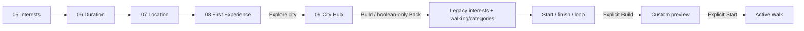
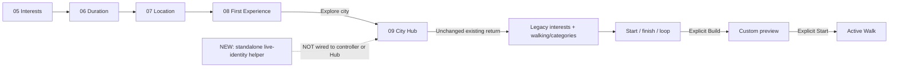

# Before / after Slice 01

The approved future UX is preserved as a specification. **The actual user-facing flow is unchanged by this helper-only slice.**

## Before — current application

## After Slice 01 — current application

## New helper lifecycle — implemented and tested

```mermaid
stateDiagram-v2
 [*] --> Empty: fresh JS runtime
 Empty --> Ready: publish valid new-draft constraints metadata
 Ready --> Ready: replace same route key with new mount token
 Ready --> Ready: stale-token revoke ignored
 Ready --> Empty: matching-token revoke or orphan reconciliation
 Ready --> Target: resolve fresh focused owning stack + exact envelope/key/city/scope/token
 Ready --> Reject: malformed/missing/mismatched/stale/unfocused state
 Empty --> Reject: serialized params without live lease
 Target --> Ready: return pop description only; no dispatch or data mutation
 Reject --> Ready: live lease remains until explicit lifecycle cleanup
```

A resolver result is not a navigation action, persistence observation or restoration guarantee. Reconciliation requires a complete live-route-key inventory across owning stacks; undefined/invalid inventory does not clear leases. Capacity is 32; overflow rejects new keys without evicting live drafts.

## Approved future flow — NOT implemented in Slice 01

08 Continue Planning → remaining constraints; Back: constraints → 08 → location → duration → interests. Explicit Edit Interests returns to constraints. Optional city browsing uses a live committed lease and revalidated owning-stack pop. Existing current walk resumes; saved route opens a fresh preview session. Only Build creates a preview; only Start starts execution. All values remain in NativeWalkFlow, not the lease.
