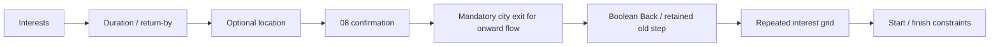
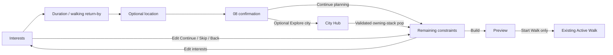

# Screen 08 Slice 02 — implementation and verification

**29 October 2026 · Local implementation verified · Native acceptance PARTIAL · No commit/push/merge/deployment**

Screen 08 now continues directly into remaining planner constraints. Interests are revisited only through explicit Back or Edit. The optional city exit retains the mounted draft, and City Hub Build returns through a validated native stack pop. The storage receipt is independent from the navigation lease. Existing current walks and saved replay keep separate storage/execution contracts.

Worktree: `/Users/assia/Documents/GitHub/citywalk-onboarding-global-welcome`; branch `codex/onboarding-global-welcome`; HEAD `98a1dbbda17f945a0d982eb6dbc36713bad61617` plus the recorded dirty source. Mobile Core: iOS/Android implementation; Public Web/Admin Web: not applicable. No backend, schema, authentication, payment or infrastructure change. Source hashes, rather than HEAD alone, identify this candidate.

## Exact production boundary — seven files

| File | Change |
|---|---|
| [walk.tsx](/Users/assia/Documents/GitHub/citywalk-onboarding-global-welcome/mobile/src/app/city/[citySlug]/walk.tsx) | Source-aware scope key and actual native route key/navigation port. |
| [NativeWalkFlow.tsx](/Users/assia/Documents/GitHub/citywalk-onboarding-global-welcome/mobile/src/components/NativeWalkFlow.tsx) | Single new-draft cursor; retained Back/Edit; direct constraints; browse lease lifecycle; focus recovery; legacy controls reused. |
| [FirstExperience.tsx](/Users/assia/Documents/GitHub/citywalk-onboarding-global-welcome/mobile/src/components/FirstExperience.tsx) | Two independent footer actions only; approved editorial body/styles retained. |
| [firstExperienceCopy.ts](/Users/assia/Documents/GitHub/citywalk-onboarding-global-welcome/mobile/src/lib/firstExperienceCopy.ts) | Typed Continue Planning label in all seven locales. |
| [index.tsx](/Users/assia/Documents/GitHub/citywalk-onboarding-global-welcome/mobile/src/app/city/[citySlug]/index.tsx) | Real focused owning-stack adapter; immediate revalidation; exact targeted pop; boolean Back removed; complete assistant context. |
| [assistant.tsx](/Users/assia/Documents/GitHub/citywalk-onboarding-global-welcome/mobile/src/app/city/[citySlug]/assistant.tsx) | Complete parsed envelope; invalid source/retained Hub params cleared through native SET_PARAMS before existing dismiss fallback. |
| [plannerNavigationCopy.ts](/Users/assia/Documents/GitHub/citywalk-onboarding-global-welcome/mobile/src/lib/plannerNavigationCopy.ts) | New small exhaustive Edit Interests copy; no state/domain ownership. |

Tests changed (six files; no new test file):

- [native-v2-regressions.test.tsx](/Users/assia/Documents/GitHub/citywalk-onboarding-global-welcome/mobile/tests/native-v2-regressions.test.tsx)
- [city-hub-editorial-v1.test.ts](/Users/assia/Documents/GitHub/citywalk-onboarding-global-welcome/mobile/tests/city-hub-editorial-v1.test.ts)
- [membership-screens.test.tsx](/Users/assia/Documents/GitHub/citywalk-onboarding-global-welcome/mobile/tests/membership-screens.test.tsx)
- [first-experience.test.tsx](/Users/assia/Documents/GitHub/citywalk-onboarding-global-welcome/mobile/tests/first-experience.test.tsx)
- [walk-flow.behavior.tsx](/Users/assia/Documents/GitHub/citywalk-onboarding-global-welcome/mobile/tests/walk-flow.behavior.tsx)
- [city-hub-actions.test.tsx](/Users/assia/Documents/GitHub/citywalk-onboarding-global-welcome/mobile/tests/city-hub-actions.test.tsx)

The membership fixture adds native hook doubles only; all membership assertions remain. The helper and its public contract/tests, walkStorage, all other production files/assets and lockfiles remain frozen. [Exact changed files](changed-files.json), [final source hashes](source-final.json), [preservation audit](assertion-and-visual-preservation.json).

## State transitions and retained values

Before:

After:

Normal internal Back is constraints → 08 → location → duration → interests. Edit has its own return target, so Continue/Skip/Back from Edit returns directly to constraints. Values remain owned by NativeWalkFlow: interests, duration, walking return-by, walking preference, dynamic categories, manual/GPS start, finish/loop/destination. The existing components and shared planner remain in use. No selection is serialized into a URL, lease or persistent draft.

New mode initializes only through the healthy new-planner hydration path; it is separate from existing current, saved replay, add and Customize. Explicit current preview/active hydration bypasses 05–08. Customize retains the legacy planner controls. Saved replay still creates a new preview execution only through the guarded replay path; it cannot silently overwrite another current walk. Only explicit Build generates from unbuilt settings; explicit saved-open replay remains its separate preexisting preview path. Only Start executes a walk.

## Lease and storage contract

The route wrapper uses normalized city/saved/account-source/add identity and passes the actual Expo native route key. Locale and return markers do not remount the controller. A per-controller token is issued once. Optional Explore reserves one ticket, commits constraints, publishes the frozen helper's metadata lease, then pushes one Hub. Duplicate taps cannot push a second Hub.

Hub return validates the full five-field envelope, live lease, city, focused final owning stack and exact controller key/scope. The adapter resolves again immediately before one synchronous `POP` addressed to the owning stack/source. It consumes the matching lease on use; controller cleanup revokes on mode/readiness/content/recovery/unmount changes. A supported blur retains the lease; focus return consumes stale browse readiness and checks storage. There is no unsafe child-stack reconciliation: leases are cleaned up by controller ownership rather than feeding an incomplete live-key inventory to the helper.

A focus read diagnoses current/corrupt/unavailable conditions without re-running hydration, replaying a saved route, applying defaults, or replacing the original receipt. Same-kind/different-byte changes are still rejected by guarded Build. Tests explicitly prove that an observed JSON `null` cannot freshen the original missing-key receipt. Explicit Retry uses existing recovery; a new draft stays on its cursor/constraints, while legacy recovery retains its existing step-one behavior. Read errors are never treated as absence. Storage remains single-runtime queued compare/write, not cross-process CAS or durable unsaved drafts.

## Approved assertion migrations

B01–B05 were implemented as reviewed: exact owning-stack dispatch instead of global boolean Back; full five-field Hub/Guide URLs; existing dismiss assertion retained; source-spelling contract replaced by the real valid/invalid Hub/adapter tests. Positive, negative and same-city forged/cold/inactive cases remain. The B01 three parameter rows remain, with the positive row now publishing a real helper lease; the bare-boolean positive interpretation is tested as rejection in I03.

The owner additionally approved **three retained-interest assertion replacements in two cases** during this turn. Those now enter Edit explicitly, assert the same selected/empty states, then assert the actual generated WalkSettings. [Additional original contexts](additional-assertions-before.txt) are retained. No other original assertion was weakened or removed. Against the prior 318-assertion baseline, **314 remain exact**, with four changed chains consisting only of B02 and those three newly approved replacements. B01/B03/B04/B05 are separately identified in the gate inventory; stronger runtime coverage replaces their obsolete contracts. Journey-driving test actions changed to the approved direct flow; native fixture updates do not implement fake planner behavior.

Eight expected-failure variants across T01/T02/T05/I02/I03/I08/A01 are now ordinary passes. D03 remains expected failure. Nineteen new ordinary cases cover the native adapter, invalid merged params, direct guest/authenticated constraints, all control settings, Edit exits, browse registration/double tap, focus recovery, locale/account refresh and original-receipt preservation.

## Automated verification — final source

| Check | Actual result |
|---|---|
| Full mobile `npm run test:run --prefix mobile` | **1,066 ordinary passes + 1 expected failure + 17 TODO = 1,084; zero unexpected failures**. Framework JSON reports 1,067 passed including its expected-failure wrapper; this report excludes that wrapper from functionality passes. |
| Strict-red walk-flow run | Exit 1 as expected: **only D03 midnight** fails as an ordinary assertion. No navigation failure remains. |
| `npm run typecheck --prefix mobile` | PASS |
| `npm run lint --prefix mobile` | PASS, zero warnings |
| `npm run i18n:check --prefix mobile` | PASS; seven locales, 681 shared UI keys each; new native copy has exhaustive NativeLocale typing |
| `npx expo export --platform ios --platform android` in mobile | PASS; local unsigned Hermes bundles, 7.2 MB iOS / 7.4 MB Android; no upload/deployment |
| `git diff --check` | PASS |
| Root Web/DB gates | Not applicable to this native-only slice; no Web/API/schema/dependency change. No DB operations run. |

[Raw verification](verification/) · [machine results](RESULTS.json) · [47-case mapping](CASE-MAPPING.md). Full-case classification is deliberately conservative: **25 passed / one expected failure / 20 pending / one blocked**. Passing partial variants do not close a full native/state matrix. Seventeen TODOs remain visible; historical descriptions claiming the cursor/callback is absent are superseded by the current mapping. The frozen helper's old I06 placeholder remains unchanged; the real controller registration test is in the behavior suite.

## Native verification and screenshots

The installed compatible development client loaded this worktree through Metro 8091 and the existing isolated local API 3000. No native dependency change or signed rebuild/store artifact is claimed. iOS 26.5 QA simulators: small SE 3 `A6ACA995-0FA8-443E-BFB3-2DA7F73235BE` (375×667 points) and standard `0C16995E-B9C1-4C80-9C1A-0FF544EBB498` (402×874 points). Default text is `large`; maximum text is `accessibility-extra-extra-extra-large`. [Capture metadata](captures.json), [before/after gallery](SCREEN08-BEFORE-AFTER.md).

Observed on the small iPhone: existing preview resumes without onboarding; explicit QA Rebuild enters new draft; selected Food and 180 minutes survive direct Continue, City Hub Build return and full Back chain; Edit adds Hidden Gems and returns directly to constraints; EN↔DE changes retain the mounted draft; optional location is skipped; Guide truthfully uses its existing place fallback and returns to discovery; existing tab/Back navigation returns to retained constraints. Explicit Build generates a preview, with Start still offered rather than automatic navigation. Start was not pressed during this native run. Normal route suggestions come from the existing planner/published city catalog.

Standard iPhone: existing preview resume, explicit QA Rebuild, skipped interests/duration/location, and English/German 08 footer captures. Both actions remain visible above the safe area at default sizes and at maximum text on the small phone. The editorial body is scrollable in source; **complete body scrolling at maximum text and gesture acceptance were not established by the automation**. Do not treat those screenshots as full accessibility acceptance. Spoken VoiceOver/TalkBack, narrow Android hardware Back/layout, physical devices, full native stack-race/cold-start matrix and a live authenticated simulator session remain unverified. Authenticated controller behavior is covered by the real-controller tests with identity/I/O doubles. `adb devices -l` returned no connected device/emulator; Android bundle success is separate evidence.

The standard QA simulator started for this task was stopped afterward. The originally running small simulator remains, with its original `large` text size and English restored. Only QA current-walk state was changed through existing explicit Rebuild/Build controls; saved content and production storage were not altered.

## Preservation, risks and stop

Screen 08's main editorial ScrollView and non-footer styles are byte-identical to the pre-slice source. Approved 01–07/09–13 components/assets/styles remain unchanged; 09/assistant handler integration does not restyle them. Active Start/update function ASTs are unchanged. Screen 14 source and owner D01–D14 decisions remain unchanged and **PENDING**. Photo credits, City Pass €4.99/72 hours, guest access, manual location fallback, auth and backend contracts are unchanged.

Remaining risks: no unsaved draft restoration after process death; lease is navigation identity only; final guarded commit remains the byte-freshness authority; single-runtime storage cannot provide cross-process CAS or undo an already-issued write. D03 midnight, D04 time-zone intent and D01 day/zone metadata remain separately gated. Keep full-case pending tests and native acceptance visible before claiming whole-flow or release readiness.

Local Slice 02 implementation and automated gates are complete. Native acceptance is partial and the new footer is returned for owner review. No broader consolidation, next slice, Screen 14/15 work, legacy deletion, commit, push, merge or deployment was performed.
