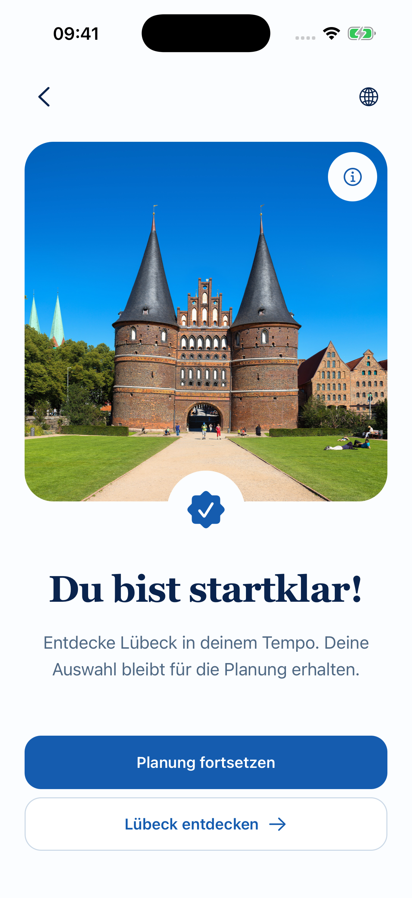
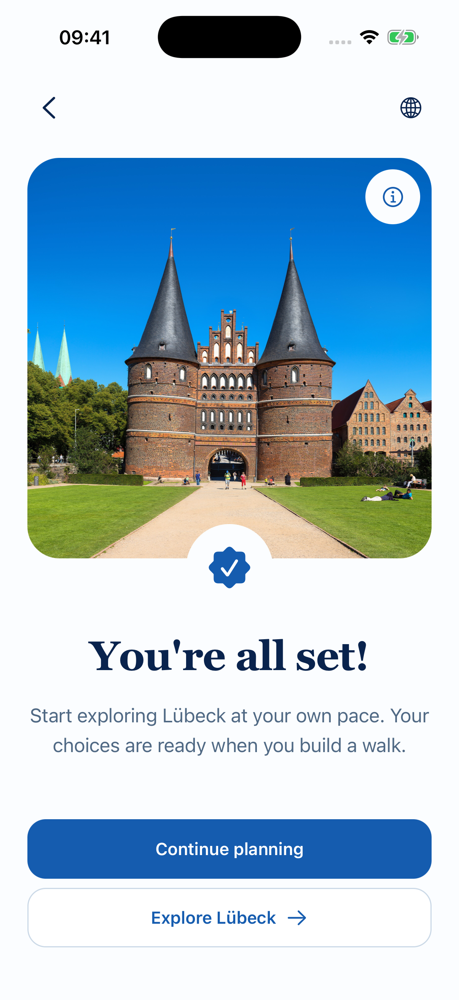
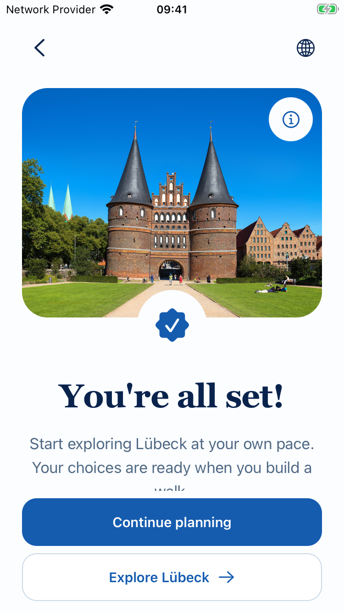
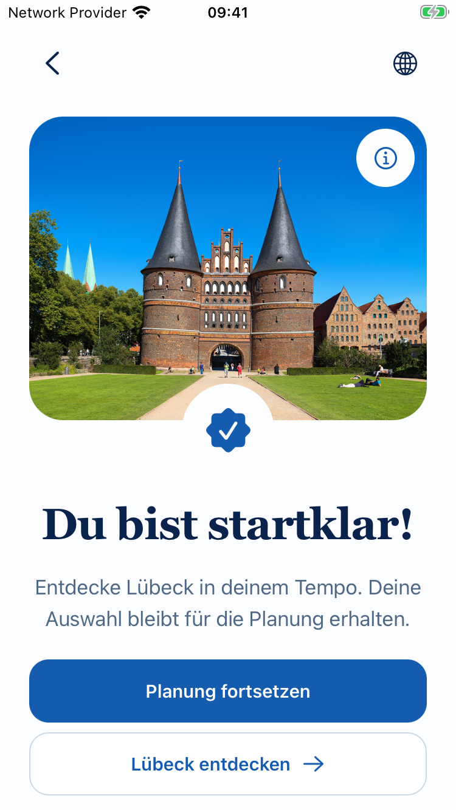
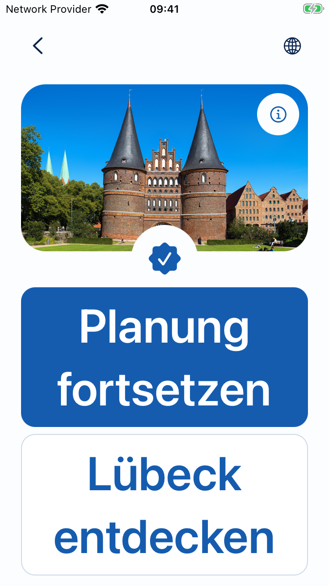

# Screen 08 — approved baseline and Slice 02 footer

Both standard German captures are 1206×2622 pixels / 402×874 points. The baseline is the preserved consolidation capture from 27 October, not a newly reconstructed old screen.

| Approved baseline | Slice 02 |
|---|---|
|  |  |

The image, badge, headline, description, typography, crop and legal access remain unchanged. Only the approved primary/secondary footer semantics and spacing changed. Main editorial ScrollView markup and all styles before the footer are byte-identical to the pre-slice source snapshot.

## New native captures

| Standard English | Small English |
|---|---|
|  |  |

| Small German | Maximum text German |
|---|---|
|  |  |

[Retained constraints](screenshots/ios-small-en-retained-constraints.png) · [English maximum text](screenshots/ios-small-en-max-text.png) · [Explicit Build preview](screenshots/ios-small-explicit-build-preview.png).

Maximum-text captures prove the two controls are visible; they do not complete body-scrolling, VoiceOver or gesture acceptance. See the implementation report for the exact native limits.
