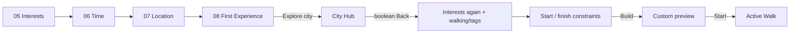
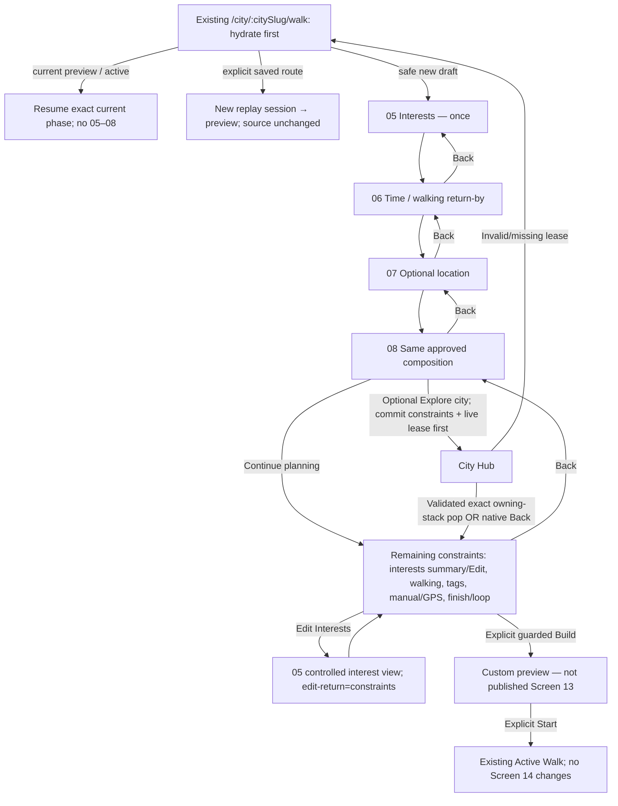

# Slice 02 — proposed flow (not implemented)

## Current



## Proposed after separately approved prerequisites and Slice 02



## Lease integration sequence

```mermaid
sequenceDiagram
 participant User
 participant Walk as Mounted NativeWalkFlow
 participant Lease as Existing plannerReturnIntents
 participant Hub as Focused City Hub
 participant Stack as Owning native stack
 User->>Walk: Explore city (reserve one browse ticket)
 Walk->>Walk: Commit cursor=constraints with same values
 Walk->>Lease: publish ready identity after healthy committed render
 Lease-->>Walk: Complete v1 envelope or rejection
 Walk->>Stack: Push one Hub only after valid publish
 User->>Hub: Build My Walk
 Hub->>Hub: Acquire one-press lock
 Hub->>Stack: Read current focused owning state
 Hub->>Lease: resolve envelope + live lease + state
 Hub->>Stack: Immediately re-read final state
 Hub->>Lease: resolve again; no async gap
 Hub->>Stack: owningNavigation.pop(finalCount)
 Hub->>Lease: revoke matching ready lease after dispatch
 Stack-->>Walk: Native focus returns
 Walk->>Walk: Consume browse ticket; revalidate content/slot before Build
 Note over Walk,Lease: Resolve is pure; metadata is never draft values or storage freshness
```

No actual transition changes have been made. These diagrams describe the proposal, not current screenshots or passing native behavior.
