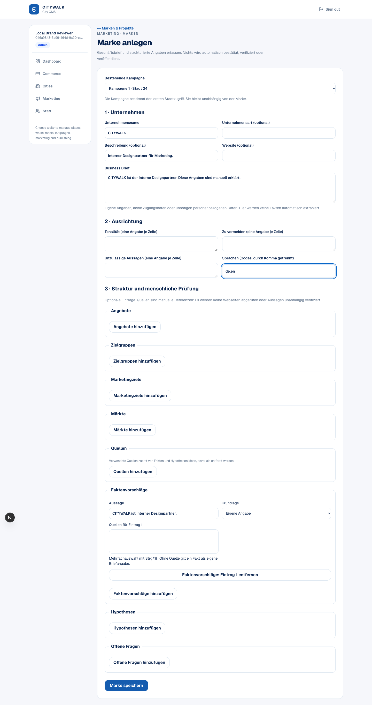
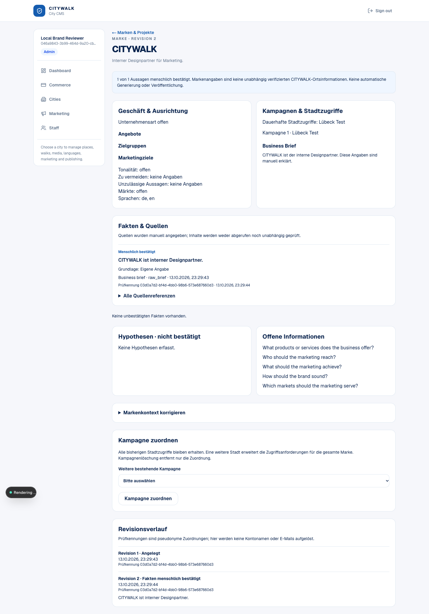
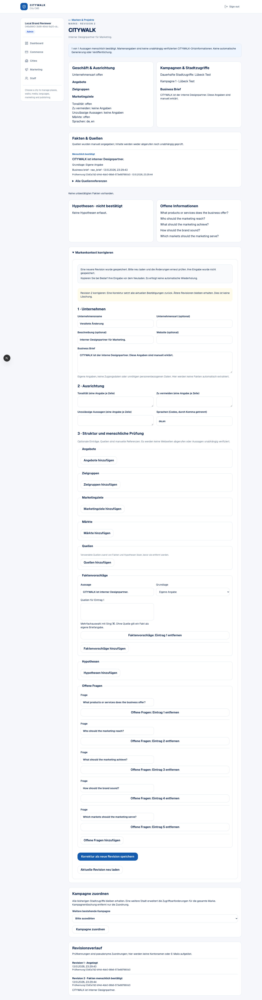
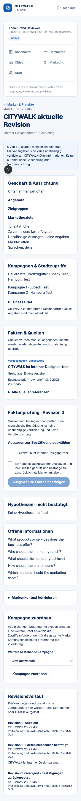
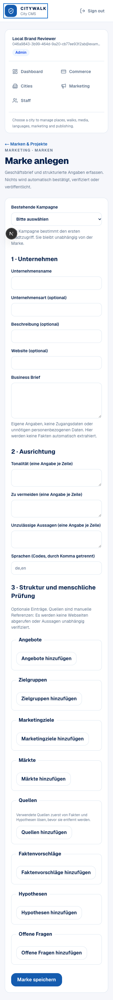

# Sprint 03 — internal Brand Workspace acceptance

Base: develop bd56e2b, including merged #362. CITYWALK remains Customer #001;
extract the independent app/auth/database before external paying customers.
Mobile Core/iOS/Android: not applicable. Public Web: not applicable.
Admin Web: implemented; responsive local browser acceptance below.

## Routes and ownership

- `/admin/marketing/brands`: 20 project summaries per page with an opaque UUID
  cursor and no counts/metadata for inaccessible projects. Marketing navigation
  and the existing Marketing page link here.
- `/admin/marketing/brands/new`: German-first guided business brief form; an
  existing authorized campaign must be explicitly selected. No campaign, business
  fact, confirmation or strategy is invented.
- `/admin/marketing/brands/[projectId]/[contextId]`: structured context, provenance,
  proposed/confirmed facts, hypotheses, gaps, campaign associations, retained city
  scopes, correction and the most recent 20 chronological audit summaries.

All pages are dynamic, staff-only, non-indexable. Narrow Server Actions reauthenticate
and delegate unknown input to existing strict service validation. Browser IDs and
expectedRevision select records and guard concurrency; they never authorize access.
Reviewer identity/time remain server-derived. No purge action is exported to UI.
Mutation responses carry only success/IDs/revision or sanitized error codes and
German field groups. No source URLs/claim text/database errors are reflected in errors.

The listing filters every retained city scope in SQL BEFORE private JSON/identity
is selected. It locks real membership and scope rows, then locks each candidate
project and rechecks all-city access before validating its current JSON. Cursor
input cannot grant scope. The workspace similarly locks/authorizes the whole project
and projects only needed history summaries, with opaque reviewer tokens and exact
confirmed statements/time. No account name/email is resolved for reviewers. The
Admin shell still shows only the currently signed-in staff member's own identity.

Association requires manage rights across old scopes and the target campaign city.
Scope accumulation, campaign unlinking and explicit admin-only project erasure are
unchanged from Sprint 02; there is no scope narrowing or project purge UI.

Core and migrations 0024/0025 are byte-identical to develop. No public/private
DTO boundary is replaced. Existing CMS QA, publication and generation behavior are
unchanged. No AI/research/provider request, automatic generation or publishing.

## UX and concurrency

Forms use native labels/fieldsets, visible focus styles and existing Admin cards/
buttons; optional collections use add/remove controls. Source-backed proposals
require external provenance under existing Core validation. Linked source removal
is blocked until references are explicitly removed. No URL is fetched. URLs open
only validated http(s) addresses in a new tab without a referrer.

Review requires selection PLUS an explicit human acknowledgement. Selections reset
on revision changes. Corrections explicitly reset current confirmations and preserve
history. Mutation pending states disable controls. Validation/conflict messages focus
an alert; unsaved corrections remain available. STALE_REVISION never refreshes or
retries silently: staff can copy their changes, explicitly reload, then review and
submit against the new revision. An ambiguous network failure asks staff to inspect
current state before retrying, avoiding blind duplicate mutations.

The browser smoke found a real 375px overflow caused by the Admin shell's implicit
grid sizing. An explicit single-column grid and shrinking cards/fieldsets fix it;
assertions remain strict. Streamed pages are awaited before browser assertions.

## Actual local acceptance

All SQL used new disposable localhost database `citywalk_brand_ui_20261013` with
current committed migrations. No existing Preview database or production data was
accessed. The user's unrelated nested checkout and running server were left alone;
full gates ran from a clean temporary tracked-code copy.

Real headless Chrome/Playwright completed:

1. CITYWALK brief onboarding through the form and existing campaign.
2. Proposed fact persisted with no confirmation; explicit human confirmation
   committed revision 2 and rendered its provenance/opaque reviewer.
3. Two real tabs loaded revision 2. One corrected to revision 3 and reset approval;
   the other received STALE_REVISION and retained unsaved input without retrying.
4. Explicit reload showed current state; another existing-city campaign was linked.
5. Staff with only one of the two retained city scopes could neither list the
   shared identity nor read facts/history/campaigns through a direct URL.
6. An unrelated fictional Nordlicht Metallbau GmbH was onboarded through the same UI.
7. 375px and 1440px smoke, native control labels, keyboard focus, no horizontal
   overflow and no browser page errors. This is not WCAG certification or device/
   screen-reader acceptance.

Reproducible opt-in script: `scripts/brand-workspace-smoke.mjs`. It refuses non-local
hosts and database names outside `citywalk_brand_ui_*`; never loads env files or
migrates. Supply explicit DATABASE_URL, BRAND_SMOKE_URL, disposable BETTER_AUTH_SECRET,
and installed Playwright (or CITYWALK_PLAYWRIGHT_MODULE). PLAYWRIGHT_CHANNEL=chrome
uses installed Chrome. It creates synthetic city/campaign/staff/session fixtures,
signs only local ephemeral session cookies, and cleans fixture projects through
supported erasure. Screenshot output defaults to /tmp/brand-workspace-screenshots.

Local full tests and coverage each passed **1,402 tests**, with 135 integration/
environment tests skipped in the default run (247 files: 228 passed, 19 skipped).
The configured existing coverage target remains 100%, not whole-repository coverage.
Brand PostgreSQL integration passed **17 tests**; committed migration upgrade/
transactional rollback passed **1**. Existing CMS/QA/generation **23**, lifecycle
**25**, city **6**, media **7**, commerce **13**, and rate-limit checks passed.
Lint: zero errors/eight existing warnings. Both typechecks, build and database
verification passed; schema generation reported no drift. Final GitHub CI results
are recorded on the Draft PR head in its description.
UI/action tests cover no invented input, explicit confirmation, conflict preservation,
field validation/conversion, reauthorization and sanitized errors. PostgreSQL tests
cover bounded cursor pagination, all-city listing/workspace denial, access revocation,
existing concurrency/audit rollback/history/campaign deletion and erasure regressions.

## Screenshots (synthetic local data)

## Preview prerequisite and limitations

**Persistent Preview migration 0025 is unverified.** Before Preview acceptance,
identify an isolated non-production DB, compare the applied 0025 journal hash and
schema/trigger definitions against current committed SQL, and verify required tables,
keys and retained-scope policy. Do not overwrite an earlier Draft 0025 or rerun it
in place. An old Draft schema needs a separately reviewed forward-migration plan.
No migration is run by build, rendering or this browser harness. No deployment was
initiated. Preview migration/state verification and manual Preview acceptance remain
separate gates before merge.

The UI is internal and JavaScript-dependent; no public intake/external tenancy.
History is bounded to the last 20 summaries, with older durable records preserved;
there is no history export/search, autosave, merge editor or abandoned-project TTL.
The Core's automatically generated open questions remain English, while controls
and statuses are German. Sources are declared references, not independently verified
facts. Pseudonymous tokens, brief text and source URLs can still be personal data;
existing retention/backup-erasure policy and private server database permissions
remain necessary. Source-link navigation and screen-reader/device acceptance require
human review. Association-change receipts and scope narrowing remain deferred.

Core may add automatic gap questions beyond the raw-input maximum of 40. Correction
shows every existing question and explicitly asks staff to reduce the count before
saving; no question is silently dropped. A regression test protects this boundary.
